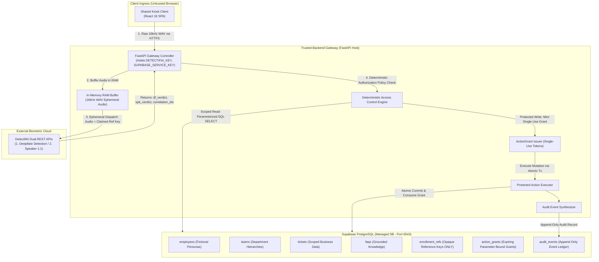
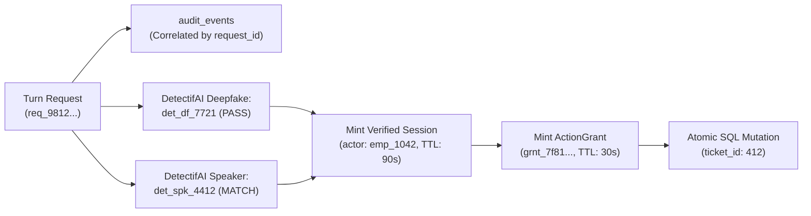

# Database and Storage Design Document — IntentLock
**Data Architecture, Cryptographic Action Grants, and Scoped Storage Boundaries**

---

## A. Executive Data Design Summary

IntentLock utilizes **Supabase PostgreSQL** as its single structured source of truth. The database houses fictional enterprise directory records, team hierarchies, support tickets, grounded knowledge snippets, cryptographic action grants, and immutable security audit logs *[PRD Section K; TRD Section L]*.



### Core Data Storage Principles

1. **Backend-Only Access**: All private tables reside behind the FastAPI application boundary. The browser client receives zero database connection strings and zero Supabase service keys. Direct client-to-database connections (PostgREST) are disabled for private tables.
2. **Zero Raw Audio Persistence**: Incoming audio streams exist strictly in volatile backend RAM for the duration of transcription and DetectifAI evaluation. No audio clips (`.wav`, `.mp3`) are persisted in Supabase storage buckets, local filesystems, or application logs.
3. **Zero Local Biometric Storage (P0 Baseline)**: Supabase stores only opaque foreign provider reference keys (`ref_det_9942a1`) returned by DetectifAI's enrollment API. Raw voiceprints and derived embedding vectors are never written to the database.
4. **Deterministic Scoping over RLS**: Because the kiosk operates without an initial employee login *[Rule Book Rule 6.6]*, standard Supabase Auth `auth.uid()` tokens do not exist. Access control is enforced deterministically by the backend using parameterized SQL queries bound to verified session state.
5. **Transactional Mutation & Audit Invariance**: Sensitive writes require a single-use, parameter-hashed `ActionGrant` token. Consumption of the grant, execution of the business mutation, and recording of the audit event execute within a single atomic PostgreSQL transaction (`BEGIN ... COMMIT`). If authorization fails, the business record remains completely untouched ($0\text{ rows mutated}$).

---

## B. Source-of-Truth and Ownership Matrix

| Data Item | System of Record | Sensitivity Classification | Created By | Read By | Retention & Deletion Policy | Build Tier |
| :--- | :--- | :--- | :--- | :--- | :--- | :--- |
| **Employee Profiles** | Supabase `employees` | Internal Directory | Admin Seed Script | Backend Policy Engine | Retained for demo; wiped on reset. | **P0** |
| **Team Hierarchy** | Supabase `teams` | Internal Directory | Admin Seed Script | Backend Policy Engine | Retained for demo; wiped on reset. | **P0** |
| **Support Tickets** | Supabase `tickets` | Confidential Business | Admin Seed / Executor | Policy Engine (Scoped) | Persistent relational state. | **P0** |
| **Public / Internal FAQs** | Supabase `faqs` | Public / Internal | Admin Seed Script | Conversation Controller | Retained for grounded retrieval. | **P0** |
| **Biometric References** | Supabase `enrollment_refs` | Security Sensitive | Enrollment Admin CLI | DetectifAI Gateway | Revocable; references provider vault. | **P0** |
| **Temporary Raw Audio** | In-Memory RAM Buffer | Sensitive Biometric | Browser Mic Ingress | STT Engine, DetectifAI | **Discarded immediately** post-turn. | **P0** |
| **Turn Transcripts** | In-Memory Session Memory | Confidential Speech | Local STT Engine | LLM Intent Extractor | Discarded on session expiry (90s). | **P0** |
| **Verified Sessions** | Backend Memory / Redis | Security Credential | Session Manager | Policy Engine | Absolute TTL: **90 seconds idle**. | **P0** |
| **Action Grants** | Supabase `action_grants` | Security Credential | Backend Grant Vault | Protected Executor | Single-use; TTL: **30 seconds**. | **P0** |
| **Security Audit Logs** | Supabase `audit_events` | Immutable Audit | Protected Executor | Trust Trace / Admin UI | Append-only; retained for judging. | **P0** |
| **Protected Documents** | Supabase Private Bucket | Confidential Doc | Admin Seed Script | Protected Stream Route | Access via signed short-lived URL. | **P1** |
| **Local Speaker Embeddings**| Supabase `speaker_embeddings`| Highly Sensitive Biometric | Embedding Pipeline | Local 1:N Classifier | **Zero storage by default** (Option A).| **P2** |

> [!CAUTION]
> ### Strictly Prohibited in Application Logs
> Standard application logs (stdout, stderr, log files) must **never** record:
> 1. Raw binary audio streams or base64-encoded audio payloads.
> 2. DetectifAI API credentials or Supabase Service Role keys.
> 3. Floating-point biometric embedding vectors.
> 4. Unnecessary full user transcripts containing personally identifiable financial or HR disclosures.

---

## C. Data Classification and Retention Policy

### 1. Classification Tiers

* **Tier 1: Public Knowledge (`faqs.visibility = 'public'`)**:
  * Unrestricted access. Readable by anonymous visitors without authentication.
  * May be injected into LLM prompts and rendered on screen freely.
* **Tier 2: Internal Business Records (`employees`, `teams`, `tickets`)**:
  * Restricted enterprise data. Accessible only when an active session matches the ownership or team scope predicate.
  * Injected into LLM context strictly after backend policy approval.
* **Tier 3: Security & Session Metadata (`action_grants`, `audit_events`)**:
  * Operational cryptographic tokens and audit records.
  * Grants are consumable exactly once. Audit rows are append-only and immutable.
* **Tier 4: Biometric Vault References (`enrollment_refs`)**:
  * Foreign pointers to external provider enrollment vaults. Contains zero acoustic data.
  * Accessible exclusively by the backend `DetectifAIGateway`.

### 2. Ephemeral Storage & Memory Cleanup Rules
* **Client Browser**: AudioWorklet buffers are flushed immediately after generating the 16kHz WAV blob. When a session terminates or times out, the React DOM purges all ticket rows, charts, and receipts.
* **FastAPI Host**: Audio buffers received over HTTP are held in RAM bytearrays. Once dispatched to the STT worker and DetectifAI REST endpoint, the bytearrays are explicitly dereferenced and reclaimed by Python garbage collection.
* **DetectifAI Provider Retention (`[TBD-API-KIT]`)**: DetectifAI's cloud-side retention and deletion policies remain subject to official kit documentation. IntentLock minimizes provider risk by transmitting only isolated, single-turn audio chunks.

---

## D. Logical Entity-Relationship Design

```mermaid
erDiagram
    EMPLOYEES ||--o{ TEAMS : manages
    EMPLOYEES ||--o{ TICKETS : owns
    TEAMS ||--o{ TICKETS : assigned_to
    EMPLOYEES ||--o| ENROLLMENT_REFS : registers
    EMPLOYEES ||--o{ ACTION_GRANTS : authorizes
    ACTION_GRANTS ||--o{ AUDIT_EVENTS : validates

    EMPLOYEES {
        varchar employee_id PK "e.g., emp_1042"
        varchar full_name "e.g., Charlie Davis"
        varchar role "employee | manager | helpdesk | executive"
        varchar department "e.g., Engineering"
        varchar team_id FK "References TEAMS"
        boolean is_active "Account status"
        timestamptz created_at
    }

    TEAMS {
        varchar team_id PK "e.g., team_eng_a"
        varchar team_name "e.g., Engineering Team A"
        varchar manager_id FK "References EMPLOYEES"
        timestamptz created_at
    }

    TICKETS {
        serial ticket_id PK "Integer primary key"
        varchar title "Issue summary"
        text description "Detailed context"
        varchar category "hardware | software | network | access"
        varchar priority "urgent | high | normal | low"
        varchar status "open | in_progress | resolved | closed"
        varchar owner_id FK "References EMPLOYEES"
        varchar team_id FK "References TEAMS"
        timestamptz created_at
        timestamptz updated_at
    }

    FAQS {
        serial faq_id PK "Integer primary key"
        text question "Normalized query"
        text answer "Verified grounding response"
        varchar visibility "public | employee | management"
        varchar source_doc "e.g., Handbook_v2.md"
        timestamptz created_at
    }

    ENROLLMENT_REFS {
        varchar ref_id PK "UUID4 reference ID"
        varchar employee_id FK "Unique foreign key"
        varchar provider_reference_key "Opaque DetectifAI key"
        varchar enrolled_by "Admin identifier"
        boolean is_revoked "Revocation status"
        timestamptz enrolled_at
    }

    ACTION_GRANTS {
        uuid grant_id PK "Cryptographic UUID"
        varchar request_id "Correlated request UUID"
        varchar actor_id FK "References EMPLOYEES"
        varchar agent_id "e.g., agent_intentlock_kiosk_v1"
        varchar action_name "e.g., create_ticket"
        char params_hash "SHA-256 parameter digest"
        boolean is_consumed "Single-use flag"
        timestamptz expires_at "Strict 30s expiry"
        timestamptz created_at
    }

    AUDIT_EVENTS {
        serial audit_id PK "Sequence ID"
        varchar request_id "Correlated request UUID"
        varchar actor_id "Null if unauthenticated"
        varchar agent_id "System agent identifier"
        varchar action "Executed or requested action"
        varchar result "SUCCESS | DENIED | ABORTED"
        uuid grant_id FK "References ACTION_GRANTS"
        jsonb details "Check outcomes & Tx metadata"
        timestamptz created_at
    }
```



---

## E. Data Dictionary for P0 Tables

### 1. Table: `employees`
* **Purpose**: Master directory of fictional enterprise personas.
* **Sensitivity**: Internal Directory.

| Field Name | Conceptual Type | Nullable | Constraints & Defaults | Description / Allowed Values | Workflow Reference |
| :--- | :--- | :--- | :--- | :--- | :--- |
| `employee_id` | `VARCHAR(32)` | **NO** | `PRIMARY KEY` | Human-readable identity (e.g., `emp_1042`, `emp_1020`). | Claim Lookup, Policy Engine |
| `full_name` | `VARCHAR(128)` | **NO** | None | Full display name (e.g., *Charlie Davis*). | UI Header, TTS Greeting |
| `role` | `VARCHAR(32)` | **NO** | `CHECK (role IN ('visitor','employee','manager','helpdesk','executive'))` | Security clearance level. | Backend Policy Engine |
| `department` | `VARCHAR(64)` | **NO** | None | Organizational department (e.g., `Engineering`). | Scoped Analytics |
| `team_id` | `VARCHAR(32)` | YES | None | Assigned team foreign identifier. | Team Scope Resolution |
| `is_active` | `BOOLEAN` | **NO** | `DEFAULT TRUE` | False blocks verification and access immediately. | Fail-Closed Session Check |
| `created_at` | `TIMESTAMPTZ` | **NO** | `DEFAULT NOW()` | Record creation timestamp. | Admin Audit |

### 2. Table: `teams`
* **Purpose**: Departmental reporting structures and managerial ownership.
* **Sensitivity**: Internal Directory.

| Field Name | Conceptual Type | Nullable | Constraints & Defaults | Description / Allowed Values | Workflow Reference |
| :--- | :--- | :--- | :--- | :--- | :--- |
| `team_id` | `VARCHAR(32)` | **NO** | `PRIMARY KEY` | Unique team key (e.g., `team_eng_a`). | Manager Query Scoping |
| `team_name` | `VARCHAR(64)` | **NO** | None | Display label (e.g., *Engineering Team A*). | UI Table Header |
| `manager_id` | `VARCHAR(32)` | **NO** | `REFERENCES employees(employee_id)` | Designates the authorized manager for this queue. | Manager Scope Enforcement |
| `created_at` | `TIMESTAMPTZ` | **NO** | `DEFAULT NOW()` | Record creation timestamp. | Admin Audit |

### 3. Table: `tickets`
* **Purpose**: Scoped operational IT support tickets.
* **Sensitivity**: Confidential Business Data.

| Field Name | Conceptual Type | Nullable | Constraints & Defaults | Description / Allowed Values | Workflow Reference |
| :--- | :--- | :--- | :--- | :--- | :--- |
| `ticket_id` | `SERIAL` | **NO** | `PRIMARY KEY` | Auto-incrementing integer identifier. | Ticket Card, Readback |
| `title` | `VARCHAR(256)` | **NO** | None | Issue headline (e.g., *Monitor flickering violently*). | UI Card, TTS Summary |
| `description` | `TEXT` | YES | None | Detailed trouble report context. | Ticket Detail View |
| `category` | `VARCHAR(32)` | **NO** | `CHECK (category IN ('hardware','software','network','access'))` | Classification category. | Helpdesk Queue Routing |
| `priority` | `VARCHAR(16)` | **NO** | `CHECK (priority IN ('urgent','high','normal','low'))` | Urgency tier. Used in Recharts metric graphs. | Recharts Chart, Policy |
| `status` | `VARCHAR(16)` | **NO** | `CHECK (status IN ('open','in_progress','resolved','closed'))` | Lifecycle state. Default: `'open'`. | Ticket Queue Filter |
| `owner_id` | `VARCHAR(32)` | **NO** | `REFERENCES employees(employee_id)` | Employee who filed/owns the ticket. | Employee Scoped Read |
| `team_id` | `VARCHAR(32)` | YES | `REFERENCES teams(team_id)` | Department team responsible for resolution. | Manager Scoped Read |
| `created_at` | `TIMESTAMPTZ` | **NO** | `DEFAULT NOW()` | Submission timestamp. | Ticket Card, Sorting |
| `updated_at` | `TIMESTAMPTZ` | **NO** | `DEFAULT NOW()` | Last modification timestamp. | Audit Trail |

### 4. Table: `faqs`
* **Purpose**: Grounded organizational knowledge base snippets.
* **Sensitivity**: Public / Internal.

| Field Name | Conceptual Type | Nullable | Constraints & Defaults | Description / Allowed Values | Workflow Reference |
| :--- | :--- | :--- | :--- | :--- | :--- |
| `faq_id` | `SERIAL` | **NO** | `PRIMARY KEY` | Auto-incrementing integer identifier. | Knowledge Retrieval |
| `question` | `TEXT` | **NO** | None | Normalized query string. | Semantic / Keyword Search |
| `answer` | `TEXT` | **NO** | None | Approved factual response text. | Public FAQ Card, TTS |
| `visibility` | `VARCHAR(16)` | **NO** | `CHECK (visibility IN ('public','employee','management'))` | Access clearance tag. Default: `'public'`. | Ingress Grounding Gate |
| `source_doc` | `VARCHAR(64)` | **NO** | None | Source attribution tag (e.g., `Handbook_v2.4.md`). | UI Source Badge |
| `created_at` | `TIMESTAMPTZ` | **NO** | `DEFAULT NOW()` | Record creation timestamp. | Content Management |

### 5. Table: `enrollment_refs`
* **Purpose**: External biometric pointers for consenting demo speakers.
* **Sensitivity**: Security Sensitive (Zero raw audio stored).

| Field Name | Conceptual Type | Nullable | Constraints & Defaults | Description / Allowed Values | Workflow Reference |
| :--- | :--- | :--- | :--- | :--- | :--- |
| `ref_id` | `VARCHAR(64)` | **NO** | `PRIMARY KEY` | Internal UUID identifier. | Biometric Lookup |
| `employee_id` | `VARCHAR(32)` | **NO** | `REFERENCES employees(employee_id) UNIQUE` | Exactly one active reference per employee. | Claim Resolution |
| `provider_reference_key` | `VARCHAR(128)` | **NO** | None | Opaque string returned by DetectifAI Enrollment API. | DetectifAI Speaker API |
| `enrolled_by` | `VARCHAR(64)` | **NO** | None | Administrator identifier recording consent. | Governance Audit |
| `is_revoked` | `BOOLEAN` | **NO** | `DEFAULT FALSE` | True immediately invalidates biometric matching. | Revocation Enforcement |
| `enrolled_at` | `TIMESTAMPTZ` | **NO** | `DEFAULT NOW()` | Enrollment timestamp. | Verification Recency |

### 6. Table: `action_grants`
* **Purpose**: Single-use, parameter-hashed authorization tokens for protected database writes.
* **Sensitivity**: Highly Sensitive Security Credential.

| Field Name | Conceptual Type | Nullable | Constraints & Defaults | Description / Allowed Values | Workflow Reference |
| :--- | :--- | :--- | :--- | :--- | :--- |
| `grant_id` | `UUID` | **NO** | `PRIMARY KEY DEFAULT gen_random_uuid()` | Cryptographically secure random grant token. | Protected Executor |
| `request_id` | `VARCHAR(64)` | **NO** | None | Ingress request correlation UUID. | Audit Traceability |
| `actor_id` | `VARCHAR(32)` | **NO** | `REFERENCES employees(employee_id)` | Verified employee authorized to mutate state. | Executor Actor Check |
| `agent_id` | `VARCHAR(64)` | **NO** | None | Registered agent key (e.g., `agent_kiosk_v1`). | Agent Identity Check |
| `action_name` | `VARCHAR(64)` | **NO** | None | Canonicalized verb (e.g., `create_ticket`). | Action Whitelist Check |
| `params_hash` | `CHAR(64)` | **NO** | None | SHA-256 digest of canonicalized JSON arguments. | Parameter Tamper Check |
| `is_consumed` | `BOOLEAN` | **NO** | `DEFAULT FALSE` | True blocks replayed execution attempts. | Atomic Consumption |
| `expires_at` | `TIMESTAMPTZ` | **NO** | None | Expiry ceiling (Strictly `created_at + 30s`). | Freshness Gate |
| `created_at` | `TIMESTAMPTZ` | **NO** | `DEFAULT NOW()` | Issuance timestamp. | TTL Calculation |

### 7. Table: `audit_events`
* **Purpose**: Append-only ledger recording all security decisions, check verdicts, and mutation results.
* **Sensitivity**: Immutable Security Ledger.

| Field Name | Conceptual Type | Nullable | Constraints & Defaults | Description / Allowed Values | Workflow Reference |
| :--- | :--- | :--- | :--- | :--- | :--- |
| `audit_id` | `SERIAL` | **NO** | `PRIMARY KEY` | Auto-incrementing sequence number. | Audit Ordering |
| `request_id` | `VARCHAR(64)` | **NO** | None | End-to-end turn correlation UUID. | Trust Receipt, Tracing |
| `actor_id` | `VARCHAR(32)` | YES | None | Verified employee ID (Null for anonymous turns). | Compliance Ledger |
| `agent_id` | `VARCHAR(64)` | **NO** | None | Conversational agent identifier. | Agent Accountability |
| `action` | `VARCHAR(64)` | **NO** | None | Requested operation verb or query category. | Activity Categorization |
| `result` | `VARCHAR(32)` | **NO** | `CHECK (result IN ('SUCCESS','DENIED','ABORTED','FAILED'))` | Concrete operational outcome. | Trust Trace Status |
| `grant_id` | `UUID` | YES | `REFERENCES action_grants(grant_id)` | Bound action grant (for mutations). | Cryptographic Trace |
| `details` | `JSONB` | **NO** | `DEFAULT '{}'::JSONB` | Check verdicts, scores, latency, error reasons. | React Flow Telemetry |
| `created_at` | `TIMESTAMPTZ` | **NO** | `DEFAULT NOW()` | Timestamp of event recording. | Chronological Ledger |

---

## F. Employee, Role, and Resource-Scoping Model

Authorization is enforced deterministically by the backend constructing parameterized SQL queries bound to verified session state:

### 1. Plain-Language Query Scoping Predicates

* **Public Visitor Scope**:
  $$\text{Query FAQ} \implies \text{WHERE } \text{visibility} = \text{'public'}$$
* **Employee (Own Record) Scope**:
  $$\text{Query Tickets} \implies \text{WHERE } \text{owner\_id} = \text{:session\_actor\_id}$$
* **Manager (Assigned Team) Scope**:
  $$\text{Query Team Queue} \implies \text{WHERE } \text{team\_id} \text{ IN } (\text{SELECT } \text{team\_id} \text{ FROM } \text{teams} \text{ WHERE } \text{manager\_id} = \text{:session\_actor\_id})$$
* **Helpdesk (Support Queue) Scope**:
  $$\text{Query Support Queue} \implies \text{WHERE } \text{category} \text{ IN } (\text{'hardware'}, \text{'software'}, \text{'network'}, \text{'access'})$$
* **Executive (Approved Aggregates) Scope**:
  $$\text{Query Trend} \implies \text{SELECT priority, COUNT(*) FROM tickets GROUP BY priority}$$
  *(Direct drill-down into individual employee PII rows is rejected by the query builder).*

---

## G. Supabase Access and Security Design

### 1. Backend Direct Connection Architecture
* **Connection Protocol**: FastAPI establishes asynchronous PostgreSQL connections over TLS via `asyncpg` or `psycopg3`.
* **Port Configuration**: Connects via Supabase Transaction Connection Pooler on port `6543` to ensure zero connection exhaustion during concurrent judging requests.
* **Zero Client PostgREST**: The public Supabase client URL and Anon Key are **not** bundled into the React frontend. Client requests route strictly through FastAPI `/api/v1/*`.

### 2. Service Key Isolation & Row-Level Security (RLS) Posture
* **Service Key Boundary**: The backend connects using the `service_role` key, which inherently bypasses RLS. Consequently, **the application layer is the primary authorization authority**.
* **Defense-in-Depth RLS Policy**: To prevent catastrophic data leakage if an attacker discovers the project Anon Key:
  ```sql
  -- Enable RLS on all tables
  ALTER TABLE employees ENABLE ROW LEVEL SECURITY;
  ALTER TABLE tickets ENABLE ROW LEVEL SECURITY;
  ALTER TABLE action_grants ENABLE ROW LEVEL SECURITY;
  ALTER TABLE audit_events ENABLE ROW LEVEL SECURITY;

  -- Default Deny: Public anon role possesses ZERO permissions
  CREATE POLICY "Deny Public All" ON employees FOR ALL TO anon USING (false);
  CREATE POLICY "Deny Public All" ON tickets FOR ALL TO anon USING (false);
  CREATE POLICY "Deny Public All" ON action_grants FOR ALL TO anon USING (false);
  CREATE POLICY "Deny Public All" ON audit_events FOR ALL TO anon USING (false);
  ```

---

## H. Enrollment Reference and Biometric-Storage Decision

### 1. Baseline Decision: Option A (Zero Local Biometrics Stored)
* **Binding Decision**: For the Day 1 prototype, **Option A** is the locked architectural baseline.
* **Storage Invariant**: Supabase table `enrollment_refs` stores strictly the foreign reference key (`provider_reference_key`) issued by DetectifAI's enrollment vault.
* **Revocation Guarantee**: Setting `is_revoked = TRUE` in `enrollment_refs` immediately halts all subsequent verification calls for that employee, causing the system to fail closed.

### 2. Optional P2 Extension: Option B (Derived Embeddings)
* If the team subsequently authorizes local 1:N pre-ranking, an isolated table `speaker_embeddings` will be initialized:
  ```sql
  -- Optional P2 Table (Disabled for Day 1 P0)
  CREATE TABLE speaker_embeddings (
      embedding_id SERIAL PRIMARY KEY,
      employee_id VARCHAR(32) REFERENCES employees(employee_id),
      embedding_vector FLOAT4[], -- 192-dimensional vector
      consent_signature VARCHAR(64) NOT NULL,
      created_at TIMESTAMPTZ DEFAULT NOW()
  );
  ```
* **Honest Constraint**: Local vector similarity will serve strictly as a heuristic ranking signal; it will **never** be stored or labeled as an "identity probability percentage."

---

## I. Verification Attempts, Sessions, and Request Correlation

Every turn generates a unique `request_id` (`UUID4`). The following data model correlates the physical turn to provider outcomes and session lifecycles:



* **Session Token Format**: `sess_<uuid4>` generated cryptographically via `secrets.token_urlsafe(32)`.
* **Session Storage**: Maintained in backend memory with a strict sliding idle timeout of **90 seconds**.
* **Replay Prevention**: The browser cannot present an expired `session_token` or forge an authorization outcome; the backend validates token existence and expiration timestamp on every turn.

---

## J. Exact-Action Grants and Transactional Writes

### 1. Canonical Parameter Hashing
Before an `ActionGrant` is issued, action arguments are normalized into a deterministic JSON string and hashed via SHA-256:
$$\text{Canonical JSON} = \text{`{"category":"hardware","priority":"urgent","title":"Monitor flickering violently"}`}$$
$$\text{params\_hash} = \text{SHA-256}(\text{Canonical JSON}) = \text{`e3b0c44298fc1c149afbf4c8996fb92427ae41e4649b934ca495991b7852b855`}$$

### 2. The Atomic Protected Execution Transaction
The Protected Executor applies the mutation within an isolated PostgreSQL transaction using `READ COMMITTED` isolation:

```sql
BEGIN;

-- Step 1: Lock and consume the grant atomically
UPDATE action_grants 
SET is_consumed = TRUE 
WHERE grant_id = 'grnt_7f81a20b-99c1-4d33' 
  AND is_consumed = FALSE 
  AND actor_id = 'emp_1042'
  AND params_hash = 'e3b0c44298fc1c149afbf4c8996fb92427ae41e4649b934ca495991b7852b855'
  AND NOW() <= expires_at;

-- Enforce consumption: if 0 rows updated, abort transaction immediately
-- (In application code: if rowcount == 0: RAISE EXCEPTION 'Invalid or Consumed Grant')

-- Step 2: Apply the permitted business mutation
INSERT INTO tickets (title, description, category, priority, status, owner_id, team_id)
VALUES (
    'Monitor flickering violently',
    'Hardware display issue reported via IntentLock kiosk',
    'hardware',
    'urgent',
    'open',
    'emp_1042',
    'team_eng_a'
)
RETURNING ticket_id;

-- Step 3: Write the immutable audit record
INSERT INTO audit_events (request_id, actor_id, agent_id, action, result, grant_id, details)
VALUES (
    'req_9812a4b8-2c31-489e',
    'emp_1042',
    'agent_intentlock_kiosk_v1',
    'create_ticket',
    'SUCCESS',
    'grnt_7f81a20b-99c1-4d33',
    '{"ticket_id": 412, "tx_status": "COMMITTED", "priority": "urgent"}'::JSONB
);

COMMIT;
```

### 3. Comparison of Permitted vs. Denied State Mutations

| Mutation Case | `tickets` Table State | `action_grants` Table State | `audit_events` Table State | UI Visible Outcome |
| :--- | :--- | :--- | :--- | :--- |
| **Permitted Write** (Charlie confirms ticket) | $+1\text{ row}$ inserted (`ticket_id: 412`). | Grant marked `is_consumed = TRUE`. | $+1\text{ row}$ inserted (`result: 'SUCCESS'`). | Ticket #412 Card + Trust Receipt. |
| **Denied Write** (Attacker / Wrong voice) | **Zero state change** ($0\text{ rows inserted}$). | Zero grants created or consumed. | $+1\text{ row}$ inserted (`result: 'DENIED'`). | Red Security Alert Banner. |
| **Tampered Write** (Modified parameter) | **Zero state change** ($0\text{ rows inserted}$). | Grant remains unconsumed / expires. | $+1\text{ row}$ inserted (`result: 'ABORTED'`). | Red Error: Parameter Hash Mismatch. |

---

## K. Audit Events and Trust Receipts

### 1. Minimal Trust Receipt Schema (Client-Rendered)
When a protected write commits, the backend returns the structured data payload required to render `ActionReceiptCard`:
```json
{
  "receipt_id": "rcpt_9812-412",
  "request_id": "req_9812a4b8-2c31-489e",
  "transaction_id": "tx_supabase_9912",
  "timestamp": "2026-10-16T11:24:14.210Z",
  "actor": {
    "employee_id": "emp_1042",
    "display_name": "Charlie Davis",
    "role": "employee"
  },
  "action_summary": {
    "verb": "create_ticket",
    "resource": "tickets",
    "resource_id": "412",
    "parameters": {
      "title": "Monitor flickering violently",
      "priority": "urgent",
      "category": "hardware"
    }
  },
  "verifications": {
    "deepfake_detection": {"verdict": "GENUINE", "correlation_id": "det_df_7721"},
    "speaker_verification": {"verdict": "MATCH", "reference_id": "ref_det_9942a1"}
  },
  "grant_evidence": {
    "grant_id": "grnt_7f81a20b-99c1-4d33",
    "params_hash": "e3b0c44298fc1c149afbf4c8996fb92427ae41e4649b934ca495991b7852b855"
  }
}
```

---

## L. Seed-Data Specification and Ingestion Rules

### 1. Persona Handoff Format (for Fictional Seed Content)
To guarantee database consistency, our friend’s fictional persona documents must map directly to the following JSON structure:

```json
{
  "employees": [
    {
      "employee_id": "emp_1042",
      "full_name": "Charlie Davis",
      "role": "employee",
      "department": "Engineering",
      "team_id": "team_eng_a",
      "is_active": true,
      "enrolled_demo_speaker": true
    },
    {
      "employee_id": "emp_1020",
      "full_name": "Bob Miller",
      "role": "manager",
      "department": "Engineering",
      "team_id": "team_eng_a",
      "is_active": true,
      "enrolled_demo_speaker": true
    },
    {
      "employee_id": "emp_1099",
      "full_name": "Diana Ross",
      "role": "executive",
      "department": "Executive Office",
      "team_id": null,
      "is_active": true,
      "enrolled_demo_speaker": false
    }
  ],
  "teams": [
    {
      "team_id": "team_eng_a",
      "team_name": "Engineering Team A",
      "manager_id": "emp_1020"
    }
  ],
  "tickets": [
    {
      "ticket_id": 301,
      "title": "Laptop Replacement Request",
      "description": "MacBook battery swelling; hardware replacement needed.",
      "category": "hardware",
      "priority": "high",
      "status": "in_progress",
      "owner_id": "emp_1042",
      "team_id": "team_eng_a"
    },
    {
      "ticket_id": 308,
      "title": "VPN Access Issue",
      "description": "Cannot connect to staging subnet.",
      "category": "network",
      "priority": "normal",
      "status": "open",
      "owner_id": "emp_1042",
      "team_id": "team_eng_a"
    }
  ],
  "faqs": [
    {
      "question": "What are the company's public support hours?",
      "answer": "Public visitor and reception hours are 08:00 to 19:00 IST Monday through Friday.",
      "visibility": "public",
      "source_doc": "Handbook_v2.4.md"
    }
  ]
}
```

### 2. Ingestion Validation Checks
1. **Foreign Key Integrity**: Every `tickets.owner_id` must resolve to a valid `employees.employee_id`.
2. **Manager Reciprocity**: Every `teams.manager_id` must reference an employee whose role is `'manager'`.
3. **No Unenrolled Verification**: Personas with `enrolled_demo_speaker: false` (e.g., Diana Ross) must **never** have an entry in `enrollment_refs`.

---

## M. Performance, Constraints, and Indexing

```sql
-- Strategic B-tree Indexes for High-Velocity Queries
CREATE INDEX idx_tickets_owner ON tickets (owner_id);
CREATE INDEX idx_tickets_team ON tickets (team_id);
CREATE INDEX idx_tickets_status_priority ON tickets (status, priority);
CREATE INDEX idx_faqs_visibility ON faqs (visibility);
CREATE INDEX idx_enrollment_employee ON enrollment_refs (employee_id) WHERE is_revoked = FALSE;
CREATE INDEX idx_action_grants_lookup ON action_grants (grant_id, is_consumed, expires_at);
CREATE INDEX idx_audit_request ON audit_events (request_id);
```

* **Query Latency Objective**: All indexed reads (`SELECT ... WHERE owner_id = :id`) must execute in $< 30\text{ms}$ on Supabase.
* **Connection Pooling**: FastAPI connection pool sized to `min_size=2`, `max_size=10` using asyncpg over port `6543`.

---

## N. Failure, Recovery, and Deletion Protocols

| Failure Event | Database State | Action Grant State | Audit Event Written | User-Facing Result |
| :--- | :--- | :--- | :--- | :--- |
| **DetectifAI API Timeout** | Zero business rows accessed. | None created. | `result: 'FAILED'`, `details: {reason: 'TIMEOUT'}` | Gray Alert: Service Unavailable. |
| **Speaker Verification Mismatch** | Zero business rows accessed. | None created. | `result: 'DENIED'`, `details: {verdict: 'MISMATCH'}` | Red Security Alert: Voice Mismatch. |
| **SQL Tx Failure (DB Down)** | Transaction auto-rolled back. | Grant remains unconsumed. | Emitted to local log fallback. | Red Error: Database Failure. |
| **Browser Network Drop** | Mutation committed in DB. | Grant marked consumed. | `result: 'SUCCESS'`. | On reconnect: Idempotent receipt lookup. |
| **Session Expiry (90s)** | In-memory session deleted. | Active grants expired. | `action: 'SESSION_EXPIRE'`. | UI DOM sanitized; returns to Idle. |
| **Consented Speaker Removal** | Row deleted from `enrollment_refs`.| All grants revoked. | `action: 'BIOMETRIC_REVOCATION'`. | Identity permanently blocked from auth. |

---

## O. P0 vs. Later Schema Implementation Order

| Entity / Table | Required for P0? | Primary Demo Dependency | Implementation Order (Tomorrow 10:00 IST) |
| :--- | :---: | :--- | :---: |
| **`employees`** | **YES** | Identity resolution, caller role verification | **Step 1 (Core Directory)** |
| **`teams`** | **YES** | Manager team queue scoping | **Step 2 (Core Directory)** |
| **`faqs`** | **YES** | Public visitor Q&A without login | **Step 3 (Knowledge Base)** |
| **`enrollment_refs`** | **YES** | DetectifAI 1:1 speaker verification | **Step 4 (Trust Infrastructure)** |
| **`tickets`** | **YES** | Scoped employee reads, manager queue, protected write | **Step 5 (Business Domain)** |
| **`action_grants`** | **YES** | Single-use protected execution boundary | **Step 6 (Trust Infrastructure)** |
| **`audit_events`** | **YES** | Immutable trust trace, judge verification receipts | **Step 7 (Audit Logging)** |
| `projects` | NO (P1) | Richer project milestone graph | Postpone to Hour 5 if time permits |
| `documents` / Storage | NO (P1) | Scoped PDF document previews | Postpone to Hour 5 if time permits |
| `speaker_embeddings`| NO (P2) | Local 1:N candidate ranking | Postpone to Day 2 (Requires privacy sign-off)|

---

## P. Acceptance and Data-Integrity Test Matrix

| Test ID | Test Target | SQL Verification Query / Action | Expected Result | Pass/Fail Criteria |
| :--- | :--- | :--- | :--- | :--- |
| **DATA-01** | Public Access Gate | `SELECT * FROM tickets` using unauthenticated client | HTTP 401 Unauthorized / 0 rows | Private tables completely unreachable |
| **DATA-02** | Scoped Read Integrity | Query tickets for `emp_1042` | Returns exactly 2 tickets (#301, #308) | Zero peer tickets returned |
| **DATA-03** | Manager Boundary | Query tickets for manager `emp_1020` | Returns 3 tickets assigned to `team_eng_a` | Zero tickets from other teams |
| **DATA-04** | Cross-Scope Refusal | Query HR tickets as employee `emp_1042` | Gateway throws `ScopeViolationException` | Zero rows returned; Audit denial logged |
| **DATA-05** | Atomic Grant Consumption| Execute write transaction with valid grant | `action_grants.is_consumed == TRUE` | Ticket inserted; grant consumed |
| **DATA-06** | Grant Replay Defense | Re-submit already consumed `grant_id` | Transaction rolls back immediately | Zero duplicate tickets created |
| **DATA-07** | Parameter Tamper Check | Submit grant with modified `priority='low'` | SHA-256 mismatch; Transaction rolls back | Database state remains unchanged |
| **DATA-08** | Audit Traceability | Query `audit_events WHERE request_id = :id` | Exactly 1 audit record matching turn | Contains provider correlation IDs |

---
*End of Database and Storage Design Document — IntentLock*
