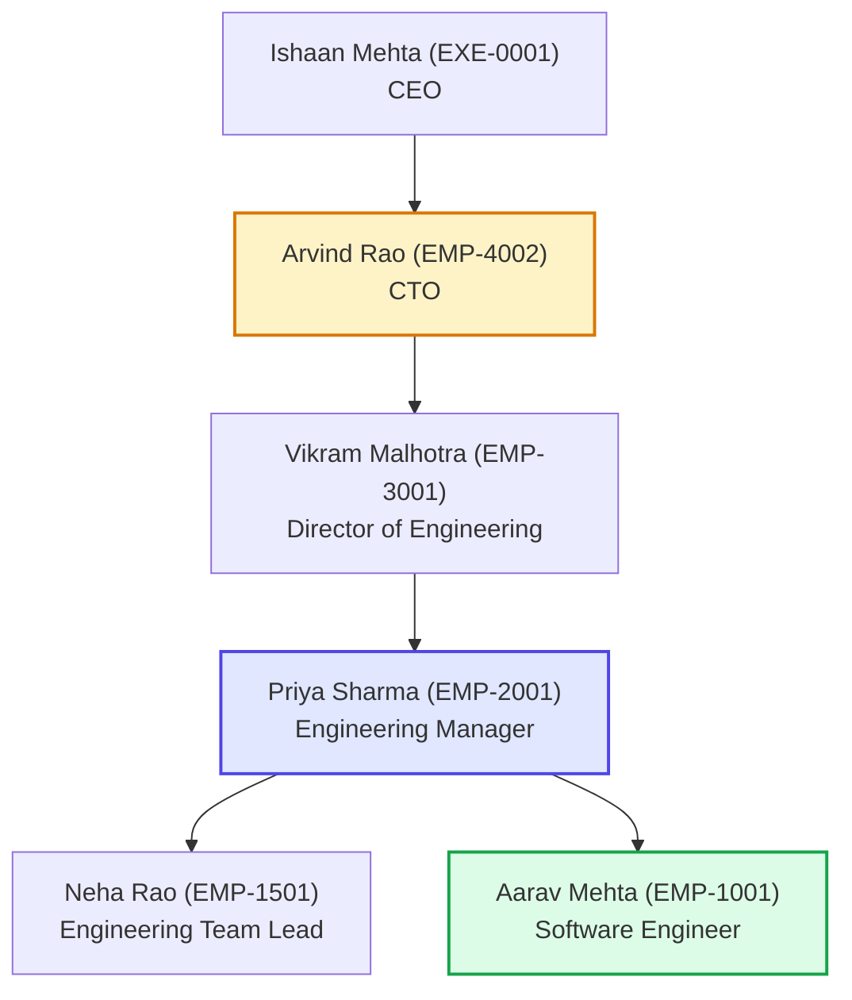
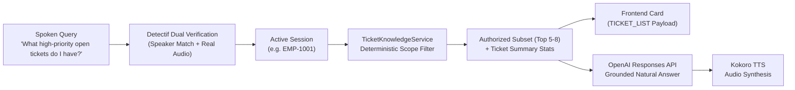

# IntentLock — Canonical Ticket Dataset Specification & Knowledge Guide

## 1. Purpose

This document specifies the canonical ticket knowledge base for IntentLock. It extends the corporate knowledge layer with 42 rich, realistic, interconnected technical support tickets focused around the primary demonstration personas:

1. **Aarav Mehta (`EMP-1001`)** — Software Engineer, Application Engineering
2. **Priya Sharma (`EMP-2001`)** — Engineering Manager, Engineering
3. **Arvind Rao (`EMP-4002`)** — Chief Technology Officer (CTO), Executive Management / Technology

The dataset provides deterministic, scoped ground-truth context enabling the IntentLock conversational assistant to answer natural-language inquiries and dynamically render frontend `TICKET_LIST` and `TicketListCard` components without hallucination or cross-boundary data leakage.

---

## 2. Primary Demo Users & Ownership Scopes



### Authorization & Visibility Boundaries:

| Persona | Role & Level | Authorized Ticket Scope | Data Denials & Guardrails |
| :--- | :--- | :--- | :--- |
| **Aarav Mehta (`EMP-1001`)** | Software Engineer (L1) | Tickets where Aarav is `assignee_id`, `requester_id`, or `created_by`. (16 tickets) | Denied executive technology tickets and non-reported peer private tickets. |
| **Priya Sharma (`EMP-2001`)** | Engineering Manager (M1) | Own tickets + all direct report tickets (`EMP-1001`, `EMP-1501`) + tickets where Priya is approver or escalation target. (27 tickets) | Denied executive compensation reviews or peer director departmental audits. |
| **Arvind Rao (`EMP-4002`)** | CTO (C-Level Executive) | All technology, infrastructure, security, architecture approvals, and escalated engineering incidents across all teams. (42 tickets) | Direct mutations require explicit readback, cryptographic ActionGrant, and dual biometric verification. |

---

## 3. Canonical Ticket Schema

Every ticket in `backend/data/all_tickets.json` conforms to the strongly-typed `CanonicalTicketRecord` model in `backend/models/ticket.py`:

```json
{
  "ticket_id": "TKT-2026-001",
  "title": "Customer Support Portal authentication session timeout after token refresh",
  "description": "Users report sudden logouts in Customer Support Portal during active chat sessions...",
  "ticket_type": "Bug",
  "category": "Authentication",
  "subcategory": "Session Management",
  "status": "In Progress",
  "priority": "High",
  "severity": "S2",
  "requester_id": "EMP-1001",
  "assignee_id": "EMP-1001",
  "created_by": "EMP-1001",
  "owner_team": "Application Engineering",
  "department": "Engineering",
  "project": "Customer Support Portal",
  "created_at": "2026-10-10T09:30:00",
  "updated_at": "2026-10-16T11:20:00",
  "due_date": "2026-10-18",
  "resolved_at": null,
  "closed_at": null,
  "sla": {
    "response_target_hours": 2,
    "resolution_target_hours": 48,
    "response_met": true,
    "resolution_status": "At Risk"
  },
  "affected_systems": ["Customer Support Portal", "Authentication Service", "Redis Session Store"],
  "tags": ["authentication", "session", "token-refresh", "customer-portal"],
  "dependencies": ["Authentication Service lock implementation"],
  "escalation": {
    "is_escalated": true,
    "escalated_to": "EMP-2001",
    "escalation_level": "L2 - Engineering Manager",
    "escalated_at": "2026-10-12T14:00:00",
    "reason": "Affecting tier-1 customer support agents during peak hours"
  },
  "approval": {
    "required": false,
    "status": "Not Required",
    "approver_id": null,
    "approved_at": null,
    "reason": null
  },
  "comments": [
    {
      "comment_id": "COM-001-01",
      "author_id": "EMP-1001",
      "author_name": "Aarav Mehta",
      "created_at": "2026-10-10T11:15:00",
      "comment": "Reproduced locally. When two browser tabs trigger silent refresh at the same second..."
    }
  ],
  "activity_history": [
    {
      "timestamp": "2026-10-10T09:30:00",
      "type": "TICKET_CREATED",
      "actor": "EMP-1001",
      "description": "Ticket created by Aarav Mehta",
      "old_value": null,
      "new_value": "Open"
    }
  ],
  "resolution": {
    "summary": null,
    "root_cause": null,
    "resolution_action": null,
    "resolved_by": null
  }
}
```

---

## 4. Ticket Statuses & Enums

### Status:
- `Open`: Newly filed ticket awaiting active engineering work.
- `In Progress`: Engineering or triage actively underway.
- `Pending`: Awaiting external approval (`approval.status = Pending`), customer feedback, or vendor dependency.
- `Blocked`: Work suspended due to explicit upstream blocker or dependency.
- `Resolved`: Technical fix merged, deployed to staging, and verified.
- `Closed`: Verified by QA or requester; lifecycle concluded.

### Priority & Severity:
- **Priority**: `Critical`, `High`, `Medium`, `Low` (mapped to frontend `URGENT`, `HIGH`, `NORMAL`, `LOW`).
- **Severity**: `S1` (Production Down / Security Incident), `S2` (Major Impairment / Core Feature Blocked), `S3` (Minor Defect / Workaround Available), `S4` (Cosmetic / Administrative Task).

---

## 5. The 5 Cross-User Connected Stories

```mermaid
sequenceDiagram
    autonumber
    actor Aarav as Aarav Mehta (EMP-1001)
    actor Priya as Priya Sharma (EMP-2001)
    actor Arvind as Arvind Rao (EMP-4002)

    Note over Aarav,Arvind: Story 1: Customer Support Portal Authentication Incident
    Aarav->>Priya: Investigates TKT-2026-001 token timeout; escalates to Priya
    Priya->>Arvind: Opens Sev-1 TKT-2026-014; escalates to Arvind for emergency architectural waiver
    Arvind-->>Priya: Approves emergency primary Redis routing (TKT-2026-034)
    Priya-->>Aarav: Coordinates hotfix deployment
    Aarav->>Aarav: Deploys fix, verifies zero session drops, marks TKT-2026-014 Resolved
```

1. **Story 1: Customer Support Portal Authentication Incident** (`TKT-2026-001` $\rightarrow$ `TKT-2026-014` $\rightarrow$ `TKT-2026-034`):
   - Aarav detects token refresh timeout race condition under concurrent browser tabs.
   - Priya declares Sev-1 production incident when 25% of support agent sessions invalidate.
   - Arvind approves emergency architecture waiver to route session validation strictly to Redis primary node.
   - Aarav deploys hotfix; root cause documented as replication lag.
2. **Story 2: Critical Production Deployment Failure & Rollback** (`TKT-2026-008` $\rightarrow$ `TKT-2026-019`):
   - Aarav reports CI/CD migration dry-run failure.
   - Release v2.4.2 generates 502 Bad Gateway; Priya immediately authorizes emergency production rollback to v2.4.1.
3. **Story 3: Security Architecture & Session Token Hardening** (`TKT-2026-025` $\rightarrow$ `TKT-2026-037`):
   - Information Security audit requires TLS-bound session cookies; Priya drafts remediation task and submits architecture review.
   - Arvind approves zero-trust session policy mandating HttpOnly SameSite=Strict cookies and 90-second session TTL for public kiosks.
4. **Story 4: AI-Agent / IntentLock Platform Change & Model Evaluation** (`TKT-2026-006` $\rightarrow$ `TKT-2026-022` $\rightarrow$ `TKT-2026-035`):
   - Aarav develops offline speech integration test harness.
   - Priya submits formal architecture review for kiosk voice gateway integration.
   - Arvind approves Track 3 UNCLONE multi-agent governance and Detectif dual verification.
5. **Story 5: Database / Infrastructure Performance & Sharding Incident** (`TKT-2026-007` $\rightarrow$ `TKT-2026-026` $\rightarrow$ `TKT-2026-038`):
   - Aarav spots slow query execution on employee directory JSONB fields.
   - Morning kiosk burst causes 98% PgBouncer connection pool exhaustion; Priya escalates to Arvind.
   - Arvind authorizes AWS Aurora read-replica provisioning and connection sharding policy.

---

## 6. How Retrieval & LLM Grounding Operates



1. **Pre-LLM Scoping**: The backend never passes raw database rows or unauthorized peer tickets to the model.
2. **Deterministic Filtering**: Status, priority, SLA, and category filters are evaluated in Python before context assembly.
3. **Frontend Contract Conformity**: `GenericResultBlock(type="TICKET_LIST")` payload matches `frontend/src/types/payloads.ts` `TicketRecord`.
4. **Zero Hallucination for Unknown Tickets**: Queries for non-existent IDs (e.g. `TKT-9999`) return explicit not-found flags: `exists = False`. The assistant explicitly tells the user the record does not exist.

---

## 7. Security Invariant: Read Queries vs. Write Mutations

- **Read Queries** (e.g., "What tickets are assigned to me?", "Show open incidents"): Evaluated through `ScopedAuthorizationService.evaluate_and_get_tickets`, returning sanitized cards and grounded speech.
- **Write Actions** (e.g., "Close ticket 412", "Reassign ticket to Neha"): Strictly forbidden from inline execution by conversational turns. Must follow the IntentLock Action Protocol:
  1. Assistant proposes tool call.
  2. Spoken confirmation readback to user.
  3. Single-use cryptographic `ActionGrant` minted (`params_hash = SHA256(...)`).
  4. Protected Executor verifies grant and commits mutation in an atomic transaction.
