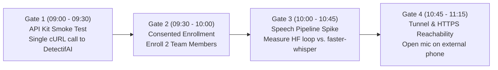
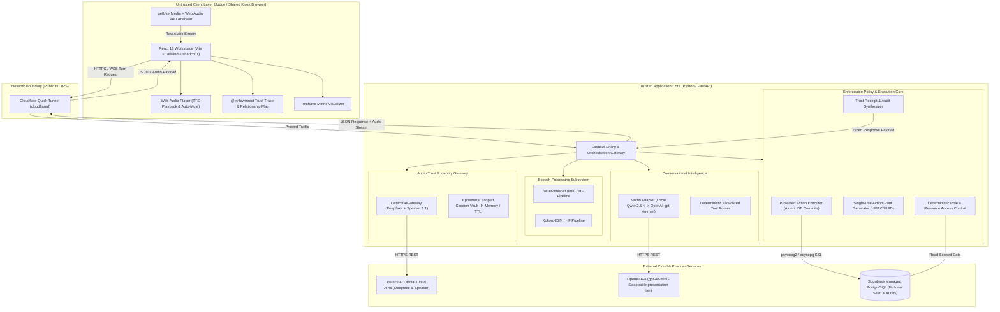
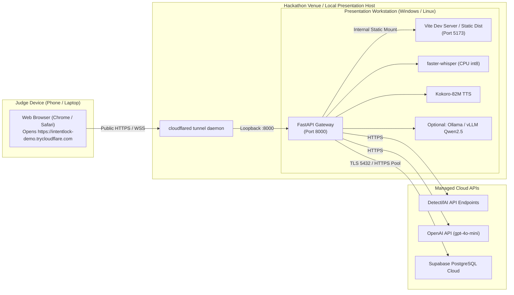
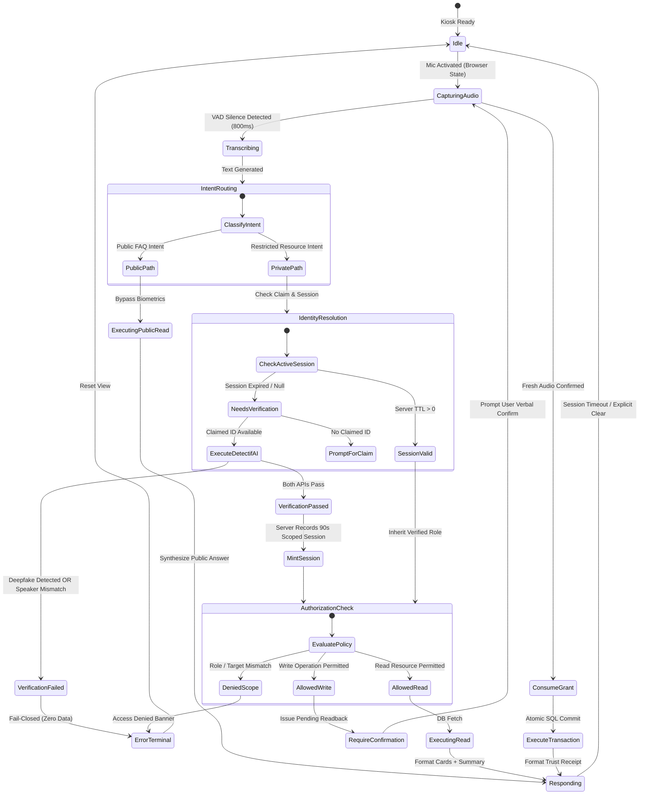
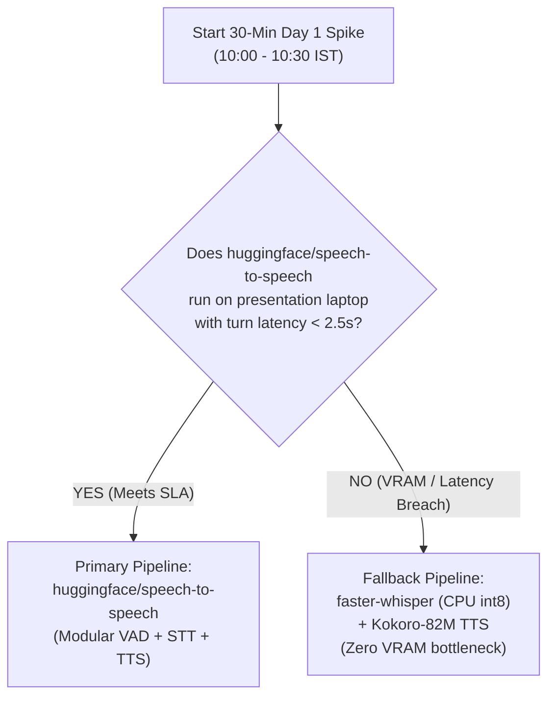
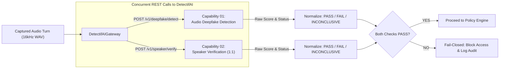
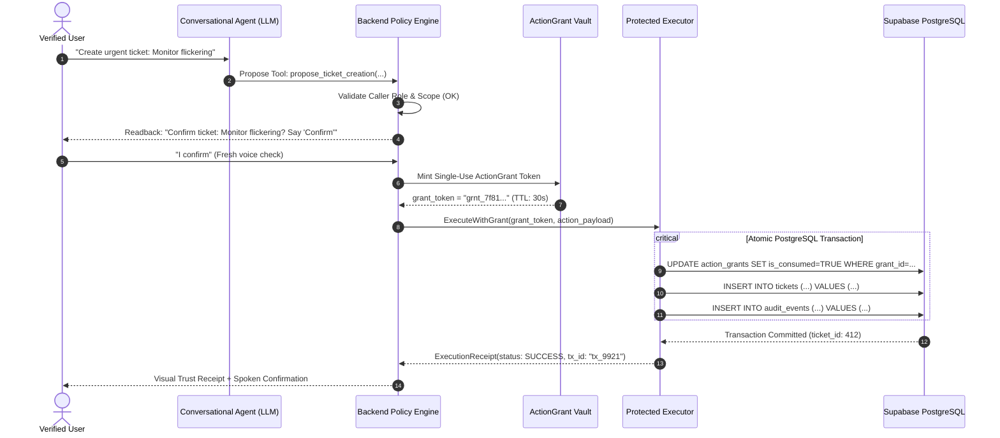

# Technical Requirements Document (TRD) — IntentLock
**System Architecture, Trust Boundaries, and Implementation Specification**

---

## A. Document Control and Technical Decisions

* **Project Name**: IntentLock
* **Track**: Track 3 — UNCLONE AGENTS *(B.M.S. College of Engineering × DetectifAI Hackathon)*
* **Document Version**: `1.0.0-PROVISIONAL`
* **Effective Date**: October 15, 2026 *(Pre-event architecture baseline)*
* **Technical Owners**:
  * *Owner 1 (Voice & Conversation)*: Audio capture, VAD, STT/TTS pipeline, LLM adapter.
  * *Owner 2 (Trust & Identity)*: DetectifAI adapters, verification state machine, session engine.
  * *Owner 3 (Workspace & Backend)*: FastAPI gateway, Supabase DB, policy engine, protected executor, UI integration.
* **Relationship to PRD**: Derives directly from [`docs/PRD.md`](file:///c:/SHARAN%20PROJECTS/IntentLock/docs/PRD.md). Formalizes component boundaries, data contracts, security primitives, and execution sequencing without altering PRD scope.

### 1. Locked Technical Decision Table

| Layer / Subsystem | Locked Choice | Architectural Rationale | Status / Dependency | Fallback Option |
| :--- | :--- | :--- | :--- | :--- |
| **Frontend UI** | React 18 + Vite + TypeScript + Tailwind CSS + shadcn/ui | Single-page conversational workspace with rapid component assembly; zero SSR overhead. | `[PRODUCT-DECISION]` | Vanilla React + Tailwind if shadcn setup fails. |
| **Visual Analytics** | Recharts (`recharts`) | High-performance quantitative trend visualization (e.g., ticket distribution by priority/team). | `[PRODUCT-DECISION]` | Plain responsive HTML/Tailwind data tables. |
| **Relationship & Trust Graphs** | React Flow (`@xyflow/react`) | Interactive node-edge visualization for project dependencies and real-time backend **Trust Traces**. | `[PRODUCT-DECISION]` | Static SVG / CSS step-indicator cards. |
| **Browser Audio I/O** | `MediaDevices.getUserMedia` + Web Audio API Analyser | Cross-browser audio capture with client-side RMS voice activity detection (VAD). | `[PRODUCT-DECISION]` | Push-to-talk manual recording button. |
| **Backend Gateway** | Python 3.11+ / FastAPI + Pydantic v2 | High-throughput asynchronous orchestration of audio buffers, REST APIs, and database transactions. | `[PRODUCT-DECISION]` | None (core team competency). |
| **Database & Auth** | Supabase PostgreSQL (Server-side access only) | Relational integrity, ACID transactions for grants, generous free tier. No client Supabase Auth. | `[PRODUCT-DECISION]` | Local SQLite with foreign keys enabled. |
| **Speech Pipeline (Primary)** | `huggingface/speech-to-speech` modular pipeline | Consolidated local VAD $\rightarrow$ STT $\rightarrow$ LLM $\rightarrow$ TTS framework tested in prior work. | `[PROTOTYPE-ASSUMPTION]`<br>*(30-min spike required)* | **Speech Fallback (Below)** |
| **Speech Pipeline (Fallback)** | `faster-whisper` (CPU int8) + `Kokoro-82M` TTS | Lightweight local transcription and fast, natural voice synthesis requiring minimal GPU VRAM. | `[PRODUCT-DECISION]`<br>*(Ready if HF repo lags)* | Standard Web Speech API (transcription only). |
| **Conversation LLM** | Local `Qwen2.5-3B/7B-Instruct` (Dev) $\rightarrow$ `gpt-4o-mini` (Demo) | Bounded tool calling. Local model for zero-cost dev; swappable OpenAI adapter within $15–$20 budget. | `[PRODUCT-DECISION]` | Pure local Qwen if OpenAI credits exhaust. |
| **Voice Authenticity** | DetectifAI Audio Deepfake Detection API | Live verification that incoming speech is genuine human audio, not a synthetic clone or replay. | `[CONFIRMED-EVENT]`<br>`[TBD-API-KIT]` | Offline labeled diagnostic test suite. |
| **Speaker Matching** | DetectifAI Speaker Verification API (1:1) | Biometric comparison of captured audio against enrolled reference for the claimed employee. | `[CONFIRMED-EVENT]`<br>`[TBD-API-KIT]` | Offline labeled diagnostic test suite. |
| **Remote Judge Access** | Cloudflare Quick Tunnel (`cloudflared`) | Instant public HTTPS URL routing to local Vite+FastAPI host; enables mobile/remote judge mic access. | `[CONFIRMED-EVENT]`<br>`[Rule Book Rule 6.6]` | ngrok / localtunnel / Pagekite. |

### 2. PRD Discrepancies and Technical Refinements

* **PRD Clarification 1 (Local Model Naming & Hardware)**: Master context and PRD noted "Qwen3 4B." In actual Hugging Face repositories and current open-weights releases, the canonical stable model family is `Qwen/Qwen2.5-3B-Instruct` or `Qwen/Qwen2.5-7B-Instruct`. Hardware requirements for the full `huggingface/speech-to-speech` stack specify 16GB–24GB VRAM for real-time concurrency. The TRD explicitly introduces a mandatory **30-minute Day 1 Spike** to test this on the presentation machine, defaulting to `faster-whisper` (int8) + `Kokoro-82M` if latency exceeds 2.5 seconds.
* **PRD Clarification 2 (Visualization Libraries)**: PRD section J specified generic cards and charts. The technical stack formally incorporates **Recharts** for quantitative metrics and **`@xyflow/react`** for structural dependency graphs and live execution **Trust Traces**. Neither component may contain LLM-invented values.
* **PRD Clarification 3 (Deprecation of Piper TTS)**: Earlier experiments referenced `rhasspy/piper`. Piper is archived; `Kokoro` is locked as the primary local TTS voice fallback.

### 3. Day 1 Early Integration Gates (Hour 0 to Hour 1.5)



* **Gate 1 (DetectifAI Contract Freeze)**: Verify auth headers, endpoints, and accepted audio format (sample rate, bit depth, encoding) using the official kit delivered at 09:00 IST.
* **Gate 2 (Speaker Enrollment)**: Successfully enroll Team Member 1 (Employee) and Team Member 2 (Manager) and receive valid reference identifiers.
* **Gate 3 (Speech Pipeline Benchmark)**: Execute end-to-end turn (Mic $\rightarrow$ STT $\rightarrow$ LLM $\rightarrow$ TTS). If turnaround exceeds $3.0\text{s}$, immediately drop `huggingface/speech-to-speech` and initialize the `faster-whisper` + `Kokoro` fallback.
* **Gate 4 (HTTPS Tunnel Smoke Test)**: Spin up Cloudflare Tunnel; open the public HTTPS link on an external mobile device; verify browser prompts for microphone permission without login prompts *[Rule Book Rule 6.6]*.

---

## B. PRD-to-TRD Traceability

| PRD Req ID | PRD Feature Name | Technical Component(s) | Interfaces / Data Handled | Verification Method | Status / Dependency |
| :--- | :--- | :--- | :--- | :--- | :--- |
| **FR-01** | Single Workspace Shell | React SPA, Vite, Tailwind | Browser DOM, Web Audio API | Render test on mobile & desktop | `[PRODUCT-DECISION]` |
| **FR-02** | Local Audio Capture & VAD | Web Audio Analyser / VAD | Raw PCM $\rightarrow$ 16kHz WAV buffer | Turn auto-triggers on 800ms silence | `[PRODUCT-DECISION]` |
| **FR-03** | Local Speech-to-Text | `faster-whisper` / HF STT | Audio chunk $\rightarrow$ UTF-8 transcript | Compare transcript to spoken input | `[PRODUCT-DECISION]` |
| **FR-04** | Public Grounded FAQ | FastAPI `Router`, Supabase | `GET /faqs?visibility=public` | Query returns verified JSON & TTS | `[PRODUCT-DECISION]` |
| **FR-05** | Deepfake Detection Adapter | `DetectifAIGateway` | POST raw/WAV audio $\rightarrow$ Verdict | Live synthetic test triggers fail | `[TBD-API-KIT]` |
| **FR-06** | Speaker Verification (1:1) | `DetectifAIGateway` | POST audio + `ref_id` $\rightarrow$ Match | Mismatched speaker triggers fail | `[TBD-API-KIT]` |
| **FR-07** | Scoped Session Engine | FastAPI Session Manager | `UUID4` session token, 90s TTL | Session expires after 90s idle | `[PRODUCT-DECISION]` |
| **FR-08** | Scoped Ticket Read | Supabase `tickets` table | SQL: `WHERE owner_id = :emp_id` | Returns only caller's rows | `[PRODUCT-DECISION]` |
| **FR-09** | Manager Scope Enforcement | Backend Policy Engine | SQL join: `teams` $\times$ `tickets` | Manager sees assigned team only | `[PRODUCT-DECISION]` |
| **FR-10** | Spoken Action Readback | Prompt Template + TTS | Extracted action $\rightarrow$ confirmation card | Assistant speaks exact parameters | `[PRODUCT-DECISION]` |
| **FR-11** | Protected Action Executor | `ActionExecutor` Service | Single-use `ActionGrant` token | Token consumed in atomic SQL | `[PRODUCT-DECISION]` |
| **FR-12** | Trust Receipt UI Card | `@xyflow/react` / Card UI | JSON receipt $\rightarrow$ Interactive node trace | UI displays exact check outcomes | `[PRODUCT-DECISION]` |
| **FR-13** | Local TTS Audio Summary | `Kokoro-82M` / HF TTS | Structured text $\rightarrow$ 24kHz audio | Audio speaks 1–2 sentence summary | `[PRODUCT-DECISION]` |
| **FR-14** | External HTTPS Judge Access | Cloudflare Quick Tunnel | Ingress: Public 443 $\rightarrow$ Localhost 8000 | External device opens link cleanly | `[CONFIRMED-EVENT]` |
| **FR-15** | Manager Team Metric Chart | Recharts component | Aggregated SQL metrics $\rightarrow$ Chart | Renders bar/pie chart without hallucination | `[PRODUCT-DECISION]` |
| **FR-16** | Protected Document Preview | FastAPI signed stream route | Scoped token $\rightarrow$ Protected PDF/Doc | Unauthorized access blocked | `[LATER-PHASE]` (P1) |
| **FR-17** | Voice Interruption / Barge-in | Client Audio Context cancel | Stop Web Audio buffer on mic active | TTS immediately silences on speech | `[LATER-PHASE]` (P1) |
| **FR-18** | Local 1:N Candidate Ranking | SpeechBrain ECAPA-TDNN | 192-d embedding cosine similarity | Candidate pre-ranked for ID check | `[LATER-PHASE]` (P2) |
| **FR-19** | Enterprise SAML / SSO | Supabase Auth SAML bridge | SAML assertion + Voice Grant | Post-hackathon enterprise auth | `[LATER-PHASE]` (P2) |

---

## C. System Architecture and Trust Boundaries

### 1. Overall Component Architecture



### 2. Component Responsibility & Boundary Rules

| Component Name | Execution Location | Trust Tier | Inbound Data | Outbound Data | Secret / Credential Owned |
| :--- | :--- | :--- | :--- | :--- | :--- |
| **Browser UI** | User Device | **Untrusted** | Server JSON responses, audio blobs | Microphone audio, button triggers, typed text | **None.** No DB keys, no API tokens. |
| **Cloudflare Tunnel** | Local host / Edge | **Transport** | Encrypted public HTTPS requests | Proxied loopback traffic (localhost:8000) | Ephemeral tunnel token. |
| **FastAPI Gateway** | Application Host | **Trusted Root** | Raw audio chunks, session tokens | Typed JSON responses, synthesized audio | Coordinates internal components. |
| **Speech Engine** | Local Host (Python) | **Trusted** | Ephemeral 16kHz audio buffer | Normalized text transcript, 24kHz audio | None. |
| **DetectifAI Gateway** | Local Host (Python) | **Trusted** | Ephemeral audio + claimed `ref_id` | Normalized verdicts (`PASS`, `FAIL`, `ERR`) | `DETECTIFAI_API_KEY` (Server-only). |
| **Session Manager** | Local Host (Memory) | **Trusted** | Validated employee ID & role | Scoped `session_token` with 90s TTL | Session signing secret key. |
| **LLM Adapter** | Local / OpenAI Cloud | **Semi-Trusted** | Grounded system prompt + user text | Structured tool call JSON proposal | `OPENAI_API_KEY` (Server-only). |
| **Policy Engine** | Local Host (Python) | **Trusted Authority** | Proposed tool name, arguments, session | Authorization decision (`ALLOW` / `DENY`) | None (deterministic business code). |
| **Action Grant Issuer** | Local Host (Python) | **Trusted Authority** | Verified actor, normalized action, params | Cryptographic `ActionGrant` token (30s) | Internal grant HMAC signing secret. |
| **Protected Executor** | Local Host (Python) | **Trusted Executor** | Valid `ActionGrant` token, DB connection | Committed SQL row, audit event ID | `SUPABASE_SERVICE_ROLE_KEY` (Server-only). |
| **Supabase DB** | Managed Cloud | **Storage Authority** | Parameterized SQL queries over TLS | Relational records, transaction receipts | Cloud database master credentials. |

### 3. Step-by-Step Read Path & Write Path

#### Scoped Read Path (e.g., Query Tickets)
1. **Audio Capture**: Browser records turn $\rightarrow$ sends audio to `/api/v1/kiosk/turn`.
2. **Speech Transcription**: Speech engine transcribes audio to text $\rightarrow$ *"Show my open tickets"*.
3. **Identity & Authenticity Check**:
   * If session is inactive, backend prompts for claimed ID.
   * If claimed ID provided, `DetectifAIGateway` invokes:
     * `POST /deepfake/detect` $\rightarrow$ Checks acoustic authenticity.
     * `POST /speaker/verify` $\rightarrow$ Matches audio against `enrolled_reference_key`.
   * Both return `PASS` $\rightarrow$ Session Manager mints 90-second scoped session token for `emp_1042`.
4. **Intent Parsing**: LLM proposes tool call `get_my_tickets(employee_id="emp_1042")`.
5. **Deterministic Policy Check**: Policy Engine validates that session actor matches argument `employee_id`.
6. **Scoped Database Read**: Gateway executes parameterized query:
   ```sql
   SELECT ticket_id, title, priority, status FROM tickets WHERE owner_id = 'emp_1042';
   ```
7. **Multimodal Presentation**: Gateway generates concise summary text, sends to TTS engine $\rightarrow$ returns JSON containing audio base64, ticket table data, and trust badge metadata.

#### Protected Write Path (e.g., Create Urgent Ticket)
1. **Action Proposal**: Verified caller states: *"Create an urgent ticket: Monitor flickering violently"*.
2. **Intent Parsing**: LLM extracts `create_ticket(title="Monitor flickering violently", priority="urgent")`.
3. **Readback State**: Policy Engine flags operation as a sensitive write $\rightarrow$ generates pending draft $\rightarrow$ returns `ConfirmationCard` with exact normalized arguments.
4. **Verbal Confirmation Turn**: Caller speaks: *"I confirm the ticket"*.
5. **Fresh Authenticity Check**: Incoming audio turn is checked for voice activity and session freshness.
6. **Grant Issuance**: `GrantIssuer` creates single-use `ActionGrant` bound to:
   $$\text{Hash}(\text{actor} + \text{action} + \text{normalized\_params} + \text{expiry})$$
7. **Atomic Protected Execution**: `ProtectedExecutor` opens a PostgreSQL transaction:
   ```sql
   BEGIN;
   -- 1. Consume grant token (fails if already consumed or expired)
   UPDATE action_grants SET is_consumed = TRUE WHERE grant_id = :grant_id AND is_consumed = FALSE;
   -- 2. Execute business mutation
   INSERT INTO tickets (title, priority, status, owner_id) VALUES (:title, :priority, 'open', :actor) RETURNING ticket_id;
   -- 3. Write immutable audit record
   INSERT INTO audit_events (request_id, actor_id, action, result, grant_id) VALUES (:req_id, :actor, 'create_ticket', 'SUCCESS', :grant_id);
   COMMIT;
   ```
8. **Trust Receipt Emission**: Backend constructs immutable receipt including transaction ID and check outcomes $\rightarrow$ UI renders `TrustReceiptCard` and dynamic `@xyflow/react` trust trace.

---

## D. Runtime / Deployment Topology



### 1. Single-Origin Reverse Proxy Strategy
To eliminate Cross-Origin Resource Sharing (CORS) bugs and avoid browser mixed-content audio blocking:
* FastAPI mounts the built React frontend (`npm run build` $\rightarrow$ `dist/`) as static files at `/`.
* All API endpoints reside under `/api/v1/*`.
* `cloudflared` routes all public traffic on port 443 directly to FastAPI on port 8000.
* A remote judge navigating to `https://<tunnel-subdomain>.trycloudflare.com` receives the UI, calls the API, and accesses the microphone over a secure, single-origin HTTPS context without login prompts *[Rule Book Rule 6.6]*.

### 2. Quotas, Resource Limits, and Cost Guardrails
* **DetectifAI Hackathon APIs**: Granted strictly for hackathon use *[Rule Book Rule 4.2]*. Payload requests limited to turn durations ($< 10\text{ seconds}$ per utterance) to preserve provider rate limits.
* **OpenAI API Credit ($15–$20 Budget)**:
  * Model locked to `gpt-4o-mini` (Pricing: $\approx \$0.15 / \text{1M input tokens}$, $\$0.60 / \text{1M output tokens}$).
  * Bounded system prompt ($< 800\text{ tokens}$).
  * Hard spend limit configured in OpenAI dashboard at $\$15.00$.
  * Automated fallback: if OpenAI API returns HTTP 429 or credit exhaustion, gateway flips traffic to local `Qwen2.5-3B-Instruct` instantly.
* **Supabase Free Tier**: Standard limits (500MB DB, ample connection pooling via Supabase transaction pooler port 6543).

---

## E. End-to-End Request Contract and State Model

### 1. Core Data Transfer Objects (Pydantic Schemas)

#### Turn Request Schema (`POST /api/v1/kiosk/turn`)
```json
{
  "request_id": "req_9812a4b8-2c31-489e",
  "turn_id": "turn_003",
  "session_token": "sess_e91b... (nullable for anonymous turns)",
  "claimed_identity": {
    "employee_id": "emp_1042",
    "name": "Charlie Davis"
  },
  "audio_payload": {
    "format": "audio/wav",
    "sample_rate": 16000,
    "channels": 1,
    "data_base64": "UklGRiQAAABXQVZFZm10IBAAAAABAAEA..."
  },
  "client_timestamp": "2026-10-16T11:24:08.120Z"
}
```

#### Typed Response Schema (`KioskTurnResponse`)
```json
{
  "request_id": "req_9812a4b8-2c31-489e",
  "turn_id": "turn_003",
  "session_state": {
    "session_token": "sess_e91b...",
    "is_verified": true,
    "verified_actor": "emp_1042",
    "role": "employee",
    "expires_at": "2026-10-16T11:25:38.120Z"
  },
  "spoken_response": {
    "text": "Welcome Charlie. You have two open tickets; your laptop replacement is marked High Priority.",
    "audio_base64": "UklGRmYBAABXQVZF..."
  },
  "ui_presentation": {
    "card_type": "TICKET_LIST",
    "title": "Your Open Tickets",
    "data": [
      {
        "ticket_id": 301,
        "title": "Laptop Replacement",
        "priority": "HIGH",
        "status": "IN_PROGRESS",
        "assigned_to": "Hardware Desk"
      },
      {
        "ticket_id": 308,
        "title": "VPN Access Issue",
        "priority": "NORMAL",
        "status": "OPEN",
        "assigned_to": "Network Ops"
      }
    ]
  },
  "trust_trace": {
    "trace_id": "trc_550e8400-e29b",
    "deepfake_check": {
      "verdict": "GENUINE",
      "raw_score": 0.94,
      "provider_correlation_id": "det_df_7721"
    },
    "speaker_check": {
      "verdict": "MATCH",
      "raw_score": 0.89,
      "reference_id": "ref_charlie_1042",
      "provider_correlation_id": "det_spk_4412"
    },
    "authorization": {
      "policy_applied": "RBAC_OWN_RESOURCE",
      "decision": "ALLOWED",
      "scope": "tickets:read:own"
    },
    "graph_nodes": [
      {"id": "1", "label": "Audio Capture", "status": "SUCCESS"},
      {"id": "2", "label": "DetectifAI Deepfake Check", "status": "SUCCESS"},
      {"id": "3", "label": "DetectifAI Speaker Match", "status": "SUCCESS"},
      {"id": "4", "label": "Role Scope Check (Employee)", "status": "SUCCESS"},
      {"id": "5", "label": "Supabase Query Execution", "status": "SUCCESS"}
    ]
  }
}
```

### 2. State Machine & Authority Separation



* **Server-Authoritative States**: Session validity, caller role, policy authorization, action grant generation, database commit.
* **Client UI-Only States**: Microphone recording animation, active transcript display, audio wave rendering, card layout transitions.

---

## F. Voice Capture, Local Speech Pipeline, and Model Integration

### 1. Audio Processing Pipeline
1. **Browser Ingress**: Capture raw PCM via `navigator.mediaDevices.getUserMedia({ audio: { echoCancellation: true, noiseSuppression: true, sampleRate: 16000 } })`.
2. **Turn Boundary Detection**: Client-side AudioWorklet monitors energy RMS. If RMS drops below threshold for $> 800\text{ms}$, the turn completes and emits an encoded 16kHz mono WAV blob.
3. **Audio Dispatch**: Audio payload is sent over HTTPS to FastAPI. FastAPI splits the stream in-memory:
   * **Branch A**: Forwarded to STT engine for transcription.
   * **Branch B**: Forwarded to `DetectifAIGateway` for deepfake and speaker verification.

### 2. Speech-to-Speech Spike vs. Fallback Implementation



* **STT Fallback**: `faster-whisper` running model `base.en` or `small.en` on CPU utilizing 4 threads with `compute_type="int8"`. Latency benchmark target: $< 800\text{ms}$ for a 4-second audio utterance.
* **TTS Fallback**: `Kokoro-82M` local synthesizer generating natural 24kHz audio in $< 400\text{ms}$.
* **Acoustic Feedback Elimination**: Client UI actively sets `audioContext.suspend()` or mutes microphone input during TTS audio playback, eliminating acoustic loopback.

### 3. Swappable Model Adapter Interface
```python
class LLMModelAdapter(ABC):
    @abstractmethod
    async def extract_intent_and_arguments(
        self, 
        transcript: str, 
        conversation_history: list[dict],
        allowlisted_tools: list[dict]
    ) -> ToolProposal:
        pass

class LocalQwenAdapter(LLMModelAdapter):
    """Used for zero-cost development and testing."""
    def __init__(self, endpoint_url: str = "http://localhost:11434/v1"):
        self.client = AsyncOpenAI(base_url=endpoint_url, api_key="ollama")

class OpenAIAdapter(LLMModelAdapter):
    """Used for presentation and high-reliability judging demonstrations."""
    def __init__(self, api_key: str, model_id: str = "gpt-4o-mini"):
        self.client = AsyncOpenAI(api_key=api_key)
        self.model_id = model_id
```

---

## G. DetectifAI Integration Specification



### 1. Integration Contract Matrix

| Capability | Official Purpose | Required Request Input | Normalized Decision Category | Correlation ID | Failure Handling | Day 1 API Dependency |
| :--- | :--- | :--- | :--- | :--- | :--- | :--- |
| **Audio Deepfake Detection** | Detect whether incoming audio is real human speech or synthetic/cloned audio. | Audio payload (16kHz WAV), `request_id`. | `PASS` (Genuine), `FAIL` (Synthetic detected), `INCONCLUSIVE`, `ERROR`. | `provider_df_ref_id` | Fail-closed $\rightarrow$ Block private access; log security alert. | `[TBD-API-KIT]` Endpoint, Auth Header, Threshold scale. |
| **Speaker Verification (1:1)** | Match audio against enrolled biometric reference for claimed employee. | Audio payload, claimed `provider_reference_key`, `request_id`. | `PASS` (Speaker match), `FAIL` (Mismatch), `INCONCLUSIVE`, `ERROR`. | `provider_spk_ref_id` | Fail-closed $\rightarrow$ Deny identity; prompt retry or remain guest. | `[TBD-API-KIT]` Reference lookup payload, Sample length constraints. |
| **Enrollment Lifecycle** | Controlled enrollment of consented demo speaker. | Audio samples of consented team member, fictional `employee_id`. | `ENROLLED`, `REJECTED`, `ERROR`. | `enrolled_reference_key` | Separate pre-event admin tool; failure blocks demo persona voice match. | `[TBD-API-KIT]` Multi-turn enrollment requirement, phrase constraints. |

### 2. Request-Audio Cryptographic Binding
To prevent client-side tampering (e.g., an attacker trying to inject `verified: true` into a JSON payload):
* The browser transmits **only** raw audio and claims to the backend.
* The backend computes an in-memory SHA-256 hash of the received audio buffer: `audio_hash = sha256(audio_bytes)`.
* When DetectifAI responds with a positive verification, the server binds the resulting session token to `audio_hash`.
* The client receives an opaque `session_token` and has zero capability to alter verification states.

---

## H. Enrollment, Claimed Identity, and Optional Hybrid Identification

### 1. Controlled Enrollment Protocol
Enrollment is an administrative operation performed strictly prior to live judging *[Rule Book Rule 5.3]*:
1. Team Member 1 provides express written/verbal consent.
2. Controlled CLI/admin script captures high-quality 16kHz enrollment audio.
3. Audio is submitted to DetectifAI Enrollment endpoint mapped to fictional ID `emp_1042` (*Charlie Davis*).
4. Returned `provider_reference_key` is stored in Supabase table `enrollment_refs`.
5. Repeat for Team Member 2 mapped to fictional ID `emp_1020` (*Bob Miller, Manager*).
6. **Zero runtime voice self-enrollment**: An anonymous kiosk user cannot enroll an unverified voice during a normal conversation turn.

### 2. P0 Baseline vs. Optional P2 Hybrid 1:N Identification

```mermaid
graph TD
    subgraph P0Baseline ["P0 Committed Baseline: Claimed ID + 1:1 Check"]
        UserVoice["Caller Speaks: 'I am Charlie, ID 1042'"] --> ExtractID["Extract Claimed ID: emp_1042"]
        ExtractID --> LookupRef["Lookup ref_charlie in Supabase"]
        LookupRef --> Provider1to1["DetectifAI 1:1 Verification API"]
        Provider1to1 --> VerifiedStatus["Identity Verified (Zero local embeddings)"]
    end

    subgraph P2Hybrid ["Optional P2 Extension: Local 1:N Ranking"]
        AnonVoice["Caller Speaks: 'What are my tickets?'"] --> LocalEmbedding["Generate Local 192-d Vector (SpeechBrain)"]
        LocalEmbedding --> VectorSearch["Cosine Similarity vs. Consented Roster"]
        VectorSearch --> RankCheck{"Top Candidate Margin > 0.15?"}
        RankCheck -- "Ambiguous" --> AskForID["Clarify: 'Are you Bob or Charlie?'"]
        RankCheck -- "Clear Lead" --> PreSelect["Pre-select Candidate: emp_1042"]
        PreSelect --> Provider1to1_P2["Mandatory DetectifAI 1:1 API Check"]
    end
```



### 3. Biometric Storage Decision: Option A Selected for P0
* **Decision**: Option A (Zero Local Biometrics Stored) is the **binding P0 baseline**.
* **Policy**: Supabase stores only foreign reference keys (`ref_charlie_1042`) pointing to DetectifAI's secure cloud vault. Local derived embedding vectors will **not** be stored in the database for Day 1, guaranteeing absolute biometric data minimization.

---

## I. Authentication, Sessions, Permissions, and Policy

### 1. Deterministic Access Policy Matrix

The Backend Policy Engine executes the following deterministic truth table. If an incoming action is not explicitly permitted, it defaults to **`DENY`**.

| Role | Permitted Read Resources | Permitted Write Resources | Denied Resources / Operations | Enforced Scope Constraint |
| :--- | :--- | :--- | :--- | :--- |
| **Anonymous / Visitor** | Public FAQs (`visibility = 'public'`) | None | Any employee profile, ticket, team, or project data | `faqs.visibility == 'public'` |
| **Employee (IC)** | Public FAQs, Own Profile, Own Tickets | Create Ticket for self, Update own ticket notes | Other employees' tickets, team queues, admin tools | `tickets.owner_id == session.actor_id` |
| **Team Manager** | Own data, Assigned Team Tickets, Team Project Summaries | Assign ticket within team, Update team ticket priority | Unrelated teams' queues, private HR/salary records | `tickets.team_id == session.assigned_team_id` |
| **Helpdesk Specialist** | All IT Support Queue Tickets, Hardware Assets | Update any IT ticket status, Reassign IT queue ticket | HR disciplinary files, executive strategic initiatives | `tickets.category == 'IT_SUPPORT'` |
| **Executive** | Approved Company-Wide Aggregate Metrics / Project Milestones | None via Voice Terminal (Requires multi-factor enterprise auth) | Individual employee personal tickets, granular employee surveillance | Scoped SQL `GROUP BY` aggregates only; 0 row-level PII |

### 2. Ephemeral Session Management
* Verified sessions are identified by an opaque UUID token (`sess_<uuid4>`).
* Maintained in-memory on the FastAPI host with an absolute idle TTL of **90 seconds**.
* Every request within an active session validates:
  $$\text{Current Time} \le \text{Session Created At} + 90\text{ seconds}$$
* Session invalidation triggers:
  1. Idle timeout expiration.
  2. Spoken command containing explicit exit intent (*"Log out"*, *"Clear session"*, *"Finished"*).
  3. Client UI "End Session" button click.
  4. Mismatched voice detected during a sensitive re-verification turn.

---

## J. AI Agent, Context, Retrieval, and Tool Contracts

### 1. Agent Tool Definitions (Allowlisted JSON Schemas)

The conversational LLM has access strictly to four allowlisted functional tools. Direct SQL generation is disabled.

#### Tool 1: `lookup_public_faq`
```json
{
  "name": "lookup_public_faq",
  "description": "Retrieve official company public information regarding hours, policies, and facilities.",
  "parameters": {
    "type": "object",
    "properties": {
      "query": {"type": "string", "description": "Normalized semantic search terms."}
    },
    "required": ["query"]
  }
}
```

#### Tool 2: `get_employee_tickets`
```json
{
  "name": "get_employee_tickets",
  "description": "Fetch open and closed IT tickets owned by the verified caller.",
  "parameters": {
    "type": "object",
    "properties": {
      "employee_id": {"type": "string", "description": "The verified caller's employee ID."}
    },
    "required": ["employee_id"]
  }
}
```

#### Tool 3: `get_team_queue`
```json
{
  "name": "get_team_queue",
  "description": "Retrieve ticket queue and aggregate metrics for an assigned management team.",
  "parameters": {
    "type": "object",
    "properties": {
      "team_id": {"type": "string", "description": "The managed team identifier."},
      "priority_filter": {"type": "string", "enum": ["all", "urgent", "high", "normal"]}
    },
    "required": ["team_id"]
  }
}
```

#### Tool 4: `propose_ticket_creation`
```json
{
  "name": "propose_ticket_creation",
  "description": "Propose the creation of a new IT support ticket. Requires verbal readback confirmation before execution.",
  "parameters": {
    "type": "object",
    "properties": {
      "title": {"type": "string", "description": "Concise summary of the issue."},
      "category": {"type": "string", "enum": ["hardware", "software", "network", "access"]},
      "priority": {"type": "string", "enum": ["urgent", "high", "normal", "low"]}
    },
    "required": ["title", "category", "priority"]
  }
}
```

---

## K. Agent Identity, Protected Executor, Action Grants, and Audit

Central to **Track 3 (UNCLONE Agents)** is demonstrating that the conversational agent does not possess unilateral authority to modify database state *[Brochure p. 2]*.



### 1. The `ActionGrant` Cryptographic Data Contract
```json
{
  "grant_id": "grnt_7f81a20b-99c1-4d33",
  "request_id": "req_9812a4b8-2c31-489e",
  "actor_id": "emp_1042",
  "agent_id": "agent_intentlock_kiosk_v1",
  "action_name": "create_ticket",
  "parameters_hash": "e3b0c44298fc1c149afbf4c8996fb92427ae41e4649b934ca495991b7852b855",
  "is_consumed": false,
  "created_at": "2026-10-16T11:24:12.000Z",
  "expires_at": "2026-10-16T11:24:42.000Z"
}
```

### 2. Tamper & Replay Rejection Rules
1. **Parameter Modification**: If an attacker attempts to alter `priority` from `normal` to `urgent` during confirmation, the `parameters_hash` check fails $\rightarrow$ Transaction aborted.
2. **Replay Defense**: If a client submits `grant_id` a second time, the SQL condition `WHERE is_consumed = FALSE` matches 0 rows $\rightarrow$ Transaction aborted with error `GRANT_ALREADY_CONSUMED`.
3. **Expiration**: If execution occurs at $t > \text{expires\_at}$, the SQL condition `WHERE now() <= expires_at` fails $\rightarrow$ Transaction aborted.

---

## L. Supabase Data Design Requirements

### 1. Relational Schema Architecture

```sql
-- 1. Fictional Company Directory
CREATE TABLE employees (
    employee_id VARCHAR(32) PRIMARY KEY,
    full_name VARCHAR(128) NOT NULL,
    role VARCHAR(32) NOT NULL CHECK (role IN ('visitor', 'employee', 'manager', 'helpdesk', 'executive')),
    department VARCHAR(64) NOT NULL,
    team_id VARCHAR(32),
    is_active BOOLEAN DEFAULT TRUE,
    created_at TIMESTAMPTZ DEFAULT NOW()
);

-- 2. Teams and Management Structure
CREATE TABLE teams (
    team_id VARCHAR(32) PRIMARY KEY,
    team_name VARCHAR(64) NOT NULL,
    manager_id VARCHAR(32) REFERENCES employees(employee_id),
    created_at TIMESTAMPTZ DEFAULT NOW()
);

-- 3. Biometric Reference Vault (Zero raw audio; foreign reference keys only)
CREATE TABLE enrollment_refs (
    ref_id VARCHAR(64) PRIMARY KEY,
    employee_id VARCHAR(32) REFERENCES employees(employee_id) UNIQUE,
    provider_reference_key VARCHAR(128) NOT NULL,
    enrolled_by VARCHAR(64) NOT NULL,
    enrolled_at TIMESTAMPTZ DEFAULT NOW()
);

-- 4. IT Support Tickets
CREATE TABLE tickets (
    ticket_id SERIAL PRIMARY KEY,
    title VARCHAR(256) NOT NULL,
    description TEXT,
    category VARCHAR(32) NOT NULL CHECK (category IN ('hardware', 'software', 'network', 'access')),
    priority VARCHAR(16) NOT NULL CHECK (priority IN ('urgent', 'high', 'normal', 'low')),
    status VARCHAR(16) NOT NULL CHECK (status IN ('open', 'in_progress', 'resolved', 'closed')),
    owner_id VARCHAR(32) REFERENCES employees(employee_id),
    team_id VARCHAR(32) REFERENCES teams(team_id),
    created_at TIMESTAMPTZ DEFAULT NOW(),
    updated_at TIMESTAMPTZ DEFAULT NOW()
);

-- 5. Public and Internal Grounded FAQs
CREATE TABLE faqs (
    faq_id SERIAL PRIMARY KEY,
    question TEXT NOT NULL,
    answer TEXT NOT NULL,
    visibility VARCHAR(16) NOT NULL CHECK (visibility IN ('public', 'employee', 'management')),
    source_document VARCHAR(64) NOT NULL,
    created_at TIMESTAMPTZ DEFAULT NOW()
);

-- 6. Enforceable Action Grants
CREATE TABLE action_grants (
    grant_id UUID PRIMARY KEY DEFAULT gen_random_uuid(),
    request_id VARCHAR(64) NOT NULL,
    actor_id VARCHAR(32) REFERENCES employees(employee_id),
    agent_id VARCHAR(64) NOT NULL,
    action_name VARCHAR(64) NOT NULL,
    params_hash CHAR(64) NOT NULL,
    is_consumed BOOLEAN DEFAULT FALSE,
    expires_at TIMESTAMPTZ NOT NULL,
    created_at TIMESTAMPTZ DEFAULT NOW()
);

-- 7. Immutable Verification & Audit Logs
CREATE TABLE audit_events (
    audit_id SERIAL PRIMARY KEY,
    request_id VARCHAR(64) NOT NULL,
    actor_id VARCHAR(32),
    agent_id VARCHAR(64) NOT NULL,
    action VARCHAR(64) NOT NULL,
    result VARCHAR(32) NOT NULL CHECK (result IN ('SUCCESS', 'DENIED', 'FAILED')),
    grant_id UUID REFERENCES action_grants(grant_id),
    details JSONB,
    created_at TIMESTAMPTZ DEFAULT NOW()
);
```

---

## M. Frontend and Typed Response Contract

### 1. Mandatory Visualization Components
* **`@xyflow/react`**: Embedded directly in the chat view to render a live **Trust Trace Graph** for every protected turn, showing nodes for *Mic Capture $\rightarrow$ DetectifAI Deepfake Check $\rightarrow$ DetectifAI Speaker Match $\rightarrow$ Scope Verification $\rightarrow$ Protected Execution*.
* **Recharts**: Embedded to render manager aggregate views (e.g., *Urgent Tickets by Engineering Queue*).
* **Guaranteed Truthfulness**: Node statuses and chart datasets must be derived strictly from verified backend JSON properties; the LLM is prohibited from emitting raw coordinates or chart data points.

---

## N. Security, Privacy, and Threat Model at Implementation Level

| Threat / Attack Vector | System Entry Point | Potential Consequence | P0 Technical Defense | Residual Risk / Limitation | Verification Test |
| :--- | :--- | :--- | :--- | :--- | :--- |
| **Voice Clone / Deepfake** | Microphone Audio Stream | Attacker impersonates employee or executive. | DetectifAI Audio Deepfake API evaluation gates all private sessions. | Zero-day physical acoustic clones cannot be guaranteed 100% detectable. | TC-06 (Synthetic Audio Denial) |
| **Speaker Impersonation** | Spoken Employee ID Claim | Attacker speaks valid ID using their own voice. | DetectifAI Speaker Verification compares audio against enrolled reference key. | Acoustic variations due to extreme background noise. | TC-05 (Wrong Speaker Mismatch) |
| **Spoken Prompt Injection** | Spoken Audio $\rightarrow$ Transcript | Injected command manipulates LLM into dumping data. | Deterministic Policy Engine; LLM has zero direct SQL or execution capability. | LLM could generate confusing conversational text; zero data leak. | TC-04 (Scope Boundary Test) |
| **Parameter Tampering** | Action Confirmation Turn | Caller changes target ID between readback & confirm. | Parameters normalized and hashed into `ActionGrant`; hash mismatch aborts. | None on server; grant invalidated immediately. | TC-08 (Tampered Grant Test) |
| **Grant Replay Attack** | Network Interception | Attacker captures and re-sends valid action payload. | Single-use flag (`is_consumed = TRUE`) consumed inside atomic SQL transaction. | Network sniffing over untrusted WiFi mitigated via HTTPS/TLS. | TC-08 (Replayed Grant Test) |
| **Shared Screen Hijacking** | Inactive Kiosk Terminal | Next passerby reads previous user's private tickets. | 90-second absolute idle timeout automatically wipes private cards from DOM. | User walks away at second 10 (80s exposure window). | TC-09 (Session Invalidation) |
| **Credential Extraction** | Browser DevTools / Inspection | Attacker inspects frontend JS for Supabase / API keys. | Keys reside strictly in FastAPI backend server environment variables. | Compromise of the physical workstation host itself. | Security Review (Zero keys in UI) |

---

## O. Error Handling, Observability, and Cost Controls

### 1. Standardized Error Taxonomy

```json
{
  "error_code": "SEC_SPEAKER_MISMATCH",
  "category": "AUTHENTICATION_FAILED",
  "user_safe_message": "Voice verification failed. The audio does not match the registered profile for this employee.",
  "request_id": "req_9812a4b8",
  "retryable": true
}
```

* **Information Leak Prevention**: If an unverified caller supplies an unknown Employee ID (e.g., `emp_9999`), the system returns `SEC_AUTHENTICATION_FAILED` without disclosing whether the ID exists in the corporate directory.

### 2. Structured Telemetry & Tracing
Every request generates a unified log entry with zero raw audio or biometric embeddings:
```json
{
  "timestamp": "2026-10-16T11:24:08.500Z",
  "request_id": "req_9812a4b8-2c31-489e",
  "endpoint": "/api/v1/kiosk/turn",
  "actor_id": "emp_1042",
  "claimed_role": "employee",
  "deepfake_verdict": "GENUINE",
  "speaker_verdict": "MATCH",
  "policy_decision": "ALLOWED",
  "latency_ms": {
    "vad_turn": 820,
    "stt": 640,
    "detectifai_df": 410,
    "detectifai_spk": 450,
    "llm_intent": 520,
    "db_exec": 22,
    "tts": 310,
    "total": 3172
  }
}
```

---

## P. Verification and Acceptance Plan

### 1. Test Harness Execution Matrix

| Test ID | Test Category | Target Component | Input / Action | Expected Technical State | Pass/Fail Gate Criteria |
| :--- | :--- | :--- | :--- | :--- | :--- |
| **TEST-01** | Unit / Policy | `PolicyEngine` | Simulated guest requesting private tickets. | Returns `DENIED` with reason `SCOPE_MISMATCH`. | 0 DB calls executed. |
| **TEST-02** | Unit / Transaction | `ProtectedExecutor` | Consuming same `grant_id` twice. | Second execution throws `GrantAlreadyConsumedException`. | Exactly 1 DB row created. |
| **TEST-03** | Live API Smoke | `DetectifAIGateway` | 3-second live speech sample to Deepfake endpoint. | HTTP 200 OK with valid verdict payload. | Latency $< 1500\text{ms}$. |
| **TEST-04** | Live Enrollment | `DetectifAIGateway` | Enrolling Team Member 1 & 2 via admin CLI. | Returns valid `provider_reference_key`. | References persisted in Supabase. |
| **TEST-05** | Live Negative Auth | DetectifAI + Gateway | Team Member 3 speaks Team Member 1's ID. | DetectifAI returns `MISMATCH`; Gateway blocks. | Zero tickets returned to UI. |
| **TEST-06** | Remote Tunnel | Ingress / Network | Open public HTTPS link on smartphone. | UI loads; mic captures audio; TTS plays back. | 0 login walls; valid SSL. |

---

## Q. Feature-Based Implementation Stages and 3-Person Ownership

```mermaid
gantt
    title 6-Hour Day 1 Build Plan (10:00 - 17:30 IST)
    dateFormat  HH:mm
    axisFormat %H:%M
    
    section Owner 1: Voice & Conversation
    Speech Spike & Engine Setup      :o1_1, 10:00, 11:00
    STT & TTS Pipeline Integration   :o1_2, 11:00, 13:00
    LLM Intent & Tool Adapter        :o1_3, 13:30, 15:30
    Voice Summary & Interruption     :o1_4, 15:30, 16:30
    
    section Owner 2: Trust & Identity
    API Kit Smoke & Enrollment Setup :o2_1, 10:00, 11:15
    DetectifAI Gateway Adapters      :o2_2, 11:15, 13:30
    Session Manager & Auth Engine    :o2_3, 13:30, 15:30
    Negative Test Suite & Rehearsal  :o2_4, 15:30, 16:30
    
    section Owner 3: Workspace & Backend
    FastAPI Shell & Supabase Seed    :o3_1, 10:00, 11:30
    Protected Executor & ActionGrant :o3_2, 11:30, 13:30
    React UI Cards & React Flow Graph:o3_3, 13:30, 15:30
    Tunnel Ingress & Judge Link Prep :o3_4, 15:30, 16:30
    
    section Full Team
    End-to-End System Rehearsal      :all_1, 16:30, 17:30
```



### Owner Responsibilities
* **Owner 1 (Voice & Conversation)**: Owns audio streaming, VAD, STT transcription, TTS synthesis, and prompt engineering for intent/argument extraction.
* **Owner 2 (Trust & Identity)**: Owns DetectifAI API integration, speaker enrollment, session lifecycle, and negative security testing (synthetic audio and wrong speaker checks).
* **Owner 3 (Workspace & Backend)**: Owns FastAPI gateway, Supabase relational schema, deterministic policy engine, protected executor transactions, React workspace UI, and Cloudflare Tunnel deployment.

---

## R. Pending Information, Glossary, and Document Map

### 1. Open Technical Blockers (Ordered by Build Urgency)
1. **DetectifAI API Kit Specifications (`[TBD-API-KIT]`)**: Exact endpoints, header formats, and payload structures delivered Day 1 09:00 IST.
2. **Exact Registration Text (`[TBD-REGISTRATION]`)**: Verbatim wording of submitted registration to ensure 100% adherence to Rule 3.7.
3. **Laptop Compute Latency (`[TBD-MEASURED-HARDWARE]`)**: Measured latency of local speech pipeline during the 10:00 IST spike.

### 2. Technical Glossary
* **Claimed Identity**: An unverified username or employee ID stated by the caller as a lookup key.
* **Audio Authenticity**: Acoustic verification that an audio signal originates from a living human vocal tract (DetectifAI Deepfake Detection).
* **Speaker Verification**: Biometric 1:1 comparison confirming speech matches a pre-enrolled acoustic profile (DetectifAI Speaker Verification).
* **Deterministic Authorization**: Code-enforced access logic evaluating caller role, team, and resource ownership without LLM discretion.
* **Agent Identity**: Cryptographic or service-level identifier binding the conversational assistant to its delegated operations.
* **ActionGrant**: A single-use, short-lived, parameter-bound database token required to execute protected mutations.
* **Trust Receipt**: An immutable execution record displaying security check outcomes and transaction IDs to the user.

---
*End of Technical Requirements Document — IntentLock*
