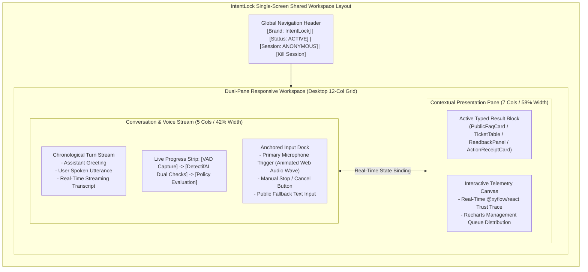
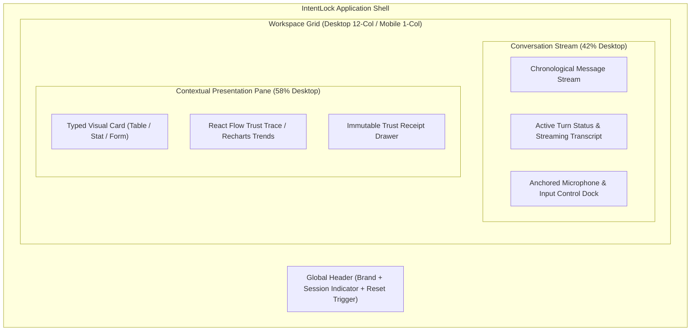
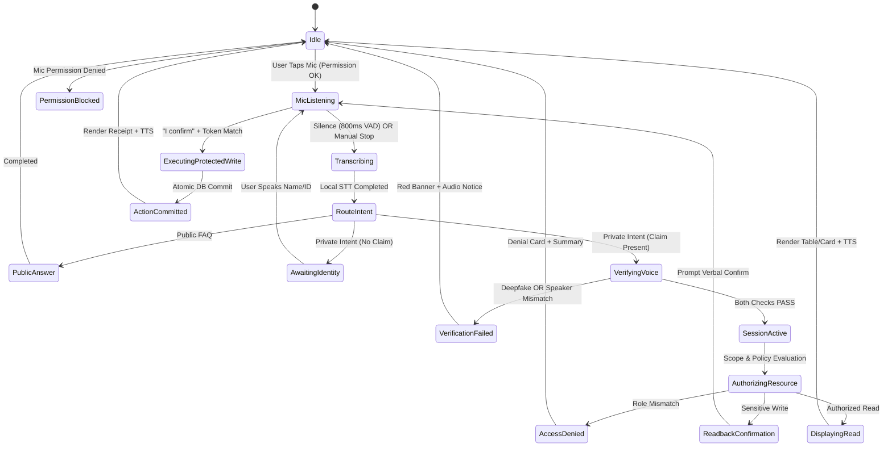

# IntentLock — UI/UX Specification & Design System
**Voice-First Shared Terminal Workspace for Track 3: UNCLONE Agents**

---

## 1. Executive UI Summary & Non-Negotiable Rules

IntentLock is a single-screen, voice-first assistance workspace engineered for shared enterprise terminals (front desks, helpdesk kiosks, shop-floor stations). It operates **without a conventional pre-session employee login** *[PRD Section B]*, allowing public visitors to access general knowledge while requiring real-time acoustic deepfake detection and speaker verification before exposing private employee data or executing protected actions.



### Seven Non-Negotiable UI Rules

1. **Rule 1 (Zero Prior-Auth Private Rendering)**: The UI must never render placeholder rows, empty card skeletons, or pre-fetched employee data before the backend confirms both `deepfake_detection == PASS` and `speaker_verification == PASS`.
2. **Rule 2 (Single Shared Origin, Zero Login Prompt)**: Opening the application root URL over HTTPS must immediately render the operational voice workspace without demanding a username, password, or SSO login *[Rule Book Rule 6.6]*.
3. **Rule 3 (Strict Audio-Visual Agreement)**: The local text-to-speech (TTS) voice summary must agree with the rendered visual card. For large tables or charts, TTS speaks an executive takeaway; it **never** recites entire tables row-by-row.
4. **Rule 4 (No Box Shadows / Pure Flat Aesthetic)**: All visual hierarchy is achieved strictly via typographic scale, crisp borders (`border-2`), solid flat color blocks, and disciplined whitespace. **Box shadows, gradients, glossy blurs, and 3D skeuomorphism are strictly banned**.
5. **Rule 5 (Verified WCAG AA Contrast)**: White text on `#3B82F6` (Blue 500) fails WCAG AA (3.68:1); normal text buttons must use `#1D4ED8` (Blue 700, 6.37:1). Emerald and Amber must strictly use contrast-certified light backgrounds with dark foregrounds or deep-shade solid fills.
6. **Rule 6 (Deterministic Trust Receipts)**: Every protected read or write must render an immutable **Trust Trace** via `@xyflow/react` and a structured `TrustReceiptCard`. Visual indicators must reflect actual backend verification events, never client-side cosmetic simulations.
7. **Rule 7 (Shared Screen Sanitization)**: Upon session expiration (90s idle) or explicit session termination, all private employee cards, tables, charts, and graph nodes must immediately flush from the DOM.

---

## 2. Source Hierarchy & Decision Notes

This specification translates the **Flat Design System** (`Pasted text(1).txt`) into a high-density, mission-critical voice workspace:

* **Marketing Removal**: Flat-design examples mentioning pricing tiers, marketing CTAs, and landing heroes are discarded. The geometric color blocking, crisp borders, and bold typography are adapted to conversational tiles, status strips, data tables, and trust graphs.
* **Contrast Remediation**: The base palette is extended with WCAG AA/AAA-compliant semantic tokens for buttons, alerts, and badges.
* **Component Discipline**: Rather than unrestrained hover scaling (which causes layout shifting in dense data views), scaling (`hover:scale-[1.01]`) is reserved exclusively for standalone action cards and primary buttons. Tables, graphs, and input bars remain dimensionally stable.

---

## 3. Information Architecture & Responsive Layout

### Desktop Layout ($\ge 1024\text{px}$)
A dual-pane, 12-column responsive grid with a fixed header and anchored voice dock:
* **Header (Full Width, 64px)**: Identity, terminal status, active session chip, and session kill button.
* **Left Column (5 Columns / 42% Width)**: Chronological conversational stream (transcript cards, assistant spoken messages, live progress strip) + Anchored Microphone Dock.
* **Right Column (7 Columns / 58% Width)**: Dynamic Contextual Result Pane (renders active typed result: Ticket Table, Recharts Chart, React Flow Trust Trace, or Confirmation Panel).

### Mobile / Tablet Layout ($< 1024\text{px}$)
A single-column vertical flow:
* Contextual results render inline directly beneath the corresponding conversation turn.
* The Microphone Dock is fixed to the bottom viewport (`sticky bottom-0 z-50`), with an auto-collapsing drawer for expanded Recharts and React Flow visualizers.



---

## 4. Tokens & Component Specifications

### 1. Contrast-Certified Semantic Color Palette

| Token Name | Hex Code | Tailwind Class | Contrast vs BG | Functional Purpose |
| :--- | :--- | :--- | :--- | :--- |
| **`bg-canvas`** | `#FFFFFF` | `bg-white` | Base Canvas | Primary terminal background. |
| **`bg-surface`** | `#F3F4F6` | `bg-gray-100` | 1.15:1 vs Canvas | Secondary panels, message cards, docks. |
| **`text-primary`** | `#111827` | `text-gray-900` | 16.1:1 on White | Headings, primary body copy, table text. |
| **`text-muted`** | `#4B5563` | `text-gray-600` | 7.0:1 on White | Subtitles, timestamps, metadata labels. |
| **`border-subtle`** | `#E5E7EB` | `border-gray-200` | N/A (Structural) | Strict 2px borders for flat containment. |
| **`action-blue`** | `#1D4ED8` | `bg-blue-700` | **6.37:1 with White** | Primary Action Button, solid status pills. |
| **`accent-blue`** | `#3B82F6` | `bg-blue-500` | 3.68:1 (Non-Text) | Active waveform bars, node borders, focus rings. |
| **`surface-blue`** | `#EFF6FF` | `bg-blue-50` | 1.1:1 vs Canvas | Active session highlight backgrounds. |
| **`success-emerald`**| `#047857` | `bg-emerald-700` | **4.53:1 with White** | Verified success buttons, passed check badges. |
| **`surface-emerald`**| `#ECFDF5` | `bg-emerald-50` | 1.08:1 vs Canvas | Light success alert banners (Text: `#065F46`). |
| **`warning-amber`** | `#B45309` | `bg-amber-700` | **4.61:1 with White** | Solid warning tags, high-priority flags. |
| **`surface-amber`** | `#FEF3C7` | `bg-amber-100` | 1.12:1 vs Canvas | Readback confirmation cards (Text: `#78350F`). |
| **`danger-crimson`** | `#B91C1C` | `bg-red-700` | **6.57:1 with White** | Access Denied alerts, security failure pills. |
| **`surface-crimson`**| `#FEF2F2` | `bg-red-50` | 1.08:1 vs Canvas | Denial / Deepfake alert boxes (Text: `#991B1B`). |

### 2. Typography Specification (Typeface: **Outfit**)

* **Font Stack**: `'Outfit', -apple-system, BlinkMacSystemFont, 'Segoe UI', Roboto, sans-serif`.
* **Scale & Hierarchy**:
  * **Header Brand**: `text-xl font-extrabold tracking-tight` (20px / 700 / `-0.02em`).
  * **Section Headings**: `text-lg font-bold tracking-tight text-gray-900` (18px / 700 / `-0.01em`).
  * **Spoken Assistant Copy**: `text-base font-normal leading-relaxed text-gray-900` (16px / 400).
  * **User Transcript Copy**: `text-base font-medium text-gray-800 italic` (16px / 500).
  * **Status & Security Pills**: `text-xs font-bold tracking-wider uppercase` (12px / 700 / `0.05em`).
  * **Table & Data Elements**: `text-sm font-medium font-mono text-gray-900` (14px / 500 / tabular figures).
  * **Receipt Metadata**: `text-xs font-mono text-gray-600` (12px / 400).

### 3. Flat Geometry & Border Tokens
* **Border Radius**: Consistent `rounded-lg` (8px) on cards, panels, and modal trays; `rounded-md` (6px) on buttons and input fields; `rounded-full` strictly for status dots and circular icon wrappers.
* **Borders**: All components use crisp, solid borders: `border-2 border-gray-200` for default surfaces; `border-2 border-blue-700` for active focus; `border-2 border-red-700` for denials. **Zero box shadows (`shadow-none`)**.
* **Focus States**: High-visibility solid outline: `focus:outline-none focus:ring-2 focus:ring-blue-700 focus:ring-offset-2`.

---

## 5. Interaction Model & Conversation States

The following state machine governs both visual rendering and audio prompts:



### Comprehensive UI State Inventory

| State ID | Trigger Event | Visible UI Feedback | Audio / TTS Output | Available Controls | Sensitive Data Exposed? | Next States |
| :--- | :--- | :--- | :--- | :--- | :--- | :--- |
| **S-01: Idle** | Page load or session reset. | Clean workspace; large blue mic button; prompt: *"Tap to speak or ask public FAQ"*. | None. | Tap Mic, Text Input. | **None.** | S-02, S-03 |
| **S-02: Permission Blocked** | Browser mic access denied. | Red warning banner: *"Microphone access required. Please allow mic permissions in browser bar."* | None. | Retry Mic Button, Help Link. | **None.** | S-01 |
| **S-03: Listening** | User taps mic button. | Pulsing primary blue waveform visualizer; *"Listening..."* label; red Stop button. | Audio capture active; assistant speaker muted. | Tap to Stop Listening. | **None.** | S-04, S-05 |
| **S-04: Silence Detected** | 4s of silence recorded. | Yellow info toast: *"No speech detected. Tap mic to try again."* | None. | Tap Mic. | **None.** | S-01 |
| **S-05: Transcribing** | Turn complete (VAD trigger). | Spinner with text: *"Transcribing speech..."*; transcript bubble renders progressively. | None. | Cancel. | **None.** | S-06, S-07 |
| **S-06: Clarifying Claim** | Private intent without ID. | Yellow badge: *"Identity Required"*; Prompt card: *"Please state your Name or Employee ID"*. | *"Who am I speaking with? Please state your name or ID."* | Tap Mic to Identify. | **None.** | S-03 |
| **S-07: Checking Audio** | Claimed ID present. | Animated progress bar: `[Checking Deepfake: ...]` $\rightarrow$ `[Verifying Speaker: ...]`. | None. | Cancel. | **None.** | S-08, S-09 |
| **S-08: Verification Failed** | Synthetic audio or mismatch. | Solid Red Alert: *"Voice Authentication Failed. Access Denied."* Detailed trust trace shows failed node. | *"Voice verification failed. Access to private records is denied."* | Dismiss, Tap Mic to Retry. | **None.** | S-01 |
| **S-09: Session Active** | Both DetectifAI checks pass. | Green Session Badge: `VERIFIED: Charlie Davis (emp_1042)`; 90s countdown timer started. | *"Welcome Charlie."* | End Session Button. | **Authorized profile only.** | S-10, S-11 |
| **S-10: Scope Denied** | Role mismatch on resource. | Crimson Alert: *"Access Denied: Your role (Employee) is not authorized for HR records."* | *"You do not have permission to view marketing department HR records."* | Dismiss, Tap Mic. | **None.** | S-09 |
| **S-11: Authorized Read** | Read query permitted. | Structured Ticket Card or Team Table displayed in Contextual Pane; trust badge shown. | 1–2 sentence summary (e.g., *"You have 2 open tickets..."*). | Filter, Scroll, Replay TTS. | **Scoped records only.** | S-09 |
| **S-12: Readback Required** | Sensitive write proposed. | Solid Amber Readback Card with exact normalized parameters + Confirm/Cancel buttons. | *"Please confirm: Create urgent ticket 'Monitor flickering'? Say 'Confirm' to execute."* | Verbal "Confirm", Button Click. | Proposed draft parameters only. | S-13, S-09 |
| **S-13: Action Committed** | Confirmed & grant consumed. | Emerald Success Card + Immutable Trust Receipt Card with TxID + React Flow trace. | *"Ticket created successfully. Reference number is 412."* | View Receipt, Print, Tap Mic. | New ticket row only. | S-09 |
| **S-14: Session Expired** | 90s idle timer hits 0. | Private pane clears immediately; toast: *"Session expired. Kiosk reset for next user."* | Short chime (no speech). | Tap Mic. | **None (DOM wiped).** | S-01 |

---

## 6. Typed Response & Rendering Contracts

The backend returns a strictly validated `ui_presentation` object. The UI router maps `card_type` to concrete flat components:

```typescript
type UIPresentationPayload = 
  | { card_type: "PUBLIC_FAQ"; title: string; answer: string; source_document: string }
  | { card_type: "EMPLOYEE_PROFILE"; employee: { id: string; name: string; role: string; team: string } }
  | { card_type: "TICKET_LIST"; tickets: Array<{ ticket_id: number; title: string; priority: string; status: string; assigned_to: string }> }
  | { card_type: "TEAM_METRIC_CHART"; chart_type: "BAR" | "PIE"; data: Array<{ label: string; count: number; priority: string }> }
  | { card_type: "TRUST_TRACE_GRAPH"; nodes: Array<any>; edges: Array<any> }
  | { card_type: "READBACK_CONFIRMATION"; draft: { action: string; target: string; params: Record<string, any> } }
  | { card_type: "ACTION_RECEIPT"; receipt: { req_id: string; tx_id: string; actor: string; timestamp: string } }
  | { card_type: "DENIAL_BANNER"; code: string; message: string; reason: string };
```

### Visual Specifications for Primary Result Types

#### 1. Public FAQ Card (`PUBLIC_FAQ`)
* **Layout**: Bordered container (`border-2 border-gray-200 bg-white p-6 rounded-lg`).
* **Header**: Badge `PUBLIC KNOWLEDGE` (`bg-gray-100 text-gray-700 font-bold px-2.5 py-1 text-xs rounded`).
* **Content**: Question heading (`text-base font-bold text-gray-900`) followed by verified answer body (`text-sm font-normal text-gray-800 leading-relaxed`).
* **Footer**: Document source pill (`[Doc: Reception_Policy_v1.2.md]`).

#### 2. Ticket Table (`TICKET_LIST`)
* **Layout**: Full-width bordered data grid (`border-2 border-gray-200 rounded-lg overflow-hidden`).
* **Header**: Solid gray strip (`bg-gray-100 border-b-2 border-gray-200 text-xs font-bold uppercase text-gray-700 px-4 py-3`).
* **Rows**: Alternating white / gray-50 rows. Priority pills:
  * `URGENT`: `bg-red-100 text-red-800 border border-red-300 font-bold px-2 py-0.5 rounded text-xs`.
  * `HIGH`: `bg-amber-100 text-amber-800 border border-amber-300 font-bold px-2 py-0.5 rounded text-xs`.
  * `NORMAL`: `bg-blue-100 text-blue-800 border border-blue-300 font-bold px-2 py-0.5 rounded text-xs`.
* **Mobile Handling**: Columns collapse; cards convert to stacked list blocks with explicit field labels.

#### 3. Readback Confirmation Panel (`READBACK_CONFIRMATION`)
* **Layout**: Prominent amber alert block (`bg-amber-50 border-2 border-amber-600 p-6 rounded-lg`).
* **Header**: Alert Icon + Heading: *"Action Confirmation Required"* (`text-amber-900 font-bold text-lg`).
* **Parameter Manifest**: Monospace parameter grid (`bg-white border border-amber-300 p-4 rounded font-mono text-sm text-gray-900`):
  * `ACTION`: `create_ticket`
  * `TITLE`: `Monitor flickering violently`
  * `PRIORITY`: `urgent`
  * `OWNER`: `Charlie Davis (emp_1042)`
* **Action Dock**: Dual buttons:
  * Primary Confirm: Solid emerald (`bg-emerald-700 hover:bg-emerald-800 text-white font-bold px-6 py-3 rounded-md`).
  * Cancel: Flat white with gray border (`bg-white border-2 border-gray-300 text-gray-700 font-bold px-6 py-3 rounded-md`).

#### 4. Immutable Trust Receipt (`ACTION_RECEIPT`)
* **Layout**: High-contrast graphic certificate block (`bg-gray-900 text-white p-6 rounded-lg border-2 border-gray-900`).
* **Header**: Shield Icon + *"IntentLock Cryptographic Execution Receipt"* (`text-emerald-400 font-bold text-sm tracking-wider uppercase`).
* **Receipt Grid**: 2-column key-value matrix displaying `Request ID`, `DB Transaction ID`, `Verified Actor`, `Action Grant Hash`, and `Execution Timestamp`.
* **Trust Seal**: Green badge: `VERIFIED & COMMITTED TO DATABASE`.

---

## 7. React Flow (`@xyflow/react`) and Recharts Usage

### 1. The Real-Time Trust Trace Graph (`@xyflow/react`)
The **Trust Trace Graph** is the definitive visual proof of Track 3 compliance *[PRD Section C]*. It dynamically visualizes the security pipeline for the active turn:

```
[ Mic Ingress ] ---> [ DetectifAI Deepfake: PASS ] ---> [ DetectifAI Speaker: MATCH ]
                                                                   |
                                                                   v
[ Supabase Commit: TX-9912 ] <--- [ Action Grant: CONSUMED ] <--- [ Policy Engine: ALLOWED ]
```

* **Node Aesthetics**: Flat, high-contrast rectangular cards (`w-48 p-3 rounded-md border-2`).
  * **Success Node**: `border-emerald-600 bg-emerald-50 text-emerald-950 font-bold`.
  * **Denied / Failed Node**: `border-red-600 bg-red-50 text-red-950 font-bold`.
  * **Pending / Skipped Node**: `border-gray-300 bg-gray-100 text-gray-500 line-through`.
* **Interactive Behavior**: Read-only by default (`nodesDraggable={false}`, `elementsSelectable={false}`, `zoomOnScroll={false}`). Users can tap a node to reveal raw JSON metadata in an accessible side tray.
* **Failure Termination**: If DetectifAI Speaker Match fails, the graph halts immediately at that node with a red terminal icon. Subsequent authorization and execution nodes are rendered as red `ABORTED` states.

### 2. Quantitative Metric Charts (`recharts`)
Used for manager and executive aggregate overviews (e.g., *Engineering Queue by Priority*):
* **Component**: Responsive `<BarChart>` or `<PieChart>` rendered within a clean white container (`border-2 border-gray-200 p-4 rounded-lg`).
* **Color Discipline**:
  * Urgent Bars: `#B91C1C` (Red 700).
  * High Bars: `#B45309` (Amber 700).
  * Normal Bars: `#1D4ED8` (Blue 700).
  * Low Bars: `#047857` (Emerald 700).
* **Guaranteed Truthfulness**: Bar data points bind strictly to SQL `GROUP BY` counts returned by the backend. The LLM is technically barred from synthesizing graph values.

---

## 8. Critical UI Journeys & Edge Cases

### Journey A: Public Anonymous FAQ (Rule 6.6 Compliance)
1. User taps mic: *"What are the public visitor hours?"*
2. Kiosk status strip turns blue: `[Listening...]` $\rightarrow$ `[Transcribing...]`.
3. Left pane displays transcript. Right pane renders `PublicFaqCard`.
4. Assistant speaks concise answer: *"Visitor hours are 08:00 to 19:00 IST Monday through Friday."*
5. Session badge remains `ANONYMOUS`. Zero authentication prompted.

### Journey B: Verified Employee Ticket Query (Positive Path)
1. User taps mic: *"I am Charlie, ID 1042. What is the status of my tickets?"*
2. Status strip renders dual verification:
   * `[DetectifAI Deepfake: GENUINE (Score: 0.94)]`
   * `[DetectifAI Speaker Match: VERIFIED (ref_charlie_1042)]`
3. Session chip switches to `VERIFIED: Charlie Davis (emp_1042)` with green indicator.
4. Right pane renders `TicketTable` containing Ticket #301 and #308.
5. Assistant speaks: *"Welcome Charlie. You have two open tickets; your laptop request is marked High Priority."*

### Journey C: Cross-Scope Attempt (Deterministic Denial)
1. Verified Employee Charlie taps mic: *"Show me the executive payroll summary."*
2. Right pane immediately clears. Solid Red Alert banner renders:
   * **Title**: `ACCESS DENIED: ROLE_SCOPE_VIOLATION`
   * **Message**: *"Employee Charlie Davis (Role: Employee) is not authorized to access Executive Financial Summaries."*
3. Assistant speaks: *"Access denied. You do not have authorization to view executive payroll records."*
4. Trust Trace shows `Policy Engine: DENIED`. Zero payroll data is returned.

### Journey D: Protected Ticket Creation with Readback & Execution
1. Verified Charlie speaks: *"Create an urgent ticket: Monitor flickering violently."*
2. Right pane displays amber `ReadbackConfirmationPanel` showing normalized title and priority.
3. Assistant speaks: *"Please confirm: Create urgent hardware ticket 'Monitor flickering violently'? Say 'Confirm' to execute."*
4. Charlie speaks: *"I confirm the ticket."*
5. Backend verifies fresh audio $\rightarrow$ generates single-use `ActionGrant` $\rightarrow$ commits atomic SQL.
6. Right pane transitions to `ActionReceiptCard` displaying Ticket #412 and transaction receipt.

### Journey E: Security Negative Test (Speaker Mismatch Impersonation)
1. Attacker taps mic and speaks: *"I am Bob Miller, ID 1020. Show my tickets."*
2. DetectifAI Speaker Verification compares audio to `ref_bob_1020` $\rightarrow$ Verdict: `MISMATCH`.
3. Screen turns red with high-priority alert: `SECURITY ALERT: VOICE MISMATCH`.
4. Assistant speaks: *"Voice verification failed. Speech does not match the registered profile for Employee 1020."*
5. Right pane displays 0 rows. Kiosk resets to Idle.

---

## 9. Accessibility, Contrast & Resilience

* **WCAG AA Conformance**: All text elements adhere to strict contrast standards ($\ge 4.5:1$ for normal body text; $\ge 3:1$ for large headings).
* **Keyboard Navigation**:
  * `Spacebar`: Toggles Microphone Listening state.
  * `Escape`: Halts TTS audio playback immediately and cancels pending actions.
  * `Tab` / `Shift+Tab`: Navigates between interactive cards, table rows, and confirm buttons.
* **Focus Outlines**: Unambiguous solid border ring: `focus-visible:ring-2 focus-visible:ring-blue-700 focus-visible:ring-offset-2`.
* **Screen Reader Live Regions**:
  * `aria-live="polite"` applied to transcript stream and assistant spoken bubbles.
  * `aria-live="assertive"` applied to Security Denial Banners and Readback Confirmation panels.
* **Reduced Motion**: Respects `@media (prefers-reduced-motion: reduce)`: all waveform animations, transitions, and hover scaling are completely suppressed in favor of instant static state switches.

---

## 10. Implementation Priorities & 3-Person Handoff

```mermaid
gantt
    title UI Build Sequence (10:00 - 17:30 IST)
    dateFormat  HH:mm
    axisFormat %H:%M
    
    section P0 Core Shell
    Flat CSS Tokens & App Layout       :u1, 10:00, 11:30
    Mic Dock & AudioWave Animation     :u2, 11:30, 13:00
    Public FAQ Card & Conversation View:u3, 13:00, 14:00
    
    section P0 Verification & Tables
    Verification Banner & Session Pill :u4, 14:00, 15:00
    Ticket Table & Cross-Scope Denial  :u5, 15:00, 16:00
    Confirmation Panel & Trust Receipt :u6, 16:00, 16:45
    
    section P1 Upgrades
    React Flow Trust Trace Integration :u7, 16:45, 17:15
    Recharts Team Queue Trend Graph    :u8, 17:15, 17:30
```



### Three-Person Coordination Table

| UI Component | Interface Contract Owned | Dependencies on Voice Lead (Owner 1) | Dependencies on Backend Lead (Owner 3) |
| :--- | :--- | :--- | :--- |
| **Microphone Dock** | Audio streaming state | Emits recording status, VAD silence triggers. | Receives binary audio payloads via `/api/v1/kiosk/turn`. |
| **Conversation Stream** | Transcript & TTS audio | Supplies live/final STT text and synthesized base64 WAV. | Delivers parsed intent and correlation `request_id`. |
| **Trust Badges & Banners** | Verification status | Supplies audio sample duration for verification. | Returns DetectifAI normalized verdicts (`PASS` / `FAIL`). |
| **Contextual Result Pane** | `UIPresentationPayload` | Mutes mic during presentation playback. | Returns validated typed JSON (Ticket rows, FAQ text). |
| **Trust Trace Graph** | React Flow node array | None. | Provides structured execution trace and SQL transaction ID. |

---

## 11. Design Acceptance Checklist (Judge Device Validation)

Prior to Day 1 presentation at 18:00 IST, test this checklist on an external smartphone and laptop connected to the public HTTPS tunnel *[Rule Book Rule 6.6]*:

- [ ] **Instant Load**: URL opens immediately with 0 login prompts; default state is `SESSION: ANONYMOUS`.
- [ ] **Mic Permission**: Tapping the mic button prompts the browser's native audio permission dialog over HTTPS.
- [ ] **Silence Rejection**: Speaking nothing causes zero database requests; UI cleanly prompts retry after 4s.
- [ ] **Public Inquiry**: Asking visitor hours renders `PublicFaqCard` and plays audio summary in $< 3.5\text{s}$.
- [ ] **Verified Access**: Enrolled Charlie speaks ID $\rightarrow$ Green badge appears $\rightarrow$ Only Charlie's 2 tickets render.
- [ ] **Cross-Scope Block**: Charlie asks for HR payroll $\rightarrow$ Red denial banner renders $\rightarrow$ Zero private rows shown.
- [ ] **Impersonation Block**: Attacker speaks Bob's ID $\rightarrow$ DetectifAI returns Mismatch $\rightarrow$ Red security banner renders.
- [ ] **Action Readback**: Creating a ticket renders amber confirmation card displaying exact title and priority.
- [ ] **Receipt Generation**: Confirming ticket creates row in Supabase and renders black cryptographic Trust Receipt card.
- [ ] **Trust Trace Graph**: React Flow renders connected nodes with green checks for passed stages and red for blocked stages.
- [ ] **Session Sanitization**: Tapping "End Session" wipes all private cards from DOM, resetting kiosk to anonymous.
- [ ] **Flat Compliance**: Zero box shadows, zero gradients, crisp 2px borders, contrast-checked blue buttons (`#1D4ED8`).

---
*End of UI/UX Specification — IntentLock*
