# Voice Pipeline Architecture — IntentLock
**Acoustic Capture, Turn Management, Biometric Dispatch, and Speech Synthesis**

---

## A. Voice Architecture Summary and Key Decisions

The IntentLock voice pipeline coordinates the physical acoustic interface of the shared kiosk. It converts human speech into structured intent, verifies the acoustic reality and claimed identity of the speaker via DetectifAI, and delivers concise spoken summaries synchronized with visual UI cards *[PRD Section L; TRD Section F; System Architecture Section E]*.

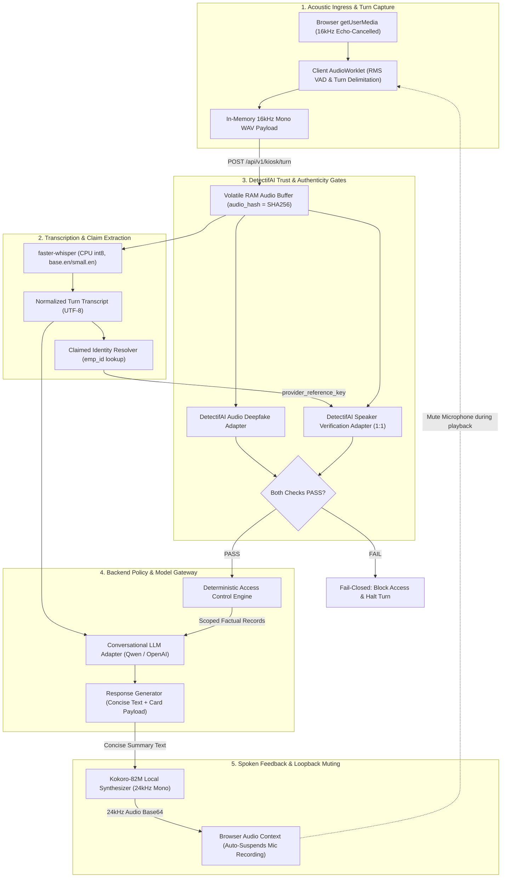

### 1. Key Architectural Decisions

| Decision Area | Selected P0 Implementation | Architectural Rationale | Test & Validation Gate | Fallback Option | Status |
| :--- | :--- | :--- | :--- | :--- | :--- |
| **Ingress Capture** | Web Audio API `AudioWorklet` with client-side RMS VAD. | Zero server-side audio streaming overhead; turn boundaries calculated at edge. | Verify 800ms silence cleanly emits 16kHz WAV blob. | Push-to-talk manual recording button. | **Locked P0** |
| **Speech-to-Text** | `faster-whisper` (CPU int8, `base.en`/`small.en`). | Fast local transcription ($< 750\text{ms}$) with zero GPU VRAM contention. | Measure latency on presentation laptop. | Hugging Face speech repo STT component. | **Locked P0** |
| **Acoustic Authenticity**| DetectifAI Deepfake Detection REST API. | Live verification that incoming speech is genuine human audio, not a synthetic clone. | cURL smoke test with sample audio at 09:00 IST. | Offline labeled diagnostic test suite. | **`[TBD-API-KIT]`** |
| **Speaker Matching** | DetectifAI Speaker Verification 1:1 REST API. | Biometric comparison of captured audio against pre-enrolled employee reference. | Live check matching Team Member 1 to `emp_1042`. | Offline labeled diagnostic test suite. | **`[TBD-API-KIT]`** |
| **Text-to-Speech** | `Kokoro-82M` local synthesizer (24kHz). | Highly intelligible, low-latency ($< 400\text{ms}$) local synthesis; avoids archived libraries. | Verify clean audio playback without glitching. | Web Speech API synthesis in browser. | **Locked P0** |
| **Echo Elimination** | Programmatic AudioContext suspension during TTS. | Completely prevents assistant's voice from feeding back into microphone as a new turn. | Speak long TTS summary; verify mic captures 0 loops. | Hardware distance / directional mic. | **Locked P0** |
| **Biometric Privacy**| Option A (Zero local embeddings stored). | Eliminates local biometric data retention liabilities; references provider vault only. | Verify zero embedding columns in Supabase. | Option B (Local derived embeddings - P2). | **Locked P0** |

### 2. The 30–45-Minute Day 1 Speech Spike (Hour 0: 10:00–10:45 IST)
1. **Target**: Evaluate `huggingface/speech-to-speech` modular pipeline on the presentation laptop.
2. **Go/No-Go Gate Criteria**:
   * Does it capture a microphone turn and produce an STT transcript in $< 1.0\text{s}$?
   * Does it allow intercepting the transcript to route through IntentLock's FastAPI policy engine without triggering internal LLM tools?
   * Does the full loop (Mic $\rightarrow$ STT $\rightarrow$ FastAPI $\rightarrow$ TTS) complete in $< 2.5\text{s}$ without GPU VRAM exhaustion?
3. **Automatic Fallback Trigger**: If configuring the HF repo exceeds 45 minutes or breaches latency/isolation gates, immediately pivot to the **turn-based fallback**: `faster-whisper` (int8) + `Kokoro-82M`.

---

## B. Voice Subsystem and Trust-Boundary Diagram

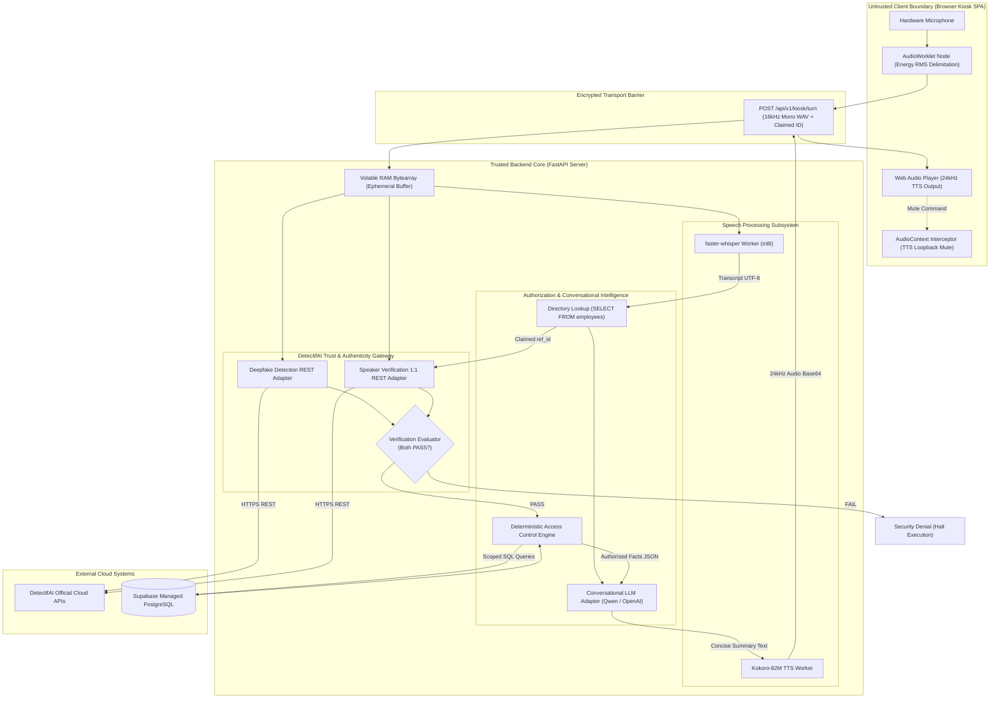

### Component Responsibility & Trust Ownership Matrix

| Component | Responsibility | Inputs Handled | Output Contract | Trusted to Authorize? | Failure Mode |
| :--- | :--- | :--- | :--- | :--- | :--- |
| **AudioWorklet** | Captures 16kHz PCM audio; monitors RMS energy for turn cutoff. | Raw microphone hardware input. | 16kHz Mono WAV blob. | **NO (Untrusted Client)**. | Emits silence error toast; resets turn. |
| **STT Engine** | Converts captured audio buffer to normalized UTF-8 text transcript. | In-memory 16kHz WAV buffer. | `TranscriptResult` object. | **NO**. Speech recognition is not authentication. | Returns `ERR_STT_UNCERTAIN`; prompts retry. |
| **Directory Lookup** | Resolves claimed employee ID to pre-enrolled `provider_reference_key`. | Spoken employee claim string. | `provider_reference_key` or null. | **NO**. Claim is an unverified lookup key. | Returns `ERR_UNENROLLED_CLAIM`; fails closed. |
| **DetectifAI Gateway**| Marshals audio payload and reference keys to DetectifAI cloud APIs. | Raw audio bytes, reference key. | Normalized verdicts (`PASS`, `FAIL`). | **YES (for acoustic evidence)**. | Fails closed on timeout ($> 3000\text{ms}$) or error. |
| **Policy Engine** | Evaluates role, team, ownership, and resource scoping rules. | Verified session state, tool call. | `ALLOWED` or `DENIED`. | **YES (Supreme Authority)**. | Defaults to `DENIED`; leaves DB unchanged. |
| **Conversational LLM**| Extracts structured tool calls; synthesizes concise spoken responses. | Grounded facts, user transcript. | `ToolProposal`, summary text. | **NO**. Model proposals carry zero authority. | Falls back to deterministic template on timeout. |
| **TTS Synthesizer** | Converts concise approved summary text into natural 24kHz audio. | Validated summary text string. | Base64-encoded WAV chunk. | **NO**. Operates downstream of authorization. | Fails silently; UI visual card remains visible. |

---

## C. Microphone Activation and Capture

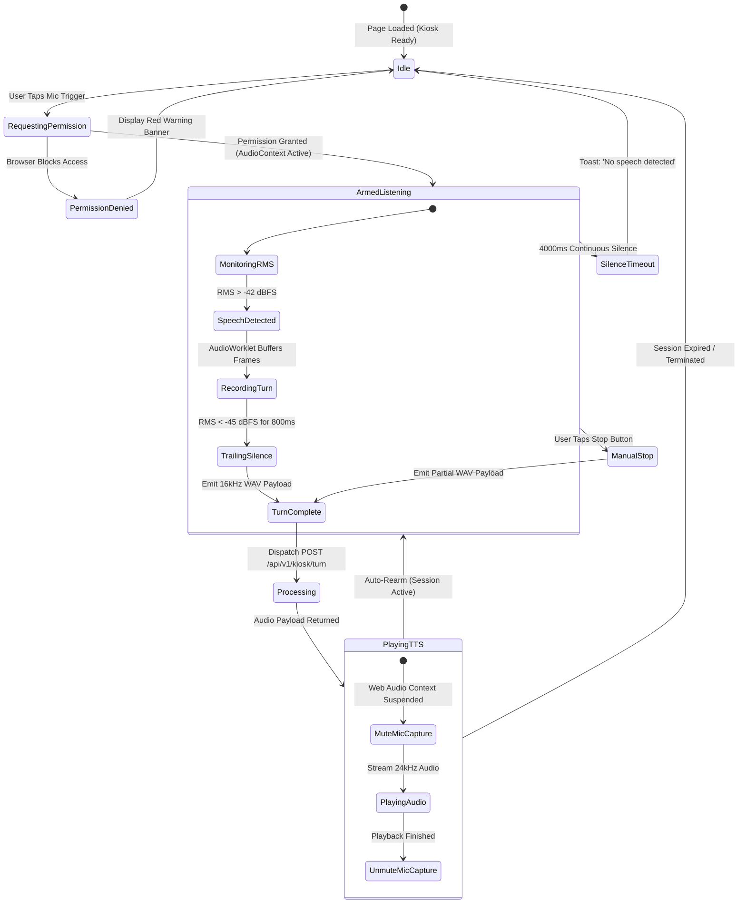

### Ingress Specifications & Guardrails

1. **Explicit User Activation Gesture**: In compliance with modern browser autoplay policies (Chrome, Safari, Edge), microphone access is **never** initiated on page load. Capture initiates strictly upon an explicit user tap on the primary microphone trigger *[UI/UX Rule 1]*.
2. **Web Audio Capture Constraints**:
   * Channel Count: 1 (Mono).
   * Ingress Sample Rate: Fixed to 16,000 Hz (`sampleRate: 16000`).
   * Browser Audio Preprocessing: `echoCancellation: true`, `noiseSuppression: true`, `autoGainControl: true`.
3. **Client-Side Spoofing Limitation Acknowledgment**:
   * While the browser interface captures from `getUserMedia`, web browsers cannot cryptographically prove that the underlying audio stream originates from a physical human vocal tract rather than a virtual audio cable (e.g., VB-Cable). 
   * **Mitigation**: IntentLock relies on **DetectifAI Audio Deepfake Detection** to evaluate the acoustic spectral properties of the incoming audio to detect synthetic, recorded, or injected streams.
4. **Shared Kiosk Echo Elimination**:
   * When the assistant speaks via TTS, the browser client calls `audioContext.suspend()` or zeroes out the microphone stream buffer.
   * Microphone capture re-arms only after `onended` fires on the audio player, guaranteeing zero recursive acoustic feedback loops.

---

## D. Turn Detection and Conversation Timing

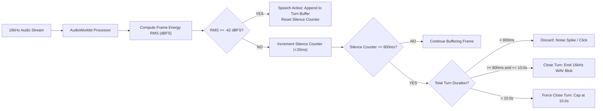

### Configurable Timing Parameters

| Parameter | Default Value | Hard Boundary | Tuning & Operational Guidance |
| :--- | :--- | :--- | :--- |
| **Energy Speech Floor** | `-42 dBFS` | `-50 to -35 dBFS` | Lower threshold in quiet rooms; raise in noisy hackathon halls to avoid noise triggers. |
| **Trailing Silence Window** | `800 ms` | `500 to 1200 ms` | Prevents premature cutoff during natural mid-sentence pauses while keeping latency low. |
| **Minimum Turn Duration** | `800 ms` | `500 ms` | Utterances shorter than 800ms are discarded as coughs, mic bumps, or ambient clicks. |
| **Maximum Turn Duration** | `10.0 s` | `12.0 s` | Prevents denial-of-service memory bloat and complies with DetectifAI turn limits. |
| **Silence Timeout** | `4.0 s` | `3.0 to 6.0 s` | If armed and zero speech is detected for 4s, the mic disarms and prompts retry. |

---

## E. Audio Formats and Transformation Boundaries

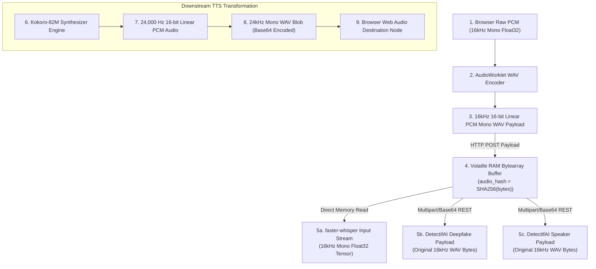

### Audio Representation & Lifecycle Matrix

| Audio Representation | Produced By | Consumed By | Temporary Memory Location | Transformation Required | Disposal / Cleanup Rule |
| :--- | :--- | :--- | :--- | :--- | :--- |
| **Browser PCM Float32** | `navigator.mediaDevices` | Client AudioWorklet | Client Browser RAM | Converted to Int16 PCM. | Flushed on turn emission. |
| **Turn Ingress WAV** | AudioWorklet WAV Encoder | FastAPI `/api/v1/kiosk/turn` | Client Browser RAM | Wrapped in standard 44-byte WAV header. | Flushed on HTTP 200 receive. |
| **Server Ephemeral Buffer**| FastAPI Ingress Handler | STT Engine, DetectifAI Gateway | Server System RAM (`bytearray`)| SHA-256 hashed; split across workers. | **Explicitly dereferenced post-turn**. |
| **STT Audio Tensor** | NumPy memory view | `faster-whisper` CTranslate2 | Server RAM / CPU L3 Cache | Normalized to `[-1.0, 1.0]` Float32. | Garbage collected post-inference. |
| **DetectifAI Payload** | FastAPI REST Client | DetectifAI Cloud APIs | Outbound HTTP Socket Buffer | Formatted per official kit spec `[TBD]`.| Socket closed post-response. |
| **Synthesized TTS Audio** | `Kokoro-82M` Model | Browser Web Audio Player | Server RAM $\rightarrow$ Client RAM | Synthesized at 24kHz; base64 encoded. | Cleared from client memory on replay end. |

> [!IMPORTANT]
> ### The Preservation Invariant
> The exact binary audio bytes received at `/api/v1/kiosk/turn` must be preserved in memory without lossy re-encoding or aggressive denoising filters before dispatching to DetectifAI. Modifying spectral noise floors or applying aggressive speech enhancement filters prior to deepfake analysis can trigger false-positive synthetic verdicts.

---

## F. STT and Language Understanding Handoff

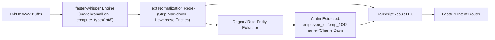

### 1. Alphanumeric Entity Normalization Rules
Spoken speech often introduces transcription quirks when interpreting corporate identifiers:
* **Employee IDs**: Spoken *"Employee one zero four two"* or *"EMP ten forty-two"* is mapped via regex pattern `r"(?i)(?:emp|id|employee)?\s*([0-9]{4})"` to normalized canonical identifier `emp_1042`.
* **Ticket Numbers**: Spoken *"Ticket three zero one"* maps to integer `301`.
* **Priority Escalation**: Spoken *"urgent"*, *"critical"*, *"asap"* maps to canonical enum `'urgent'`.

### 2. The Transcript Trust Boundary
* **Untrusted Data Status**: Transcripts produced by STT represent user input data, **not verified facts**. 
* **Typed Corrections**: If a user uses the optional text box to correct an alphanumeric ID (e.g., fixing `emp_1041` to `emp_1042`), the corrected text updates the *claimed lookup key*, but **cannot satisfy the voice verification gate**. The subsequent turn mandates fresh audio matching `emp_1042`'s biometric profile.

---

## G. Public versus Protected Routing

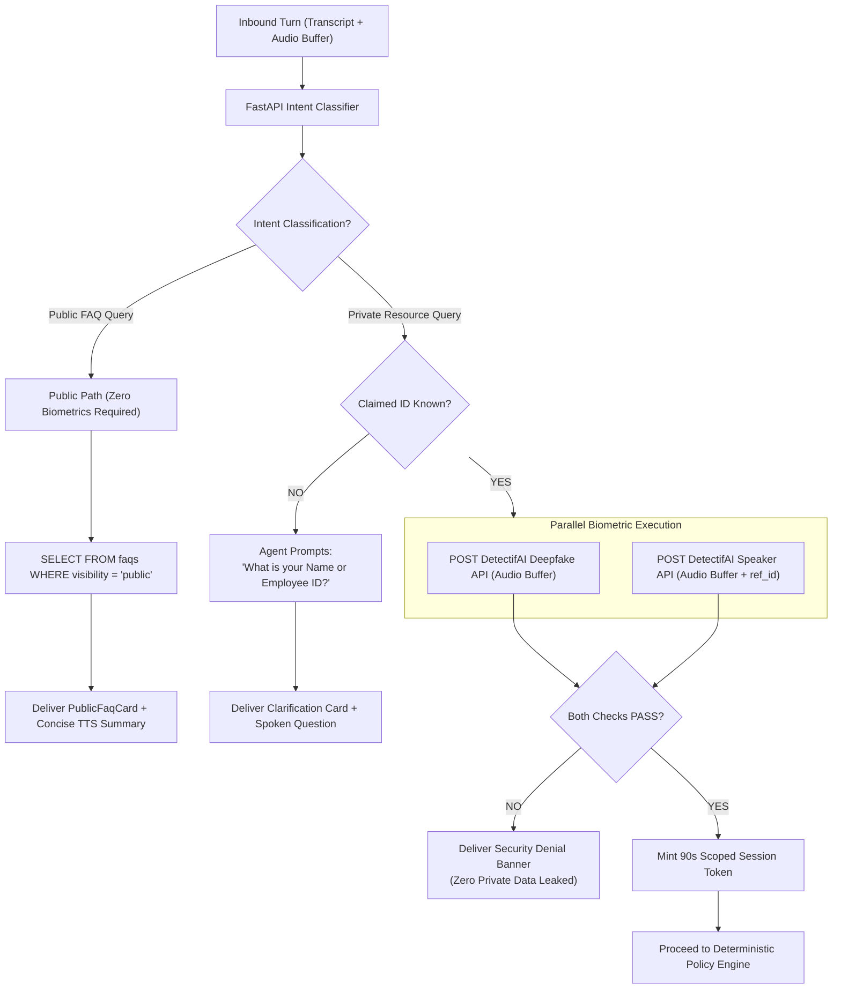

---

## H. DetectifAI Adapters and Decision Normalization

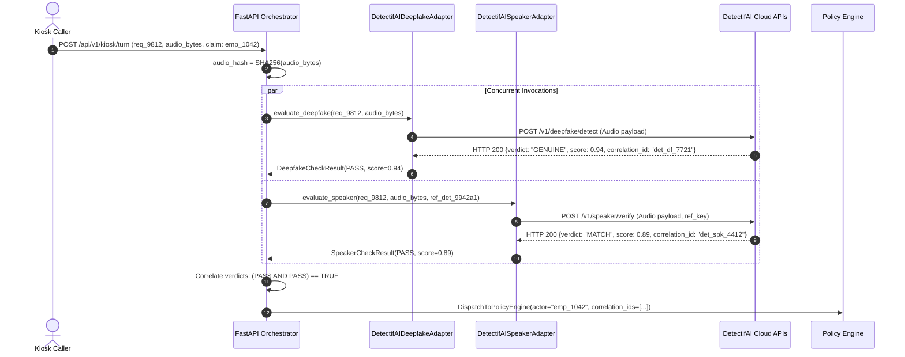

### Normalized Application Verdict Categories

| Application Verdict | DetectifAI Raw Condition | Decision for Private Read | Decision for Protected Write | Audit Status | User-Safe Message |
| :--- | :--- | :--- | :--- | :--- | :--- |
| **`PASS (GENUINE & MATCH)`** | `df == GENUINE` $\land$ `spk == MATCH` | **`ALLOWED`** | **`PROCEED TO READBACK`** | `SUCCESS` | *"Welcome Charlie. [Authorized summary]."* |
| **`FAIL (SYNTHETIC)`** | `df == SYNTHETIC_DETECTED` | **`DENIED`** | **`BLOCKED`** | `SECURITY_ALERT` | *"Audio authenticity check failed. Synthetic speech detected."* |
| **`FAIL (MISMATCH)`** | `spk == MISMATCH` | **`DENIED`** | **`BLOCKED`** | `SECURITY_ALERT` | *"Voice verification failed. Speech does not match profile."* |
| **`INCONCLUSIVE`** | Score within provider margin | **`DENIED`** | **`BLOCKED`** | `UNCERTAIN` | *"Acoustic verification was inconclusive. Please speak closer to mic."* |
| **`PROVIDER_TIMEOUT`** | Latency $> 3000\text{ms}$ | **`DENIED`** | **`BLOCKED`** | `FAILED` | *"Voice security service timed out. Please try again shortly."* |

---

## I. Claimed Identity, Enrollment, and Voice Samples

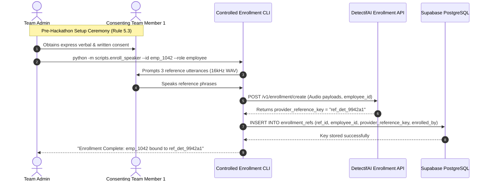

### Permitted Live Testing Roster (Rule 5.3 & 5.4 Compliant)
* **Demo Speaker 1**: Team Member 1 $\rightarrow$ Consented and enrolled as `emp_1042` (*Charlie Davis, Engineer*). Used to demonstrate positive verification, scoped ticket reads, and protected ticket creation.
* **Demo Speaker 2**: Team Member 2 $\rightarrow$ Consented and enrolled as `emp_1020` (*Bob Miller, Manager*). Used to demonstrate manager-specific team queue queries and aggregate charts.
* **Adversarial Attacker**: Team Member 3 $\rightarrow$ Consented but **strictly unenrolled**. Speaks Bob's ID to demonstrate live, truthful speaker mismatch rejection (`TC-05`).
* **Synthetic Sample**: A permitted synthetic audio file generated from Team Member 1's voice to demonstrate live deepfake detection rejection (`TC-06`).

---

## J. Optional Hybrid Speaker-Identification Extension (P2)

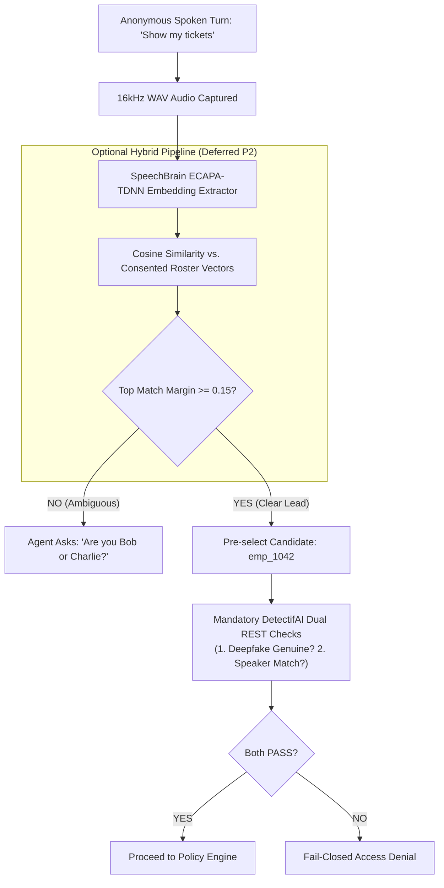

### Honest Biometric Storage Boundary
* **Decision**: As locked in `System_Architecture.md` (ADR-02), **Option A (Zero Local Biometrics Stored)** is the active P0 baseline.
* Local persistent 1:N candidate search is classified as an **optional Day 2 extension**. The P0 demo requires zero local biometric embedding vectors.

---

## K. Replay, Challenge, and Risk-Based Reverification

| Operation Risk Tier | Illustrative Spoken Request | Re-Verification Policy | Acoustic Proof Required | State Outcome |
| :--- | :--- | :--- | :--- | :--- |
| **Tier 0: Public** | *"What are your reception hours?"* | Zero authentication required. | None. | Direct grounded FAQ answer. |
| **Tier 1: Scoped Read** | *"Show my current IT tickets."* | DetectifAI dual checks required once per 90s session. | Fresh 16kHz audio turn. | Verified session established; scoped tickets shown. |
| **Tier 2: Sensitive Write**| *"Create urgent ticket: Monitor flickering"* | Exact-action readback + Fresh VAD turn check. | Fresh spoken confirmation (*"I confirm"*). | Single-use `ActionGrant` issued; committed atomically. |
| **Tier 3: High-Risk Admin**| *"Grant admin rights to Charlie"* | **BANNED VIA VOICE**. Requires MFA / Human Review. | Out-of-band enterprise credential. | Voice terminal halts; displays high-risk refusal banner. |

---

## L. Conversation Model and Spoken Reply Path

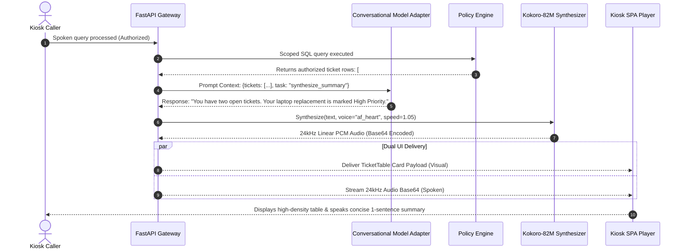

### Audio-Visual Synthesis Rules
1. **Executive Takeaway Synthesis**: For large datasets, tables, or Recharts graphs, TTS synthesizes strictly an executive takeaway (e.g., *"You have three urgent tickets in Team A"*). TTS **never** recites entire tables row-by-row *[UI/UX Rule 3]*.
2. **Pre-Commit Voice Safety**: The assistant will **never** speak *"Ticket created successfully"* while a database transaction is pending. Spoken confirmation is emitted strictly after the Protected Executor returns `status: SUCCESS` with a valid transaction ID.

---

## M. Application-Owned Interfaces

```typescript
// 1. Audio Turn Payload from Browser
interface AudioTurnPayload {
  request_id: string;              // UUID4
  turn_id: string;                 // e.g., "turn_001"
  session_token: string | null;    // Active session token if present
  claimed_employee_id: string | null; // e.g., "emp_1042"
  audio_bytes_base64: string;      // 16kHz Mono WAV base64
  sample_rate: 16000;
  channels: 1;
  duration_ms: number;
}

// 2. STT Transcription Result
interface TranscriptResult {
  turn_id: string;
  raw_transcript: string;
  normalized_transcript: string;
  detected_language: "en";
  latency_ms: number;
  extracted_claims: {
    employee_id?: string;
    action_verb?: string;
  };
}

// 3. Normalized DetectifAI Verification Evidence
interface VerificationEvidence {
  request_id: string;
  audio_hash: string;              // SHA-256 of audio buffer
  deepfake_check: {
    verdict: "GENUINE" | "SYNTHETIC_DETECTED" | "INCONCLUSIVE" | "ERROR";
    raw_score: number;             // Provider score
    correlation_id: string;
  };
  speaker_check: {
    verdict: "MATCH" | "MISMATCH" | "INCONCLUSIVE" | "ERROR";
    reference_id: string;          // ref_det_9942a1
    raw_score: number;             // Provider score
    correlation_id: string;
  };
  combined_verdict: "PASS" | "FAIL" | "FAIL_CLOSED";
}

// 4. Assistant Speech Delivery Request
interface AssistantSpeechRequest {
  request_id: string;
  turn_id: string;
  summary_text: string;            // Concise 1-2 sentence text
  voice_id: "kokoro_en_female" | "kokoro_en_male";
  speed_multiplier: number;        // e.g., 1.05
  audio_base64?: string;
}
```

---

## N. Privacy, Observability, and Resource Usage

### 1. Minimal Telemetry Logging Format
Every voice turn writes a single structured log line to stdout with zero biometric vectors, zero credentials, and zero raw audio:
```json
{
  "timestamp": "2026-10-16T11:24:08.520Z",
  "request_id": "req_9812a4b8-2c31-489e",
  "turn_id": "turn_001",
  "actor_id": "emp_1042",
  "deepfake_verdict": "GENUINE",
  "deepfake_score": 0.94,
  "speaker_verdict": "MATCH",
  "speaker_score": 0.89,
  "policy_decision": "ALLOWED",
  "latency_metrics": {
    "vad_turn_ms": 820,
    "stt_ms": 610,
    "detectifai_df_ms": 380,
    "detectifai_spk_ms": 410,
    "db_query_ms": 18,
    "tts_ms": 320,
    "total_turn_ms": 2558
  }
}
```

### 2. Workstation Resource Contention Management
* **STT (`faster-whisper`)**: Bound to 4 CPU threads using INT8 quantization (RAM footprint: $\approx 450\text{MB}$, CPU utilization: $< 35\%$).
* **TTS (`Kokoro-82M`)**: PyTorch/ONNX CPU inference (RAM footprint: $\approx 350\text{MB}$, CPU utilization: $< 25\%$).
* **LLM**: Hosted locally via Ollama or remotely via OpenAI `gpt-4o-mini`, completely eliminating GPU memory contention.

---

## O. Failure and Recovery Matrix

| Failure Mode | Detected By | Kiosk Next State | User Visible UI State | User Spoken Audio | Can Public FAQ Work? | Can Private Ops Proceed? |
| :--- | :--- | :--- | :--- | :--- | :--- | :--- |
| **Mic Denied** | Browser `getUserMedia` | `Idle` | Red Warning Banner: *"Mic access blocked."* | None | **YES (via typing)** | **NO** (Voice proof required) |
| **Silence / No Speech**| Client AudioWorklet | `Idle` | Toast: *"No speech detected. Tap mic."* | None | **YES** | **NO** |
| **Early VAD Cutoff** | User stops speaking | `Processing` | Transcript displays incomplete sentence. | None | **YES** | User taps mic to append/clarify. |
| **Deepfake API Outage**| Gateway Timeout ($> 3\text{s}$)| `Idle` | Red Alert: *"Security service unavailable."* | *"Voice security service timed out."*| **YES** | **BLOCKED (Fail-Closed)** |
| **Speaker Mismatch** | DetectifAI API | `Idle` | Red Alert: *"Voice Mismatch Detected."* | *"Voice does not match profile."* | **YES** | **BLOCKED (Fail-Closed)** |
| **Synthetic Audio Flag**| DetectifAI API | `Idle` | Red Alert: *"Synthetic Speech Detected."* | *"Synthetic audio detected. Denied."* | **YES** | **BLOCKED (Fail-Closed)** |
| **STT Unintelligible** | Whisper low confidence| `ArmedListening` | Prompt: *"I didn't quite catch that. Repeat?"*| *"I didn't catch that. Please repeat."*| **YES** | Re-prompts without penalty. |
| **TTS Worker Crash** | Python Speech Service | `Completed` | Visual Card renders with full text. | None (Silent audio failure) | **YES** | **YES (Visual data unaffected)** |
| **Shared Bystander Turn**| VAD speech boundary | `Verifying` | If speaker changes, DetectifAI returns Mismatch.| *"Voice mismatch. Access denied."* | **YES** | **BLOCKED (Fail-Closed)** |

---

## P. P0 Implementation Sequence and Acceptance Tests

```mermaid
gantt
    title Day 1 Voice Pipeline Milestones (10:00 - 17:30 IST)
    dateFormat  HH:mm
    axisFormat %H:%M
    
    section Stage 0: Spikes & Smoke Tests
    Hardware Speech Spike (HF vs. faster-whisper) :vp1, 10:00, 10:45
    DetectifAI Live API Kit Smoke Test (cURL)     :vp2, 10:45, 11:30
    
    section Stage 1: Core Voice I/O Loop
    VAD & 16kHz WAV Ingress In RAM                :vp3, 11:30, 12:30
    faster-whisper STT + Kokoro-82M TTS Loop      :vp4, 12:30, 13:30
    
    section Stage 2: Trust Gates & Enrollment
    Controlled Enrollment CLI & Reference Storage :vp5, 13:30, 14:30
    DetectifAI Dual REST Adapters (Fail-Closed)   :vp6, 14:30, 15:30
    
    section Stage 3: Integration & Rehearsal
    Loopback Muting & Audio-Visual Card Sync      :vp7, 15:30, 16:30
    Adversarial Negative Tests (SEC-03 to SEC-06) :vp8, 16:30, 17:30
```

### Voice Pipeline Acceptance Matrix

| Test ID | Test Scenario | Input / Spoken Utterance | Expected System Action | Observable Pass/Fail Criteria |
| :--- | :--- | :--- | :--- | :--- |
| **V-01** | Silence Turn Delimitation | User activates mic, remains silent for 4s | AudioWorklet detects silence floor; drops turn | 0 server requests; Toast: *"No speech detected"*. |
| **V-02** | Public Knowledge Flow | *"What are the public cafeteria hours?"* | Routes to `lookup_public_faq`; zero biometrics | Public card renders; TTS plays summary in $< 3.0\text{s}$. |
| **V-03** | Live Consented Verification | *"I'm Charlie, ID 1042. Show my tickets"* | Dual DetectifAI calls pass against `ref_charlie` | Green Verified Badge renders; Charlie's 2 tickets shown. |
| **V-04** | Live Speaker Mismatch Denial| Unenrolled speaker utters: *"I'm Bob, ID 1020"* | DetectifAI Speaker Verification returns `MISMATCH` | Red Security Alert; Zero ticket rows rendered. |
| **V-05** | Synthetic Audio Gating | Plays permitted synthetic TTS clone sample | DetectifAI Deepfake API flags synthetic markers | Red Security Alert: *"Synthetic Speech Detected"*. |
| **V-06** | Audio Loopback Prevention | Assistant speaks 15-second TTS summary | Microphone recording suspended during playback | Mic captures 0 audio frames; zero recursive turns. |
| **V-07** | Readback Confirmation | Verified user utters: *"I confirm the ticket"* | Fresh VAD turn correlated to active draft action | Single-use grant consumed; Ticket created in Supabase. |

---
*End of Voice Pipeline Architecture Document — IntentLock*
