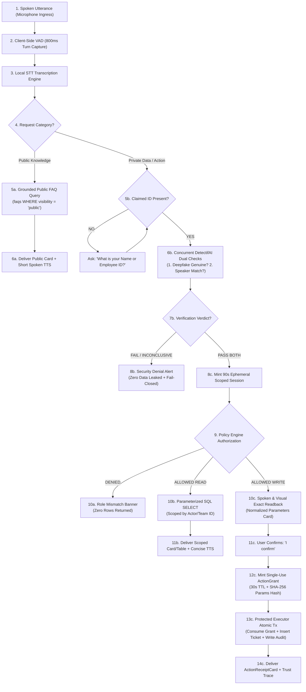
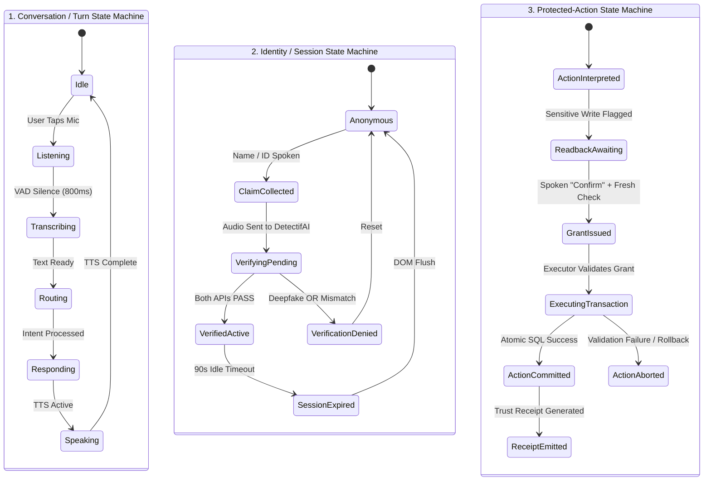
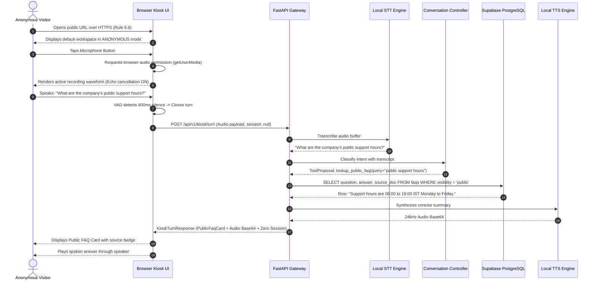
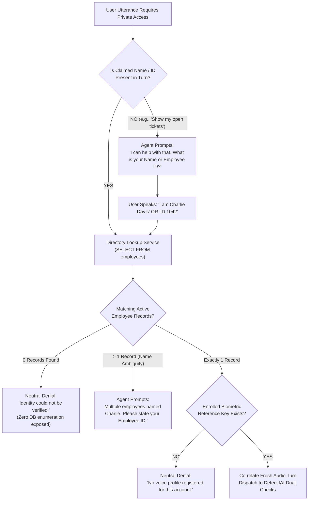
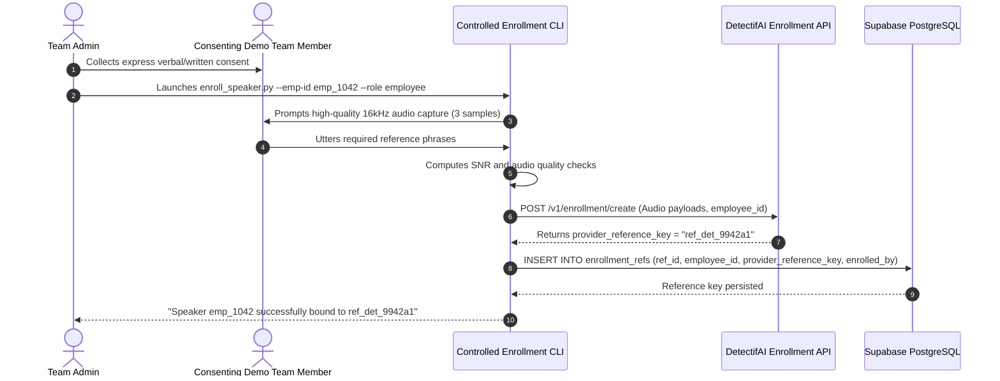
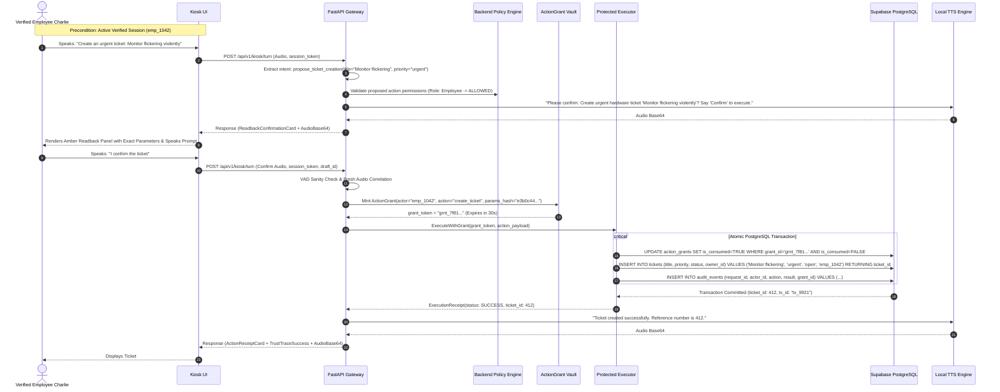
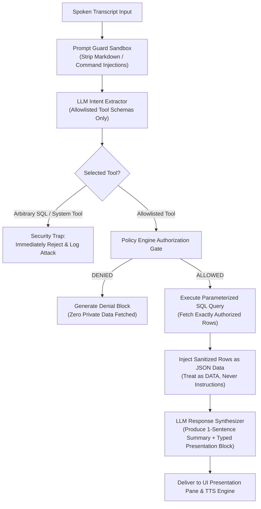
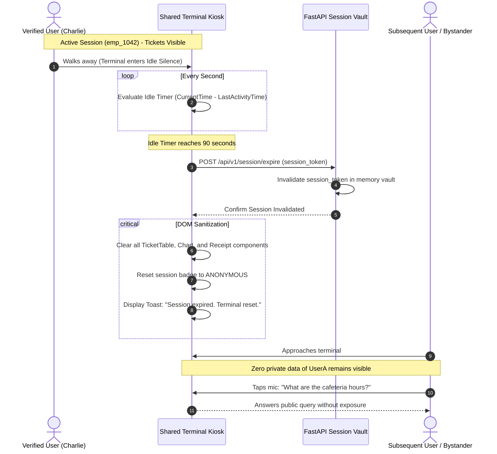
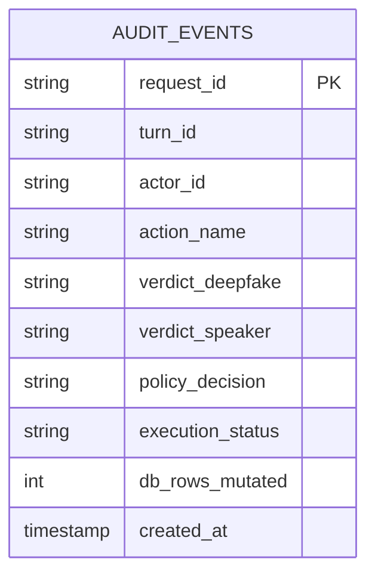

# IntentLock — End-to-End Workflow Specification
**Operational State Machines, Trust Boundaries, and Execution Sequencing**

---

## A. Workflow Overview and Governing Invariants

IntentLock operates as an unauthenticated-first, voice-driven kiosk terminal deployed in shared organizational environments *[PRD Section B]*. This document governs the lifecycle of every request, mapping exact transitions between user speech, client audio capture, cryptographic/biometric verification via DetectifAI, deterministic policy checks, protected database mutations, and multimodal UI/TTS outputs.



### The 14 Non-Negotiable Workflow Invariants

1. **Invariant 1 (Zero Client/Model Trust)**: Browser inputs, spoken claims, STT transcripts, LLM text/tool outputs, and client UI states are completely untrusted as security evidence.
2. **Invariant 2 (Strict Prior-Authorization Fence)**: No private record is ever retrieved from the database or placed into LLM context before the Backend Policy Engine validates active authorization.
3. **Invariant 3 (Claim $\neq$ Proof)**: A spoken name or Employee ID is an unverified *lookup claim*, never proof of caller identity.
4. **Invariant 4 (Orthogonal Biometric Guarantees)**: Speaker verification does not prove audio is genuine (replays match enrolled speakers); deepfake detection does not prove identity (a genuine voice could belong to an impostor). Both must pass independently.
5. **Invariant 5 (Fresh Turn Binding)**: DetectifAI API checks must be executed against the fresh audio bytes captured during the relevant turn. Old verification flags cannot be replayed.
6. **Invariant 6 (Fail-Closed Default)**: Any required check that fails, times out ($> 3000\text{ms}$), errors, or yields an inconclusive verdict results in immediate, fail-closed access refusal.
7. **Invariant 7 (Pervasive Scoping)**: A verified session establishes caller identity, not universal clearance. Every private read and action is individually checked against role, ownership, and team boundaries.
8. **Invariant 8 (Text Input Parity Constraint)**: A typed message or edited transcript may refine search terms or clarify spelling, but can **never** bypass or satisfy a required voiced biometric check.
9. **Invariant 9 (Agent Proposes, Engine Disposes)**: The LLM agent has zero execution capability. It extracts structured intents; deterministic backend code authorizes; the Protected Executor commits.
10. **Invariant 10 (Single-Use Grant Immutability)**: An `ActionGrant` token is cryptographically bound to the exact normalized parameters of an action. Any alteration of arguments invalidates the grant.
11. **Invariant 11 (Absolute State Immutability on Denial)**: Any unauthorized or failed write attempt leaves targeted business database records strictly unchanged ($0\text{ rows mutated}$).
12. **Invariant 12 (Truthful Receipts)**: Visual cards and Trust Receipts state the actual committed database outcome and provider event IDs, never the model’s conversational prediction.
13. **Invariant 13 (Shared Kiosk Sanitization)**: When a session expires (90s idle) or is terminated, all private cards, tables, charts, and graph nodes must immediately flush from the client DOM.
14. **Invariant 14 (Genuine Live Detection)**: No pre-recorded, mocked, cached, or hardcoded provider outcomes may be presented as live detection *[Rule Book Rule 5.4, 9.5]*.

---

## B. Participants and Ownership

| Participant / Component | Layer | Core Operational Responsibility | Trusted Inputs | Absolute Prohibition (Must NEVER Decide) |
| :--- | :--- | :--- | :--- | :--- |
| **User / Caller** | Physical | Utters speech, provides claims, speaks verbal confirmations. | N/A (Untrusted). | Cannot declare own identity or grant own access. |
| **Browser Kiosk UI** | Client | Records audio, renders typed cards, plots React Flow trust traces. | Server-signed JSON responses, audio playback streams. | **Must never** hold service keys or set `verified = true`. |
| **Speech Pipeline (VAD/STT/TTS)** | Host | Converts mic audio to text; converts summaries to speech. | Ephemeral 16kHz audio buffer; server response text. | **Must never** evaluate access permissions or filter records. |
| **Conversation Controller (LLM)** | Backend | Normalizes text into allowlisted tool calls and arguments. | Grounded facts supplied by backend; user transcripts. | **Must never** authorize tools, generate direct SQL, or claim a write succeeded. |
| **Identity Lookup Service** | Backend | Resolves claimed name/ID to enrolled reference IDs. | Read-only directory rows from Supabase `employees`. | **Must never** treat an enrolled match as authenticated without DetectifAI verification. |
| **DetectifAI Deepfake Adapter** | Gateway | Dispatches fresh audio to DetectifAI; returns authenticity. | Binary audio bytes; request ID. | Does not verify *who* spoke; evaluates only *authenticity*. |
| **DetectifAI Speaker Adapter** | Gateway | Compares fresh audio to enrolled biometric reference key. | Binary audio bytes; `provider_reference_key`. | Does not verify *authenticity*; evaluates only *acoustic match*. |
| **Session Manager** | Backend | Mints, tracks, and expires 90-second scoped session tokens. | Successful dual DetectifAI verification payloads. | Does not determine resource permissions; maintains identity lifespan. |
| **Backend Policy Engine** | Backend | Evaluates role, team, ownership, and resource permissions. | Server-authenticated session token; target resource ID. | Deterministic code only; **zero LLM discretion**. |
| **Company Data Query Tools** | Backend | Executes scoped `SELECT` queries for authorized reads. | Sanitized parameters vetted by Policy Engine. | Cannot execute `INSERT`, `UPDATE`, or `DELETE`. |
| **Protected Executor** | Backend | Executes database mutations within atomic transactions. | Valid, unconsumed, unexpired `ActionGrant` tokens. | Cannot execute actions without a cryptographically valid grant. |
| **Supabase PostgreSQL** | Cloud DB | Stores relational business records and audit logs. | Parameterized SQL over TLS from backend only. | Never directly accessible to browser client. |
| **Audit & Receipt Service** | Backend | Generates immutable Trust Receipts and logs security events. | Actual SQL commit status, provider correlation IDs. | Cannot alter business records; writes append-only logs. |

---

## C. State Models: Conversation, Identity, and Action

IntentLock tracks three orthogonal, decoupled state machines to prevent state-confusion vulnerabilities:



### Comprehensive Transition & Guard Matrix

| Machine | Current State | Triggering Event | Guard / Verification Required | Responsible Component | Next State | Spoken / Visual Output | DB / Data Change | Audit Event Emitted |
| :--- | :--- | :--- | :--- | :--- | :--- | :--- | :--- | :--- |
| **CSM** | `Idle` | `MIC_CLICKED` | Browser mic permission granted | Browser UI | `Listening` | Blue pulsing wave; *"Listening..."* | None | None |
| **CSM** | `Listening` | `VAD_SILENCE` | Trailing silence $\ge 800\text{ms}$ | Client VAD AudioWorklet | `Transcribing` | Spinner; *"Processing..."* | None | None |
| **CSM** | `Listening` | `TIMEOUT_SILENCE` | 4000ms zero speech detected | Client VAD AudioWorklet | `Idle` | *"No speech detected. Tap mic to retry."* | None | `CSM_SILENCE_TIMEOUT` |
| **ISM** | `Anonymous` | `CLAIM_SPOKEN` | String contains name or Employee ID | Conversation Controller | `ClaimCollected` | Transcript renders claim; status checks start | None | `ISM_CLAIM_REGISTERED` |
| **ISM** | `ClaimCollected` | `DISPATCH_CHECKS` | Audio buffer $\ge 1.0\text{s}$ duration | FastAPI Gateway | `VerifyingPending` | Progress: `[Verifying Deepfake & Speaker...]` | None | None |
| **ISM** | `VerifyingPending`| `CHECKS_PASSED` | `df_verdict == PASS` $\land$ `spk_verdict == MATCH` | `DetectifAIGateway` | `VerifiedActive` | Green Pill: `VERIFIED: Charlie Davis (emp_1042)` | Memory session created (90s TTL) | `AUTH_VERIFICATION_SUCCESS` |
| **ISM** | `VerifyingPending`| `CHECKS_FAILED` | `df_verdict == FAIL` $\lor$ `spk_verdict == FAIL` | `DetectifAIGateway` | `VerificationDenied` | Red Alert: *"Voice Authentication Failed."* | None (Zero data accessed) | `AUTH_SECURITY_ALERT` |
| **ASM** | `None` | `WRITE_DETECTED` | Tool is `propose_ticket_creation` | Policy Engine | `ReadbackAwaiting` | Amber Card: Parameter manifest; Spoken readback | None | `ACTION_PROPOSED` |
| **ASM** | `ReadbackAwaiting`| `USER_CONFIRMED` | Utterance matches confirm regex + fresh VAD | Policy Engine | `GrantIssued` | Spinner: *"Executing authorized transaction..."* | Single-use `ActionGrant` inserted | `GRANT_ISSUED` |
| **ASM** | `GrantIssued` | `EXECUTOR_COMMIT` | `grant.is_consumed == FALSE` $\land$ `now() <= expiry` | Protected Executor | `ActionCommitted` | Emerald Card + Trust Receipt; Spoken confirm | Ticket row inserted; Grant marked consumed | `ACTION_EXECUTION_SUCCESS` |
| **ASM** | `GrantIssued` | `GRANT_INVALID` | Grant expired OR parameters hash mismatch | Protected Executor | `ActionAborted` | Red Alert: *"Security Grant Error. Aborted."* | Rollback transaction; 0 rows inserted | `GRANT_TAMPER_BLOCKED` |
| **ISM** | `VerifiedActive` | `SESSION_TIMEOUT`| Server idle timer $\ge 90\text{ seconds}$ | Session Manager | `Anonymous` | Screen clears private cards; reset to Idle | Session token deleted from memory | `SESSION_EXPIRED` |

---

## D. Entry, Microphone Activation, and Public-Question Workflow



### Edge Cases in Public Ingress
* **Microphone Permission Denied**: UI transitions immediately to state `S-02`. A red informational toast displays: *"Microphone access blocked. Enable microphone permissions in your browser URL bar."* The optional text input bar remains available for public inquiries.
* **Ambient Noise / Inaudible Turn**: If audio duration is $< 0.8\text{ seconds}$ or average RMS energy is below acoustic floor, the turn drops silently without hitting the LLM or database.
* **Non-Public Inquiry by Anonymous User**: If an unauthenticated user asks *"Show my salary"* or *"What tickets did I raise?"*, the classifier routes to **Section E (Identity Claim Workflow)**. **Zero employee rows are fetched.**

---

## E. Missing or Ambiguous Identity Workflow

When an utterance requires employee permissions but lacks a definitive, verified claim, the agent initiates an active clarification loop:



### Information Leakage Prevention Rules
* If an attacker speaks a non-existent ID (e.g., `emp_9999`), the assistant responds: *"Voice verification could not be completed."*
* The assistant **never** states: *"Employee ID 9999 does not exist in the company directory."* Directory enumeration is strictly blocked.

---

## F. Controlled Voice-Enrollment Workflow

Voice enrollment is an administrative ceremony conducted strictly prior to live hackathon judging *[Rule Book Rule 5.3]*. Ordinary kiosk users cannot enroll arbitrary voices dynamically:



### Privacy & Biometric Storage Boundary
* **Option A (Active Baseline)**: Zero raw audio and zero embedding vectors are persisted in Supabase or local logs. Supabase stores only the opaque foreign string `provider_reference_key`.
* **Revocation**: Executing `DELETE FROM enrollment_refs WHERE employee_id = 'emp_1042'` immediately invalidates the biometric lookup. Subsequent attempts fail closed.

---

## G. Private Read and Verified-Session Workflow

```mermaid
sequenceDiagram
    autonumber
    actor User as Consented Employee (Charlie Davis)
    participant UI as Kiosk UI
    participant Gateway as FastAPI Gateway
    participant DetectifAI as DetectifAI Dual APIs
    participant Policy as Backend Policy Engine
    participant DB as Supabase PostgreSQL
    participant TTS as Local TTS Engine

    User->>UI: Speaks: "I'm Charlie, ID 1042. Show my open tickets."
    UI->>Gateway: POST /api/v1/kiosk/turn (Audio bytes, claim: emp_1042)
    
    par Dual DetectifAI Invocations
        Gateway->>DetectifAI: 1. POST /v1/deepfake/detect (Audio bytes)
        DetectifAI-->>Gateway: Verdict: GENUINE (Score: 0.94)
    and
        Gateway->>DetectifAI: 2. POST /v1/speaker/verify (Audio bytes, ref_det_9942a1)
        DetectifAI-->>Gateway: Verdict: MATCH (Score: 0.89)
    end
    
    Gateway->>Gateway: SessionManager.create_session(actor="emp_1042", role="employee", ttl=90s)
    Gateway->>Policy: EvaluateRead(actor="emp_1042", role="employee", resource="tickets")
    Policy-->>Gateway: ALLOWED (Scope: tickets.owner_id == 'emp_1042')
    
    Gateway->>DB: SELECT ticket_id, title, priority, status FROM tickets WHERE owner_id = 'emp_1042'
    DB-->>Gateway: 2 Rows Returned (Laptop Replacement, VPN Access)
    
    Gateway->>TTS: "Welcome Charlie. You have two open tickets; your laptop request is High Priority."
    TTS-->>Gateway: Audio Base64
    
    Gateway-->>UI: Response (SessionToken + TicketListCard + AudioBase64 + TrustTraceNodes)
    UI-->>User: Displays Ticket Cards + Green Verified Badge + Speaks Audio
```

### Role & Resource Boundary Rules
* **Employee Scope**: Authorized strictly for records where `owner_id == session.actor_id`. Cross-employee reads are denied.
* **Manager Scope**: Authorized strictly for tickets where `team_id == session.assigned_team_id`. Peer manager teams are denied.
* **Executive Scope**: Authorized strictly for SQL `COUNT()` / `GROUP BY` aggregates. Individual employee private profiles are denied.

---

## H. Protected Write and Exact-Action Confirmation Workflow



### Parameter Modification Abort Rule
If the user modifies any parameter during confirmation (e.g., saying *"I confirm, but make it low priority"*), the pending grant is immediately discarded. The system initiates a new readback cycle reflecting the modified parameters.

---

## I. Audio-Authenticity, Speaker Mismatch, and Replay Decision Table

| DetectifAI Deepfake Result | DetectifAI Speaker Match Result | Session Eligibility | Protected Data / Write Result | UI Presentation State | User-Safe Spoken Feedback |
| :--- | :--- | :--- | :--- | :--- | :--- |
| **`GENUINE`** | **`MATCH`** | **Eligible** (Mint 90s Scoped Session) | **`ALLOWED`** (Evaluated by Policy Engine) | Green Verified Badge + Authorized Cards | *"Welcome [Name]. [Authorized summary]."* |
| **`SYNTHETIC_DETECTED`** | **`MATCH`** | **Ineligible** (Zero Session) | **`DENIED`** (Immediate Halt) | Red Security Alert: `SYNTHETIC_AUDIO_DETECTED` | *"Audio authenticity check failed. Synthetic speech detected."* |
| **`GENUINE`** | **`MISMATCH`** | **Ineligible** (Zero Session) | **`DENIED`** (Immediate Halt) | Red Security Alert: `SPEAKER_MISMATCH` | *"Voice verification failed. Audio does not match registered profile."* |
| **`SYNTHETIC_DETECTED`** | **`MISMATCH`** | **Ineligible** (Zero Session) | **`DENIED`** (Immediate Halt) | Red Security Alert: `HIGH_SEVERITY_ATTACK` | *"Security verification failed. Access denied."* |
| **`INCONCLUSIVE`** | Any | **Ineligible** (Zero Session) | **`DENIED`** (Fail-Closed) | Amber Alert: `AUDIO_UNCERTAIN` | *"Acoustic check was inconclusive. Please speak closer to the mic."* |
| Any | **`INCONCLUSIVE`** | **Ineligible** (Zero Session) | **`DENIED`** (Fail-Closed) | Amber Alert: `SPEAKER_UNCERTAIN` | *"Speaker match inconclusive. Please state your ID again."* |
| **`TIMEOUT / ERROR`** | Any | **Ineligible** (Zero Session) | **`DENIED`** (Fail-Closed) | Gray Alert: `PROVIDER_UNAVAILABLE` | *"Verification service temporarily unavailable. Please try shortly."* |

---

## J. Optional Hybrid Speaker-Candidate Workflow (P2 Extension)

This workflow is an optional Day 2 enhancement; it is **not** a Day 1 P0 prerequisite:
1. **Precondition**: Consented team members' derived 192-dimensional floating-point embeddings are stored locally in Supabase table `speaker_embeddings` *[TRD Section H]*.
2. **Local Pre-Ranking**: User taps mic and asks a private question without stating an ID. Local `SpeechBrain ECAPA-TDNN` calculates cosine similarity against enrolled vectors.
3. **Margin Test**: If top candidate similarity exceeds second candidate by $\Delta \ge 0.15$, system pre-selects the candidate.
4. **Mandatory Provider Gate**: The candidate is **not** authenticated by local cosine score alone. The audio payload is still dispatched to DetectifAI for official 1:1 verification and deepfake detection.

---

## K. AI Context, Retrieval, and Response Workflow



---

## L. Visual-Result Workflow

| Result Type | Producing Component | Authorization Checkpoint | Backend Payload Property | UI Component Rendered | Spoken TTS Behavior | Session Expiry Effect |
| :--- | :--- | :--- | :--- | :--- | :--- | :--- |
| **Public Answer** | Grounded FAQ Engine | Public visibility flag in `faqs` | `card_type: "PUBLIC_FAQ"` | `PublicFaqCard` | Reads full answer ($< 35\text{ words}$) | Remains visible (Public) |
| **Employee Tickets** | Data Tool: `get_tickets` | `tickets.owner_id == actor_id` | `card_type: "TICKET_LIST"` | `TicketTable` | Speaks 1-sentence priority summary | **Immediately Flushed** |
| **Team Queue Table** | Data Tool: `get_team_queue` | `teams.manager_id == actor_id` | `card_type: "TICKET_LIST"` | `TeamQueueTable` | Speaks urgent count and team name | **Immediately Flushed** |
| **Metric Chart** | Backend Analytics | Manager / Executive Role | `card_type: "TEAM_METRIC_CHART"`| Recharts `<BarChart>` | Speaks aggregate trend takeaway | **Immediately Flushed** |
| **Trust Trace** | Audit / Receipt Service | Evaluated check outcomes | `card_type: "TRUST_TRACE_GRAPH"`| `@xyflow/react` Node Canvas | None (Visual telemetry) | **Immediately Flushed** |
| **Readback Panel** | Policy Engine | Sensitive write rule | `card_type: "READBACK_CONFIRMATION"`| `ReadbackConfirmationPanel` | Recites exact parameters & prompt | **Immediately Flushed** |
| **Trust Receipt** | Protected Executor | Atomic SQL commit verification | `card_type: "ACTION_RECEIPT"` | `ActionReceiptCard` | Speaks reference ID and success | **Immediately Flushed** |
| **Security Denial** | Policy / DetectifAI | Check failure or role mismatch | `card_type: "DENIAL_BANNER"` | `DenialAlertBanner` | Speaks concise refusal reason | Resets after 10s |

---

## M. Shared-Screen Session Lifecycle



---

## N. Error, Timeout, Retry, and Recovery Matrix

| Failure Mode | Detection Point | User-Safe Visible UI Alert | User-Safe Spoken Audio | Session State | Protected DB Mutation? | Telemetry / Audit Code |
| :--- | :--- | :--- | :--- | :--- | :--- | :--- |
| **Mic Denied** | Browser `getUserMedia` | Red Banner: *"Mic access required."* | None | `Anonymous` | None ($0\text{ rows}$) | `ERR_BROWSER_MIC_DENIED` |
| **VAD Silence** | Client AudioWorklet | Toast: *"No speech detected."* | None | Preserved | None ($0\text{ rows}$) | `CSM_SILENCE_TIMEOUT` |
| **Corrupt Audio** | Gateway Ingress Check | Toast: *"Audio capture error. Tap mic."*| *"I didn't catch that. Please speak again."* | Preserved | None ($0\text{ rows}$) | `ERR_AUDIO_CORRUPT` |
| **DetectifAI Timeout** | `DetectifAIGateway` ($> 3\text{s}$) | Banner: *"Security service timed out."* | *"Verification timed out. Please try again."* | Terminated | None ($0\text{ rows}$) | `ERR_DETECTIFAI_TIMEOUT` |
| **Speaker Mismatch** | DetectifAI API (verdict `FAIL`)| Red Alert: *"Voice Mismatch."* | *"Voice does not match the registered profile."*| Terminated | None ($0\text{ rows}$) | `SEC_SPEAKER_MISMATCH` |
| **Synthetic Audio** | DetectifAI API (verdict `FAIL`)| Red Alert: *"Synthetic Speech Detected."*| *"Synthetic audio detected. Access denied."* | Terminated | None ($0\text{ rows}$) | `SEC_SYNTHETIC_DETECTED` |
| **Scope Violation** | Policy Engine Check | Crimson Banner: *"Scope Mismatch."* | *"You do not have permission for that record."* | Preserved | None ($0\text{ rows}$) | `SEC_SCOPE_VIOLATION` |
| **Tampered Grant** | Protected Executor | Red Alert: *"Security Grant Invalid."* | *"Action authorization error. Transaction aborted."*| Preserved | **Rolled Back** ($0\text{ rows}$) | `SEC_GRANT_TAMPERED` |
| **Supabase Timeout** | Database Query Pool | Toast: *"Database connection timeout."* | *"Company database is momentarily unreachable."* | Preserved | **Rolled Back** ($0\text{ rows}$) | `ERR_DB_TIMEOUT` |
| **TTS Engine Failure**| Local TTS Synthesizer | Visual card displays normally | None (Audio fails silently) | Preserved | Unaffected | `WARN_TTS_SYNTH_FAILED` |

---

## O. Data Changes, Audit, and Correlation

Every operation emits an audit record with correlated identifiers: `request_id`, `turn_id`, `session_token`, and `grant_id`.



* **Public Read**: $0\text{ business rows mutated}$; $0\text{ audit rows created}$.
* **Denied Private Read**: $0\text{ business rows mutated}$; $1\text{ audit row created}$ (`policy_decision: DENIED`).
* **Completed Protected Write**: $1\text{ ticket row inserted}$; $1\text{ grant row consumed}$; $1\text{ audit row created}$ (`execution_status: SUCCESS`, `db_rows_mutated: 1`).
* **Aborted Write**: $0\text{ ticket rows inserted}$; $1\text{ audit row created}$ (`execution_status: ABORTED`, `db_rows_mutated: 0`).

---

## P. Role-Based Scenario Table

| User Persona | Role | Example Voice Request | Identity & Biometrics Required? | Scope Boundary Enforced | Expected Outcome | Database Mutation? |
| :--- | :--- | :--- | :--- | :--- | :--- | :--- |
| **Visitor** | `visitor` | *"What is the visitor parking policy?"* | **NO** (Bypasses biometrics) | `faqs.visibility == 'public'` | Renders `PublicFaqCard` + TTS | **NO** ($0\text{ rows}$) |
| **Charlie Davis** | `employee` | *"Show my current IT support tickets."* | **YES** (DetectifAI Dual Checks) | `tickets.owner_id == 'emp_1042'` | Renders Charlie's 2 tickets | **NO** ($0\text{ rows}$) |
| **Charlie Davis** | `employee` | *"Show me executive payroll summaries."*| **YES** (Active Verified Session) | Blocked: `role != 'executive'` | Red Alert: Scope Denial | **NO** ($0\text{ rows}$) |
| **Charlie Davis** | `employee` | *"Create urgent ticket: Monitor flickering"*| **YES** (Verbal Readback Confirm) | Permitted ticket category | Ticket #412 created + Receipt | **YES** ($1\text{ row INSERT}$) |
| **Bob Miller** | `manager` | *"Show urgent tickets in Engineering Team A."*| **YES** (DetectifAI Dual Checks) | `tickets.team_id == 'team_eng_a'` | Renders Team A queue table | **NO** ($0\text{ rows}$) |
| **Bob Miller** | `manager` | *"Show tickets in Sales Team B."* | **YES** (Active Verified Session) | Blocked: `team_id != 'team_sales_b'`| Red Alert: Scope Denial | **NO** ($0\text{ rows}$) |
| **Attacker** | `unverified`| *"I am Bob Miller, ID 1020. Show tickets."*| **YES** (DetectifAI Speaker Match) | Mismatch detected | Red Alert: Voice Mismatch | **NO** ($0\text{ rows}$) |

---

## Q. P0 Demo Sequence and Implementation Handoffs

### The 7-Step P0 Live Judging Sequence
1. **Public Ingress**: Judge opens URL without login $\rightarrow$ Asks cafeteria hours $\rightarrow$ Instant Public Card & Audio summary *[Rule Book Rule 6.6]*.
2. **Employee Claim & Auth**: Charlie Davis speaks: *"I'm Charlie, ID 1042. Show my tickets"* $\rightarrow$ Dual DetectifAI calls pass live $\rightarrow$ Charlie's 2 tickets render with Trust Badge.
3. **Cross-Scope Deterministic Refusal**: Charlie speaks: *"Show executive payroll"* $\rightarrow$ Immediate red denial banner $\rightarrow$ Zero private records leaked.
4. **Security Negative Test (Speaker Impersonation)**: Attacker speaks Bob's ID: *"I am Bob Miller, ID 1020"* $\rightarrow$ DetectifAI returns Mismatch $\rightarrow$ Terminal displays red Security Alert.
5. **Manager Scoped Read**: Enrolled Manager Bob Miller speaks $\rightarrow$ Verified live $\rightarrow$ Team A queue renders with Recharts priority chart.
6. **Protected Action Execution**: Charlie speaks: *"Create urgent ticket: Monitor flickering violently"* $\rightarrow$ System recites exact readback $\rightarrow$ Charlie confirms $\rightarrow$ Single-use grant consumed in atomic SQL transaction $\rightarrow$ Ticket #412 rendered with immutable Trust Receipt.
7. **Session Wipe**: Tapping "End Session" flushes all private data instantly from the DOM.

### Three-Person Feature Owner Handoff Table

| Handoff Interface | Producer | Consumer | Data & State Contract | Failure Behavior | Integration Smoke Test |
| :--- | :--- | :--- | :--- | :--- | :--- |
| **1. Browser $\rightarrow$ Gateway** | UI Lead (Owner 3) | Voice Lead (Owner 1) | Binary 16kHz WAV blob over `/api/v1/kiosk/turn` | Returns HTTP 400 with audio error toast | Submit 3s WAV via cURL; verify 200 OK |
| **2. Gateway $\rightarrow$ DetectifAI**| Gateway (Owner 1) | Trust Lead (Owner 2) | Normalized `DetectifAIGateway.evaluate(audio_bytes, ref_id)` | Returns `INCONCLUSIVE` on timeout; fails closed | Execute live API call with test audio sample |
| **3. Verification $\rightarrow$ Session**| Trust Lead (Owner 2) | Backend Lead (Owner 3) | Mint `SessionToken(actor, role, expires_at)` | Zero session minted; returns auth error payload | Verify session expires exactly after 90 seconds |
| **4. Policy $\rightarrow$ Data Tools** | Backend Lead (Owner 3)| Backend Lead (Owner 3) | Scoped SQL filters (`owner_id = :actor_id`) | Throws `ScopeViolationException`; returns 0 rows | Test query with mismatched actor ID |
| **5. Agent $\rightarrow$ Executor** | Voice Lead (Owner 1) | Backend Lead (Owner 3) | Single-use `ActionGrant(grant_id, params_hash)` | Invalid grant aborts PostgreSQL transaction | Attempt to execute same `grant_id` twice |
| **6. Gateway $\rightarrow$ Typed UI** | Backend Lead (Owner 3)| UI Lead (Owner 3) | Pydantic `KioskTurnResponse` containing card payload | UI renders generic safe error card | Validate JSON schema matches UI TypeScript type |

---
*End of Workflow Document — IntentLock*
