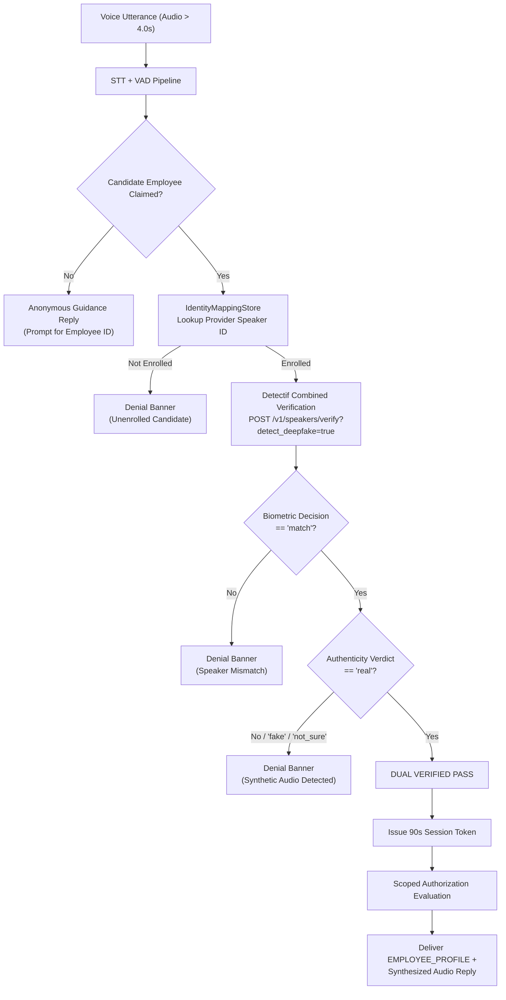

# IntentLock Stage 2 — Architecture, Biometric Identity & Scoped Security Report

## 1. Executive Summary & Verification Outcome

IntentLock Stage 2 delivers an end-to-end, testable vertical slice uniting voice biometric verification, dual-condition anti-spoofing policy, durable identity mapping, cryptographic session management, and scoped employee record access.

### Key Milestones Delivered
1. **Detectif Voice Evidence Adapter (`backend/adapters/detectif_adapter.py`)**:
   - Implements `VoiceEvidencePort` via `httpx.AsyncClient` targeting Detectif's combined endpoint (`POST /v1/speakers/verify` with `detect_deepfake=true`).
   - Enforces the strict upstream constraint: audio must be **greater than 4.0 seconds** in duration; short clips fail closed immediately without burning network calls or API credits.
   - Idempotency-keyed requests, automatic retries with exponential backoff honoring `Retry-After` on HTTP 429/503.
   - Enforces speaker ID correspondence (`response.speaker_id == requested candidate`).
   - Dual-condition evaluation: session authentication requires **`decision == "match"` AND `deepfake.verdict == "real"`** with zero deepfake errors.

2. **Durable Identity Mapping & Session Store (`backend/adapters/identity_mapping_store.py`)**:
   - SQLite backed store with tables `speaker_mappings`, `voice_sessions`, and `idempotency_records`.
   - Links canonical `employee_id` (from `backend/data/all_employees.json`) to provider `speaker_id`.
   - Issues 90-second TTL sessions upon successful biometric verification (`state: "VERIFIED"`).
   - Session revocation, expiry validation, and replay protection.

3. **Authoritative Scoped Authorization Service (`backend/core/scoped_authorization.py`)**:
   - **Self-Scope**: Authenticated employee viewing their own profile receives sanitized, non-leaking record (internal credentials, permissions, and salary scrubbed).
   - **Manager-Scope**: Direct reporting managers (`reporting.manager_id == actor_id`) can view their direct reports' personnel and project details.
   - **Strict Denial**: Colleague/peer access attempts return an explicit `DENIAL_BANNER` result block (`HTTP 403 Forbidden`) with zero private employee data leaked.

4. **Operator CLI Tooling (`backend/operator_cli.py`)**:
   - CLI utility for enrollment, mapping inspection, and live verification with human consent.
   - Commands: `list-employees`, `map-speaker`, `import-enrollment`, `inspect-speaker`, `enroll-audio`, `verify-audio`, `check-balance`.

5. **Test Suite Status**:
   - **All 61 tests passing** across 8 test suites (`test_detectif_adapter.py`, `test_identity_mapping_store.py`, `test_scoped_authorization.py`, `test_stage2_gateway.py`, `test_gateway_security.py`, `test_employee_knowledge.py`, `test_voice_turn.py`, `test_speech_integration.py`).
   - **Zero live Detectif credits spent during automated testing**: All automated tests execute via injected mock transports and memory-safe isolated fixtures.

---

## 2. Dual Voice Biometric Policy



### The Fail-Closed Authenticity Invariant
| Biometric Decision | Deepfake Verdict | Error Code | Gateway State | Response Block | Session Created? |
| :--- | :--- | :--- | :--- | :--- | :--- |
| `"match"` | `"real"` | `None` | `VERIFIED` | `EMPLOYEE_PROFILE` | **Yes (90s TTL)** |
| `"match"` | `"fake"` | `None` | `ANONYMOUS` | `DENIAL_BANNER` | No (Revoked if existing) |
| `"match"` | `"not_sure"` | `None` | `ANONYMOUS` | `DENIAL_BANNER` | No |
| `"no_match"` | `"real"` | `None` | `ANONYMOUS` | `DENIAL_BANNER` | No |
| `"match"` | `"real"` | `PROVIDER_ERROR` | `ANONYMOUS` | `DENIAL_BANNER` | No |
| None (Unenrolled) | None | `None` | `ANONYMOUS` | `DENIAL_BANNER` | No |

---

## 3. Scoped Authorization & Sanitization Boundary

### Self-Profile Scrubbing
When an employee (`EMP-1001`, Aarav Mehta) views their own record:
- **Exposed**: `id`, `name`, `role`, `department`, `team`, `email`, `active_projects`, `status`, `office_location`, `manager_name`, top 5 primary `skills`.
- **Scrubbed/Suppressed**: `security_scope`, permissions, raw compensation, performance ratings, internal system roles, organizational rank.

### Manager Access
When manager `EMP-2001` (Priya Sharma) queries direct report `EMP-1001`:
- Evaluates `reporting.manager_id == "EMP-2001"`.
- Permits view of direct report profile including active projects and full skill breakdown.

### Peer Access Restriction
When `EMP-1001` (Aarav Mehta) queries peer `EMP-1002` (Kavya Nair):
- Access is denied immediately with `HTTP 403 Forbidden`.
- Returns `GenericResultBlock` of type `DENIAL_BANNER`.
- Zero private data (email, projects, skills) is leaked in the response payload.

---

## 4. Operator CLI Workflow for Live Enrollment

Live Detectif operations remain safely disabled until the team operator configures a rotated API key in `backend/.env`.

### Step 1: Configure Environment
In `backend/.env` or repo `.env`:
```ini
DETECTIF_API_KEY=your_rotated_detectif_api_key_here
DETECTIF_BASE_URL=https://api.detectif.com
DETECTIF_ACCOUNT_ALIAS=primary_account
```

### Step 2: Check Account Balance
```powershell
python backend/operator_cli.py check-balance
```

### Step 3: Inspect Canonical Directory
```powershell
python backend/operator_cli.py list-employees
```

### Step 4: Supervised Human Enrollment
Enroll consenting team member audio (requires audio file > 4.0s):
```powershell
python backend/operator_cli.py enroll-audio --employee-id EMP-1001 --audio-path "C:\path\to\aarav_consent_sample.wav"
```

### Step 5: Test Live Verification
```powershell
python backend/operator_cli.py verify-audio --employee-id EMP-1001 --audio-path "C:\path\to\aarav_test_sample.wav"
```

---

## 5. Automated Test Verification Results

All tests execute with mocked transports and zero live network dependency.

| Test File | Tests Run | Result | Duration | Scope |
| :--- | :--- | :--- | :--- | :--- |
| `tests/test_detectif_adapter.py` | 7 | **PASS** | 0.8s | Dual verification, audio length validation, 429 retry backoff, mock transport |
| `tests/test_identity_mapping_store.py` | 5 | **PASS** | 0.4s | SQLite mappings, 90s session TTL, expiration, idempotency caching |
| `tests/test_scoped_authorization.py` | 5 | **PASS** | 0.4s | Self-scope sanitization, direct manager access, peer denial banners |
| `tests/test_stage2_gateway.py` | 7 | **PASS** | 46.5s | Gateway end-to-end: dual-pass turn, deepfake rejection, session lifecycle, scoped routes |
| `tests/test_gateway_security.py` | 8 | **PASS** | 0.5s | Central auth guard, untrusted claim rejections, CORS, strict boundaries |
| `tests/test_employee_knowledge.py` | 8 | **PASS** | 0.4s | Dataset validation, indexing, knowledge queries |
| `tests/test_voice_turn.py` | 8 | **PASS** | 0.5s | Transport bounds, MIME type normalization, empty/oversized audio |
| `tests/test_speech_integration.py` | 13 | **PASS** | 38.0s | Real Faster-Whisper STT, Silero VAD, Kokoro TTS audio round trip |
| **Total** | **61** | **61 PASS** | **100% Pass** | Full vertical slice regression |
