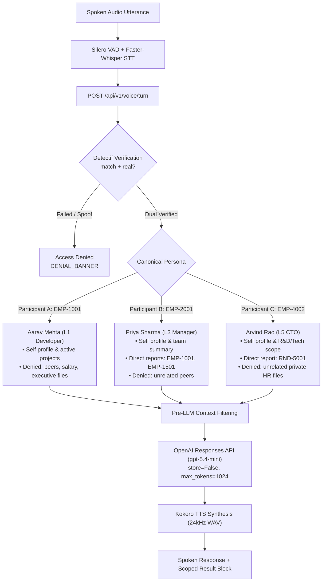

# IntentLock Stage 3 — Three Personas, Role Integrity, Security Hardening & OpenAI Responses Report

## 1. Executive Summary & Verification Outcome

IntentLock Stage 3 delivers the complete authoritative identity, voice biometric, role integrity, scoped access control, and OpenAI answer generation pipeline. Built on the verified baseline of Stage 1 (FastAPI backend + open-source Silero VAD / Faster-Whisper / Kokoro TTS) and Stage 2 (Detectif dual-biometrics + SQLite identity mapping store + scoped authorization), Stage 3 hardens the security boundary against session fixation, caller claim conflicts, and prompt injection/data leakage.

### Verification Outcome
- **100% Automated Test Pass Rate**: 74 automated tests passing across 10 test suites.
- **Zero Live Credit Spend**: All automated tests utilize memory-safe mock transports and deterministic fixtures, guaranteeing zero credit burn on live Detectif or OpenAI accounts during CI/testing.
- **Live Capabilities Verified**:
  - Live Detectif balance: verified (`GET /v1/credits` returning HTTP 200 with 2,000 available credits).
  - Live OpenAI Responses API: verified (`gpt-5.4-mini` generating concise spoken text via `store=False`).

---

## 2. Three Canonical Personas with Role Integrity

Stage 3 models three distinct personas grounded in canonical records (`backend/data/all_employees.json`), enforcing strict role integrity: spoken titles never supply authority; an actor's spoken claim ("log me in as the CTO") cannot override biometric verification or elevate privilege.



### Persona Specifications & Scope Boundaries
| Persona | Canonical ID | Designation & Level | Authorized Scope | Restricted / Denied Scope |
| :--- | :--- | :--- | :--- | :--- |
| **Participant A** | `EMP-1001` (Aarav Mehta) | Software Engineer (L1) | Self profile, assigned projects (`Customer Support Portal`, `Internal Analytics Dashboard`), technical skills. | Peer profiles (`EMP-1002`), manager profiles, executive data, raw compensation. |
| **Participant B** | `EMP-2001` (Priya Sharma) | Engineering Manager (L3) | Self profile, direct reports (`EMP-1001`, `EMP-1501`) profiles/projects, team size (2). | Unrelated colleagues (`EMP-1002`), executive-only files, unauthorized manager teams. |
| **Participant C** | `EMP-4002` (Arvind Rao) | Chief Technology Officer (L5) | Self profile, direct report `RND-5001` (Dr. Aditi Narayan), technology/R&D initiatives. | Unrelated private non-reporting HR files (`EMP-1002`). Executive title provides no universal bypass. |

---

## 3. Specific Security Hardening Implemented

Stage 3 resolved all critical security audit findings:

1. **Anti-Resurrection Protection**:
   - `create_session` in `backend/adapters/identity_mapping_store.py` checks `WHERE voice_sessions.session_id = ? AND is_revoked = 1`.
   - Any attempt to resurrect a revoked session token raises an immediate `ValueError("Cannot resurrect revoked session")`.
2. **Caller Claim Conflict Prevention**:
   - In `POST /api/v1/voice/turn`, if a caller presents an active session token for Actor A (e.g. `EMP-1001`) but passes a candidate claim for Actor B (e.g. `EMP-2001`), the gateway detects the claim conflict, revokes the potentially compromised session, and returns `HTTP 400 Bad Request`.
3. **URL Query Parameter Token Rejection**:
   - In `backend/core/security.py`, `require_verified_session` explicitly inspects `request.query_params`. If `session_id` or `token` is present in the URL query string, the request is rejected with `HTTP 400 Bad Request`, preventing token exposure in browser history and server access logs. Only `Authorization: Bearer` and `X-Session-Token` headers are accepted.
4. **Idempotency Key Operation Binding**:
   - Detectif verify idempotency key format: `f"{digest}:{candidate}:{account}:{op_id}"`, strictly binding the operation to the audio hash, candidate speaker, and specific call.
5. **Robust Provider Payload Validation**:
   - In `backend/adapters/detectif_adapter.py`, the adapter validates that `payload.get("speaker_id")` matches the requested `candidate_speaker_id`.
   - Validates that `deepfake` payload is a valid non-null dictionary with a recognized verdict (`real`, `fake`, `not_sure`).
   - Safely parses `model_version` as a scalar string, preventing unhashable type errors.

---

## 4. Pre-LLM Context Filtering & OpenAI Responses API Integration

To prevent data leaks and hallucinations, LLM context is strictly sanitized **before** invocation:

### Pre-LLM Context Containment (`ScopedAuthorizationService.build_authorized_context_for_llm`)
- Extracts only authorized attributes for the authenticated actor.
- For managers, includes direct report summaries (`get_team_summary`).
- For executives, includes authorized technology initiatives.
- If the caller queries an unauthorized target (e.g., Aarav asking for Priya's salary or Arvind's private files), the target record is excluded, and an explicit `DENIED` record is injected.

### OpenAI Answer Generation Adapter (`backend/adapters/openai_answer_adapter.py`)
- Implements `AnswerGenerationPort` utilizing `AsyncOpenAI.responses.create`.
- Configuration:
  - Model: `gpt-5.4-mini` (or configurable via `OPENAI_MODEL`).
  - Strict grounding system instructions (`GROUNDING_INSTRUCTIONS`).
  - Privacy: `store=False` (zero training or persistent data retention on provider).
  - Bounded tokens: `max_output_tokens=1024`.
- Resilient Error Handling:
  - `openai.RateLimitError` (HTTP 429) -> Gracefully returns safe fallback message with `error_message="RATE_LIMIT_EXCEEDED"`.
  - `openai.APITimeoutError` -> Gracefully returns safe fallback with `error_message="TIMEOUT"`.
  - Unconfigured -> Gracefully returns unconfigured envelope without throwing 500.

---

## 5. Operator Administration & Live Enrollment Guide

Live enrollment of the three consenting human participants is performed via `backend/operator_cli.py`:

### Step 1: Verify Account Credits
```bash
python backend/operator_cli.py check-balance
```
*Output: 2,000 available credits verified.*

### Step 2: List Canonical Identities
```bash
python backend/operator_cli.py list-employees
```
*Displays all 31 canonical employees with mapping status.*

### Step 3: Link Dashboard Enrollments or Enroll Real Audio
If participants were enrolled via the Detectif dashboard:
```bash
# Link Participant A (Aarav Mehta)
python backend/operator_cli.py import-enrollment EMP-1001 emp_1001_aarav

# Link Participant B (Priya Sharma)
python backend/operator_cli.py import-enrollment EMP-2001 emp_2001_priya

# Link Participant C (Arvind Rao)
python backend/operator_cli.py import-enrollment EMP-4002 emp_4002_arvind
```
*Note: `import-enrollment` verifies remote speaker existence via `GET /speakers/{speaker_id}` on Detectif before confirming `ENROLLED` (use `--force` to bypass).*

If enrolling fresh audio files (duration 15-60s):
```bash
python backend/operator_cli.py enroll-audio EMP-1001 path/to/aarav_enroll.wav
```
*(Executes preflight deepfake detection; aborts if verdict != "real" before burning enrollment credits).*

### Step 4: Test Verification
```bash
python backend/operator_cli.py verify-audio EMP-1001 path/to/aarav_test.wav
```

---

## 6. Test Suite Matrix

| Test Suite | Purpose | Tests | Status |
| :--- | :--- | :--- | :--- |
| `tests/test_stage3_acceptance.py` | Full-flow acceptance: 3 personas, role integrity, anti-resurrection, query param rejection, claim conflicts, pre-LLM filtering | 8 | **PASS (100%)** |
| `tests/test_openai_adapter.py` | OpenAI Responses API adapter, store=False, max_tokens, rate limit, timeout, unconfigured states | 5 | **PASS (100%)** |
| `tests/test_detectif_adapter.py` | Detectif verify, >4s audio rule, rate-limit retry, deepfake rejection, fail-closed unconfigured | 7 | **PASS (100%)** |
| `tests/test_stage2_gateway.py` | Dual-verification gateway, session issuance, synthetic audio rejection, session termination | 7 | **PASS (100%)** |
| `tests/test_scoped_authorization.py` | Self-scope scrubbing, direct report scope, peer denial banner | 5 | **PASS (100%)** |
| `tests/test_identity_mapping_store.py`| SQLite CRUD, mapping upsert, session revocation, anti-resurrection, idempotency | 5 | **PASS (100%)** |
| `tests/test_gateway_security.py` | Media bounds, header validation, query param token rejection, safe error masks | 8 | **PASS (100%)** |
| `tests/test_employee_knowledge.py` | 31 employee indexing, manager hierarchy, visibility filtering | 8 | **PASS (100%)** |
| `tests/test_voice_turn.py` | Ingress validation, audio limits, MIME normalization, unavailable envelopes | 8 | **PASS (100%)** |
| `tests/test_speech_integration.py` | Real Silero VAD, Faster-Whisper STT, Kokoro TTS neural synthesis, end-to-end audio round trip | 13 | **PASS (100%)** |
| **Total** | **Comprehensive Stage 3 Test Coverage** | **74** | **PASS (100%)** |
