# IntentLock — Person 2 Stage 0 Audit
**Component:** Intelligence, Semantic Planning, Conversation Workflows & Backend Result Generation  
**Owner:** Sharan (Person 2)  
**Date:** 2026-10-17  
**Status:** Complete Audit (No Source Code Mutations)

---

## 1. Inspected Baseline & Workspace Preflight

- **Workspace Path:** `C:\SHARAN PROJECTS\IntentLock`
- **Active Git Branch:** `main`
- **Inspected Commit (HEAD):** `d189664ddfe789da0b22e1269e5ba0d42fdb4bf6` (`feat: integrate Supabase PostgreSQL persistence, semantic routing, and protected contact actions`)
- **Working-Tree Status:** Clean (`git status` reports 0 untracked / 0 modified files)
- **Assigned Implementation Baseline:** `d189664`
- **Shared Supabase Stage 0 Status:** Baseline commit exists locally and is synchronized with `origin/main`. However, independent Stage 0 formal team acceptance across all teammates remains pending.
- **Checkout Isolation:** Currently inspecting shared local workspace. Future active feature development for Person 2 will branch cleanly to `codex/semantic-results`.

---

## 2. Ownership Map

```mermaid
flowchart TD
    subgraph Person_1["Person 1: Trust, Identity & Persistence"]
        M[backend/main.py Gateway]
        AUTH[backend/core/scoped_authorization.py]
        ACT[backend/services/ticket_action_store.py]
        DB[backend/adapters/postgres_*]
        ID[backend/adapters/identity_mapping_store.py]
        MIG[backend/migrations/* & scripts/migrate_to_postgres.py]
    end

    subgraph Person_2["Person 2: Intelligence & Results (Sharan)"]
        DISP[backend/services/conversation_dispatch.py]
        LLM[backend/adapters/openai_answer_adapter.py]
        PLAN[Future: Semantic Planning Modules]
        RES[Future: Entity Resolution & Result Builders]
        CTX[ConversationStore & Result Snapshots]
        TESTS[tests/test_conversation_dispatch.py, etc.]
    end

    subgraph Person_3["Person 3: Frontend & Speech"]
        FE[frontend/src/** UI Components]
        REG[frontend/src/components/workspace/resultRegistry.ts]
        SPEECH[backend/adapters/speech_* & VAD/STT/TTS]
    end

    M -->|Parses via| DISP
    M -->|Plans via| LLM
    DISP -->|Reads Scoped Data via| AUTH
    DISP -->|Proposes Actions via| ACT
    DISP -->|Emits Blocks to| FE
    FE -->|Sends Clicks/Selection to| M
```



### File Boundaries
- **Exclusively Owned by Person 2:**
  - `backend/services/conversation_dispatch.py`
  - `backend/adapters/openai_answer_adapter.py`
  - Future modules: `backend/services/semantic_planner.py`, `backend/services/entity_resolver.py`, `backend/services/result_builders/`
  - Conversation/result context implementation (`ConversationStore`, `ResultSnapshot`, `ConversationState`)
  - Semantic, query, context, and result-generation test suites (`tests/test_conversation_dispatch.py`, `tests/test_headcount_and_routing.py`, `tests/test_render_fixes_recheck.py`)
- **Exclusively Owned by Person 1 (Read-Only to Person 2):**
  - `backend/main.py` (Voice gateway, route registration, transport)
  - `backend/core/config.py`, `backend/core/ports.py`, `backend/core/security.py`, `backend/core/scoped_authorization.py`
  - `backend/services/employee_knowledge_service.py`, `backend/services/ticket_knowledge_service.py`
  - `backend/services/ticket_action_store.py` (Protected executor)
  - `backend/adapters/postgres_*`, `backend/adapters/identity_mapping_store.py`, `backend/migrations/*`, `scripts/migrate_to_postgres.py`
- **Exclusively Owned by Person 3 (Read-Only to Person 2):**
  - `frontend/src/**` (All React components, hooks, cards, renderers, types)
  - `backend/adapters/speech_stt.py`, `backend/adapters/speech_tts.py`, `backend/adapters/speech_vad.py`, `backend/adapters/audio_decoder.py`, `backend/voice_preview.py`

---

## 3. Audit of the Complete Request Path (Boundaries A to L)

| Boundary | Method / Location | Input / Output | Caller / Owner | State Read / Written | Current Error Handling & Gaps |
|---|---|---|---|---|---|
| **A. Ingress** | `POST /api/v1/voice/turn` (`backend/main.py:730`) | Multipart audio + form fields $\rightarrow$ `VoiceTurnResponse` | Client / Person 1 | Reads `in_flight_turns` lock, replay cache | Enforces MIME, 8MB cap, 10MB total multipart cap. Replay duplicate turns coalesced. |
| **B. Local Parser** | `parse_local(text, state)` (`conversation_dispatch.py:364-388`) | String `text`, optional `ConversationState` $\rightarrow$ `IntentPlan` | Person 1 gateway / Person 2 | Reads `state.active_id`, `state.selected_ticket_id` | **Regex-heavy**: relies on strict keyword patterns. Falls back to `clarify` on unhandled phrasing. |
| **C. Model Planner** | `plan_request(utterance, has_current_result)` (`openai_answer_adapter.py:70-101`) | String `utterance`, `bool` $\rightarrow$ Optional `IntentPlan` | Person 1 gateway / Person 2 | None (stateless API call) | Currently only invoked if `parse_local` returns `clarify` or `help`. Cannot inspect full conversation selection. |
| **D. Identity & Session** | `IdentityMappingStore.get_session()` (`backend/main.py:836-872`) | `session_id`, `candidate_employee_id` $\rightarrow$ `claimed_id` | Person 1 | Reads/updates `voice_sessions`, purges expired | Enforces claim conflict check between session actor and candidate identity. |
| **E. Verification Policy** | `VoiceEvidencePort.verify_evidence()` (`backend/main.py:873-920`) | `AudioMetadata`, audio bytes $\rightarrow$ `VoiceEvidenceResult` | Person 1 | Reuses snapshot evidence if `rechart`, `back`, or `cancel` | Dual verification required (`MATCH` + `REAL`) for new private reads. Fails closed to `unverified` or `denied`. |
| **F. Target Resolution** | `_resolve_profile_target()` (`conversation_dispatch.py:414-440`) | `actor_id`, `phrase`, `ConversationState` $\rightarrow$ `Optional[str]` | Person 2 | Reads `knowledge.get_employee_by_id`, `state.snapshots` | Resolves `"my manager"`, ordinal references (`"first person"`), or explicit employee IDs. Fails closed with denial. |
| **G. Record Access** | `_ticket_rows()`, `_team()` (`conversation_dispatch.py:441-485`) | `actor_id`, `IntentPlan` $\rightarrow$ `List[dict]` | Person 2 | Calls `knowledge` and `ticket_service` | Strictly scoped to actor, direct reports, or CTO organization scope. Never accesses raw unrestricted database. |
| **H. Filters & Calculations** | `dispatch()` (`conversation_dispatch.py:651-778, 804-857`) | Scoped rows $\rightarrow$ filtered rows, SLA metrics, Counter | Person 2 | Reads/writes `base_rows`, `source_rows` in `ResultSnapshot` | Base rows retained across turns to allow filter replacement (e.g. High $\rightarrow$ Low priority without empty sets). |
| **I. Result Block Creation** | `block()`, `_chart()` (`conversation_dispatch.py:133-138, 486-500`) | Payload dictionary $\rightarrow$ `GenericResultBlock` | Person 2 | Creates unique `blk_<uuid>` with ISO UTC timestamp | Maps to 10 registered frontend discriminators. Multi-results returned via `result_blocks` list. |
| **J. Grounded Narration** | `generate_answer()` (`openai_answer_adapter.py:102-192`) | `question`, `authorized_context` dict $\rightarrow$ `AnswerResult` | Person 1 gateway / Person 2 | Stateless Responses API | Context strictly limited to `result_block.payload`. Skipped for receipts/readbacks. Safe fallback on timeout. |
| **K. Frontend Delivery** | `LiveApp.tsx`, `ResultHost.tsx` (`frontend/src/**`) | `VoiceTurnResponse` $\rightarrow$ React state / Card renderers | Person 3 | Updates React state, audio player, result tab pills | Validates schema before mounting registered card component. |
| **L. Click Context Feedback** | `handleResultAction()` (`LiveApp.tsx:288-305`) | `select_ticket` $\rightarrow$ updates `selected_ticket_id` | Person 3 / Person 2 | Modifies `ConversationState.selected_ticket_id` | Allows speech follow-up like *"Details for this ticket"* to resolve the clicked ticket row. |

---

## 4. Capability Inventory Table

| Operation | In Schema (`IntentPlan`) | Local Parse Recognizes | Planner Recognizes | Dispatched in Code | Authorization Service Called | Data Interface Used | Emitted Result Block | Frontend Renderer Accepted | Test Coverage | Status |
|---|---|---|---|---|---|---|---|---|---|---|
| **`help`** | Yes | Yes (`re.search`) | Yes | Yes | None (Public) | None | `PUBLIC_FAQ` | `PublicFaqCard` | `test_7_what_can_you_do_public_help_zero_detectif` | Implemented & Tested |
| **`profile`** | Yes | Yes | Yes | Yes | `evaluate_and_get_profile` | `EmployeeKnowledgeService` | `EMPLOYEE_PROFILE` | `EmployeeProfileCard` | `test_conversation_dispatch.py` | Implemented & Tested |
| **`team_table`** | Yes | Yes | Yes | Yes | `evaluate_and_get_profile` | `get_direct_reports` | `DATA_TABLE` | `DataTableCard` | `test_render_fixes_recheck.py` | Implemented & Tested |
| **`team_count`** | Yes | Yes | Yes | Yes | `evaluate_and_get_profile` | `get_direct_reports` | `TEAM_METRIC_CHART` | `TeamMetricChartCard` | `test_headcount_and_routing.py` | Implemented & Tested |
| **`org_tree`** | Yes | Yes | Yes | Yes | `evaluate_and_get_profile` | `get_direct_reports` | `ORG_TREE` | `OrgTreeCard` | `test_render_fixes_recheck.py` | Implemented & Tested |
| **`headcount`** | Yes | Yes | Yes | Yes | Executive check (`EMP-4002`) | `list_all_employees` | `TEAM_METRIC_CHART` | `TeamMetricChartCard` | `test_headcount_and_routing.py` | Implemented & Tested |
| **`ticket_list`** | Yes | Yes | Yes | Yes | Scoped ticket policy | `TicketKnowledgeService` | `TICKET_LIST` | `TicketListCard` | `test_conversation_dispatch.py` | Implemented & Tested |
| **`ticket_chart`** | Yes | Yes | Yes | Yes | Scoped ticket policy | `TicketKnowledgeService` | `TEAM_METRIC_CHART` | `TeamMetricChartCard` | `test_render_fixes_recheck.py` | Implemented & Tested |
| **`rechart`** | Yes | Yes | Yes | Yes | None (uses active snapshot) | `active.base_rows` | `TEAM_METRIC_CHART` / `TICKET_LIST` | `TeamMetricChartCard` / `TicketListCard` | `test_filter_switching_retains_base_rows_without_false_empty` | Implemented & Tested |
| **`back`** | Yes | Yes | Yes | Yes | None (uses active snapshot) | `state.previous_id` | Previous Block | Previous Card | `test_conversation_dispatch.py` | Implemented & Tested |
| **`compound`** | Yes | Yes (`and` regex) | No (planned) | Yes | Recursively dispatched | Dispatched sub-plans | Multiple blocks (`result_blocks`) | Multi-tab `ResultHost` | `test_compound_query_emits_multiple_result_blocks` | Implemented & Tested |
| **`create_ticket`** | Yes | Yes | Yes | Yes | `TicketActionStore.propose` | `TicketActionStore` | `READBACK_CONFIRMATION` | `ReadbackConfirmationCard` | `test_conversation_dispatch.py` | Implemented & Tested |
| **`update_ticket`** | Yes | Yes | Yes | Yes | `TicketActionStore.propose` | `TicketActionStore` | `READBACK_CONFIRMATION` | `ReadbackConfirmationCard` | `test_conversation_dispatch.py` | Implemented & Tested |
| **`comment_ticket`**| Yes | Yes | Yes | Yes | `TicketActionStore.propose` | `TicketActionStore` | `READBACK_CONFIRMATION` | `ReadbackConfirmationCard` | `test_conversation_dispatch.py` | Implemented & Tested |
| **`update_contact`** | Yes | Yes | Yes | Yes | Self-only + `profile_modification` ALLOW | `TicketActionStore` | `READBACK_CONFIRMATION` | `ReadbackConfirmationCard` | `test_contact_update.py` | Implemented & Tested |
| **`confirm`** | Yes | Yes | Yes | Yes | `TicketActionStore.confirm` (fresh audio) | `TicketActionStore` | `ACTION_RECEIPT` | `ActionReceiptCard` | `test_supabase_storage.py` | Implemented & Tested |
| **`cancel`** | Yes | Yes | Yes | Yes | `TicketActionStore.cancel` | `TicketActionStore` | `PUBLIC_FAQ` (status) | `PublicFaqCard` | `test_conversation_dispatch.py` | Implemented & Tested |
| **`clarify`** | Yes | Yes | Yes | Yes | None (Public / Unresolved) | None | None (spoken only) | Amber badge / transcript | `test_headcount_and_routing.py` | Implemented & Tested |

---

## 5. Planner and Schema Alignment Audit

1. **Schema Definition Location:**
   - Defined in `backend/services/conversation_dispatch.py:32-54` as `class IntentPlan(BaseModel)`.
   - Imported by `backend/adapters/openai_answer_adapter.py:16` and used directly as `text_format=IntentPlan` in the OpenAI Responses API `.parse()` call (`openai_answer_adapter.py:93`).
2. **Context Provided to Planner:**
   - In `backend/adapters/openai_answer_adapter.py:92`:
     ```python
     input=f"Current result available: {has_current_result}. User command: {utterance[:1000]}"
     ```
   - **Gaps Identified:**
     - The planner only receives a boolean `has_current_result: bool`.
     - It has **zero awareness** of the active snapshot kind (e.g. `source_kind == "tickets"` vs `"profile"`), the currently selected ticket ID, the visible employee IDs, or the active filters!
     - This forces `_parse_single()` to perform heavy regex guessing on context keywords (e.g. checking `state.selected_ticket_id` locally).
3. **Model Fallback and Error Handling:**
   - When OpenAI call fails (timeout, rate limit, JSON schema mismatch, API error), `plan_request()` returns `None`.
   - In `backend/main.py:776`, if `intent_plan is None`:
     `intent_plan = IntentPlan(operation="clarify")`
   - This ensures safe, deterministic fail-closed behavior (no unhandled exceptions).
4. **Keyword Interception Preventing Planning:**
   - `backend/main.py:762` evaluates `local_plan = parse_local(transcript_text, plan_state)`.
   - If `local_plan.operation != "clarify"` and not a public help query, the local plan is **immediately used**, completely skipping the OpenAI model planner.
   - While this makes keyword queries computationally fast, it means complex phrasing that matches a loose regex will never benefit from semantic reasoning.

---

## 6. Claims, Targets, and Entity Resolution Audit

1. **Actor Claim vs. Query Target Separation:**
   - Explicit spoken self-claims are identified via `re.search(r"\b(?:i am|my employee id is|this is)\s+((?:EMP|RND|EXE)[-_ ]?\d{4})\b", text, re.I)` in `backend/main.py:749`.
   - `backend/services/conversation_dispatch.py:180-186`: An employee ID in the query text is only treated as a profile target if ticket/SLA keywords are absent.
   - However, `_resolve_profile_target()` currently resolves employee IDs strictly against:
     `visible = [actor_id] + [e["employee_id"] for e in self.scoped.knowledge.get_direct_reports(actor_id)] + active.visible_ids`
   - If a target employee ID is outside the actor's permitted view, `_resolve_profile_target` returns `None`, which triggers an explicit policy denial message.
2. **Role Claim Non-Authentication:**
   - In `backend/main.py:863-872`: Spoken phrases like `"I am the CTO"` do NOT match the `(?:EMP|RND|EXE)-\d{4}` regex.
   - Consequently, `claimed_id` remains unestablished unless an explicit candidate identity was selected.
   - This was validated in `test_5_i_am_the_cto_without_candidate_identity` where `"I am the CTO"` returns a prompt for an employee ID with 0 Detectif calls.
3. **Ordinal References:**
   - `conversation_dispatch.py:424-427` maps `"first person"`, `"second person"`, `"third person"` to `active.visible_ids[0..3]`.
   - **Limitation:** Ordinal ticket selection (e.g. *"Open the second ticket"*) is currently missing from `_parse_single`!

---

## 7. Conversation State & Snapshot Lifecycle Audit

1. **State Storage Structure:**
   - `ConversationStore` maintains a dictionary `_states: Dict[str, ConversationState]`.
   - Bound strictly to `(session_id, actor_id)`.
   - Automatic cleanup of abandoned sessions (>300s since last access) and LRU capacity bound of 64 concurrent states.
   - Individual snapshots older than 300s are automatically pruned on each `.get()`.
2. **Snapshot Retention:**
   - Each state retains up to 12 `ResultSnapshot` objects in a FIFO eviction queue (`ConversationState.remember()`).
   - `base_rows` stores the full unfiltered candidate pool for the query dimension, while `source_rows` stores the filtered subset.
   - This prevents false-empty results when switching filters (e.g., from High to Low priority).
3. **Context Risks:**
   - **Click context synchronization:** Clicking a ticket currently sends an action that updates `selected_ticket_id`. However, clicking an employee tree node or table row does NOT yet emit a standardized `select_employee` event to the backend.
   - **Actor binding:** If `session_id` expires or changes, `state.actor_id != actor_id` creates a fresh state, preventing cross-actor leakage.

---

## 8. Query and Aggregation Order Audit

The required order is:
$$\text{Resolve Request} \longrightarrow \text{Obtain Permitted Scope} \longrightarrow \text{Apply Filters} \longrightarrow \text{Calculate Facts} \longrightarrow \text{Build Results}$$

1. **Compliance in Code:**
   - In `_ticket_rows()` (`conversation_dispatch.py:450-485`):
     1. Fetches scoped tickets via `scoped.ticket_service.get_scoped_tickets_for_actor(actor_id, ...)` (Permitted Scope).
     2. Applies `ticket_id`, `person_filter`, `status_filter`, `priority_filter`, `dates` (Filters).
     3. Computes SLA metrics or chart aggregates on filtered rows (Calculate Facts).
     4. Wraps facts in `GenericResultBlock` (Build Result).
2. **Truthful Unknowns vs. Zeros:**
   - In `conversation_dispatch.py:859-883` (`headcount`):
     - Recognized location `"Bengaluru"` $\rightarrow$ Returns 31 employees (Total Headcount).
     - Known location with 0 demo records (e.g. `"London"`) $\rightarrow$ Returns clarification: `"Location 'London' has no recorded employees in our directory."`
     - Unknown location (e.g. `"Tulum"`) $\rightarrow$ Returns clarification: `"I heard 'Tulum' as the location. Our demo directory only covers Bengaluru. Would you like the headcount for Bengaluru?"`
   - In `conversation_dispatch.py:684, 744` (`sla`):
     - Unset SLA targets remain `"Unknown / No SLA"` rather than defaulting to compliant.

---

## 9. Result and Narration Consistency Audit

1. **Facts Object Agreement:**
   - The payload dictionary passed into `block()` is identical to the payload rendered by Person 3's frontend cards.
   - When OpenAI answer generation is active (`backend/main.py:1003-1015`), `authorized_context` receives:
     ```python
     grounded_context = {
         "type": result_block.type,
         "title": result_block.title,
         "payload": result_block.payload,
     }
     ```
   - The model is instructed: `"Answer ONLY from the supplied Authorized Context. Never assume or extrapolate missing facts."`
   - This ensures the UI card, assistant text, and Kokoro TTS speech all state the exact same numbers.
2. **Multiple Results Retention:**
   - In `backend/services/conversation_dispatch.py:532-537`, compound requests emit both `result_block` (primary) and `result_blocks: List[GenericResultBlock]` (all generated blocks).
   - In `frontend/src/components/workspace/ResultHost.tsx:31-70`, `ResultHost` renders pill/tab switchers when `result_blocks.length > 1`, allowing the user to view all generated blocks.

---

## 10. Action Handoffs Audit (Person 2 $\rightarrow$ Person 1)

1. **Boundary Integrity:**
   - Person 2 (`conversation_dispatch.py`) **does not execute database mutations**.
   - For `create_ticket`, `update_ticket`, `comment_ticket`, and `update_contact`:
     1. Dispatches to `action_store.build_typed_proposal()`.
     2. Calls `action_store.propose()` to create an `action_drafts` record and generate a canonical SHA-256 manifest hash.
     3. Emits `READBACK_CONFIRMATION` block requiring voice confirmation.
   - Confirmation is only dispatched when explicit spoken confirmation is received, delegating execution entirely to `action_store.confirm()`.
2. **Self-Contact RBAC Check:**
   - Line 568 explicitly enforces: `plan.entity and plan.entity.strip().upper() != actor_id.strip().upper() -> Denied`.
   - Line 574 verifies `permissions.profile_modification.effect == "ALLOW"`.

---

## 11. Findings Inventory

| ID | Severity | Source Location | Finding Description | User / Security Implication | Proposed Owner | Recommended Stage Resolution |
|---|---|---|---|---|---|---|
| **F-01** | `P2` | `openai_answer_adapter.py:92` | Planner input receives only `has_current_result: bool`, missing active snapshot type, selected IDs, and current filters. | Model planner cannot resolve contextual follow-ups (e.g. *"Show their projects"*) without local regex pre-resolution. | Person 2 | **Stage 1 & 3**: Extend planner prompt to include compact context summary (`source_kind`, `selected_id`). |
| **F-02** | `P2` | `conversation_dispatch.py:187` | Ordinal selection handles `"first/second person"`, but lacks `"first/second ticket"`. | Users cannot speak *"Open the second ticket"* from a displayed ticket list. | Person 2 | **Stage 5**: Add ordinal resolution for displayed ticket IDs using `active.visible_ids`. |
| **F-03** | `P2` | `frontend/src/LiveApp.tsx` | Tree node clicks and table employee row clicks do not dispatch a backend selection event. | Clicking an employee in the org tree leaves `ConversationState.selected_employee_id` unset on the backend. | Person 3 + Person 2 | **Stage 1 & 5**: Agree on `select_employee` action event payload and wire to `ConversationState`. |
| **F-04** | `P3` | `conversation_dispatch.py:371` | Compound query parsing is restricted to `"and"` / `"as well as"` regex matching. | Natural compound phrasing without explicit `"and"` (e.g. *"Give me my profile, also open tickets"*) falls back to single plan. | Person 2 | **Stage 3**: Expand compound plan schema to allow planner to emit `compound_plans` directly. |
| **F-05** | `P3` | `conversation_dispatch.py:441` | `_team()` hardcodes `EMP-4002` for indirect descendants. | Other management tiers with multi-level reporting trees cannot view full tree depth. | Person 2 | **Stage 4**: Query full reporting tree dynamically via `knowledge.get_reporting_tree(actor_id)`. |

---

## 12. Safe Audit Test Runs & Evidence

Three isolated Person 2 test suites were executed using temporary SQLite fixtures and mocked provider ports (0 paid API credits, 0 live network calls, 0 database writes):

1. **`tests/test_conversation_dispatch.py`**:
   - Command: `cmd /c "set INTENTLOCK_OFFLINE_TESTS=1 && python -m pytest tests/test_conversation_dispatch.py -v"`
   - Result: **18 passed in 17.31s** (0 failures).
2. **`tests/test_headcount_and_routing.py`**:
   - Command: `cmd /c "set INTENTLOCK_OFFLINE_TESTS=1 && python -m pytest tests/test_headcount_and_routing.py -v"`
   - Result: **12 passed in 80.85s** (0 failures).
3. **`tests/test_render_fixes_recheck.py`**:
   - Command: `cmd /c "set INTENTLOCK_OFFLINE_TESTS=1 && python -m pytest tests/test_render_fixes_recheck.py -v"`
   - Result: **12 passed in 15.77s** (0 failures).

**Total Audit Test Pass:** **42 passed, 0 failed** across all Person 2 test suites.

---

## 13. Limitations & Non-Goals for Stage 0

- No production source code was modified during this audit.
- No database migrations were executed or altered.
- No live Detectif or OpenAI credits were expended.
- Stage 0 completion confirms structural understanding and interface readiness; it does not authorize independent feature branching or merging without team alignment.
