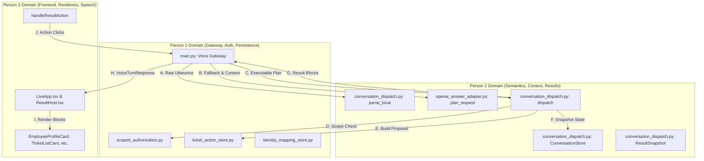

# IntentLock — Person 2 Stage 1 Contract Map
**Author:** Sharan (Person 2) — Intelligence, Semantic Planning & Results  
**Baseline Commit:** `d189664ddfe789da0b22e1269e5ba0d42fdb4bf6`  
**Date:** 2026-10-17  
**Status:** Stage 1 Contract Foundation

---

## 1. Interface Dependency & Ownership Map

---

## 2. Detailed Contract Matrix

| Interface Key | Interface Name | Current Owner | Location | Current Signature / Contract | Proposed / Agreed Extension | Consumers | Integration Status |
|---|---|---|---|---|---|---|---|
| **A** | **Local Parser** | Person 2 | `conversation_dispatch.py:364` | `parse_local(text: str, state: Optional[ConversationState] = None) -> IntentPlan` | Returns `IntentPlan` with optional `actor_claim`, `selected_id`, `filter_action` | `main.py:762` | **Implemented Locally & Backward Compatible** (Gateway integration for `actor_claim` pending Stage 2) |
| **B** | **Model Planner** | Person 2 | `openai_answer_adapter.py:70` | `plan_request(utterance: str, has_current_result: bool) -> Optional[IntentPlan]` | `plan_request(utterance: str, has_current_result: Union[bool, PlannerContext] = False, context: Optional[PlannerContext] = None) -> Optional[IntentPlan]` | `main.py:768` | **Implemented Locally & Dual Compatible** (Gateway currently passes legacy boolean) |
| **C** | **Dispatcher Execution** | Person 2 | `conversation_dispatch.py:502` | `dispatch(actor_id: str, session_id: str, plan: IntentPlan, spoken_text: str = "", evidence_digest: str = "") -> ScopedProfileResult` | Consumes `IntentPlan` extensions without breaking existing operations | `main.py:957` | **Current Production** |
| **D** | **Authorization Scope** | Person 1 | `scoped_authorization.py:78` | `evaluate_and_get_profile(actor_id: str, target_employee_id: str) -> ScopedProfileResult` | Stable; no schema change needed | `conversation_dispatch.py:608` | **Current Production** |
| **E** | **Protected Proposal** | Person 1 | `ticket_action_store.py:246` | `build_typed_proposal(operation, ticket_id, field, value, utterance) -> dict` | `field` now accepts `"phone"` for contact updates | `conversation_dispatch.py:578` | **Current Production** |
| **F** | **Conversation State** | Person 2 | `conversation_dispatch.py:69` | `ConversationState(actor_id, snapshots, active_id, previous_id, selected_ticket_id)` | Added `selected_employee_id: Optional[str] = None` | `conversation_dispatch.py:157`, `main.py` | **Implemented Locally** |
| **G** | **Result Block Factory** | Person 2 | `conversation_dispatch.py:133` | `block(kind: str, title: str, payload: dict, sensitive: bool = True) -> GenericResultBlock` | Emits 10 standard discriminators matching Person 3's card registry | `conversation_dispatch.py` | **Current Production** |
| **H** | **Grounded Narration** | Person 2 | `openai_answer_adapter.py:102` | `generate_answer(question: str, authorized_context: Dict[str, Any], correlation_id: str) -> AnswerResult` | Context strictly bounded to `result_block.payload` | `main.py:1008` | **Current Production** |
| **I** | **Frontend Action Emission** | Person 3 | `LiveApp.tsx:288` | `handleResultAction(actionVerb: string, parameters: Record[str, unknown])` | Wires `select_ticket`; proposes `select_employee` for tree/table | Frontend event handler | **Proposed with Person 3** |
| **J** | **Frontend Renderers** | Person 3 | `payloads.ts` & `resultRegistry.ts` | 10 registered renderers (`PUBLIC_FAQ`, `EMPLOYEE_PROFILE`, `DATA_TABLE`, `ORG_TREE`, `TICKET_LIST`, `TEAM_METRIC_CHART`, `READBACK_CONFIRMATION`, `ACTION_RECEIPT`, `DENIAL_BANNER`, `TRUST_TRACE_GRAPH`) | Stable contracts matching backend blocks | `ResultHost.tsx` | **Current Production** |

---

## 3. Representative Contract Payloads & Fixtures

All 17 standardized fixtures reside under `tests/fixtures/person2/`:
1. `public_help.json` — Public help bypasses biometric checks (`status="success"`, `PUBLIC_FAQ`).
2. `explicit_actor_claim_vs_target.json` — Decoupled `actor_claim="EMP-4002"` from `entity="EMP-2001"`.
3. `self_profile.json` — Verified self-profile read (`EMPLOYEE_PROFILE`).
4. `team_descendant_request.json` — Organization tree with multi-level descendants (`ORG_TREE`).
5. `unknown_location.json` — Out-of-scope location returns honest clarification (`clarification_reason="UNRESOLVED_LOCATION"`).
6. `ambiguous_name.json` — Ambiguous name prompt (`clarification_reason="AMBIGUOUS_PERSON_NAME"`).
7. `selected_employee_followup.json` — Tree click follow-up (`selected_id="EMP-1001"`).
8. `selected_ticket_followup.json` — Ticket row click follow-up (`selected_ticket_id="TKT-2026-001"`).
9. `priority_filter_replacement.json` — Filter replacement preserving `base_rows` (12 High $\rightarrow$ 5 Low).
10. `presentation_only_change.json` — View transformation without re-query (`view="PIE"`).
11. `compound_request.json` — Multi-intent execution emitting `result_blocks` list.
12. `contact_ticket_proposal.json` — Two-phase proposal emitting `READBACK_CONFIRMATION`.
13. `approval_required_role_change.json` — Blocked execution with clear HR workflow requirement.
14. `denied_query.json` — Policy denial emitting `DENIAL_BANNER`.
15. `planner_repository_unavailable.json` — Safe fail-closed clarification fallback on model timeout.
16. `stale_context.json` — Denied navigation when no prior result exists.
17. `committed_receipt_executor.json` — Committed receipt emitted by Person 1's executor (`ACTION_RECEIPT`).
