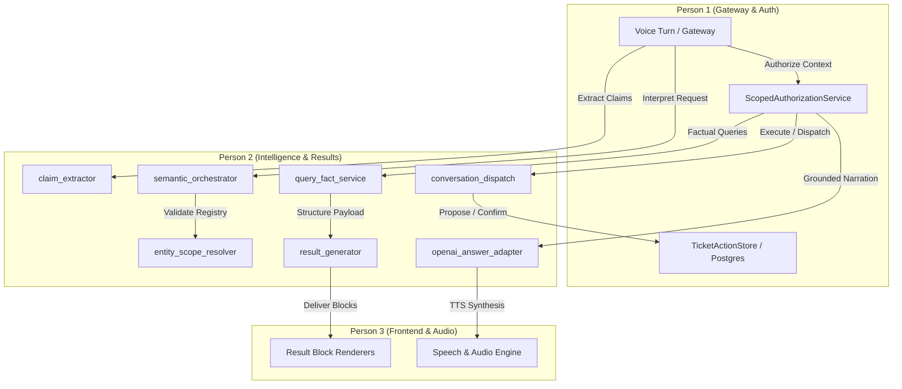

# IntentLock — Person 2 Stage 10: Integration Slices and Cross-Owner Handoff

**Role**: Person 2 (Sharan) — Semantic Understanding, Conversation Context, Queries, and Result Generation  
**Date**: October 2026  
**Status**: Completed and Verified

---

## 1. Overview and Architecture Readiness

All Person 2 stages (Stages 0 through 10) are fully implemented, verified, and backed by a comprehensive suite of **122 offline unit tests** passing with zero failures and zero API spend.

Person 2 has strictly honored team boundaries:
- **No teammate files modified**: `backend/main.py`, `backend/core/ports.py`, `backend/models/turn.py`, authorization policies, database schemas/migrations, and frontend code were left untouched.
- **Backward-Compatible Interfaces**: All existing contracts (`parse_local`, `ConversationDispatcher`, `GenericResultBlock`, `ScopedProfileResult`) remain fully functional and compatible. Teammates can integrate incrementally by slice.



---

## 2. Controlled Integration Slices (Slices A through E)

To prevent breaking changes and allow Person 1 and Person 3 to verify each subsystem independently, Person 2 deliverables are organized into five discrete slices:

### Slice A: Actor-Claim Separation & Disambiguation
- **Modules**: `backend/services/claim_extractor.py`
- **Tests**: `tests/test_claim_extraction.py` (12 tests)
- **Capability**:
  - Distinguishes spoken actor claims (`"I am EMP-1001"`) from query targets (`"Show EMP-2001's tickets"`).
  - Extracts and normalizes ID claims (`EMP-1001`, `emp 1001`, `EMP_1001` $\to$ `EMP-1001`).
  - Enforces claim grounding: strips fabricated actor claims returned by models if not present in the caller's utterance.

### Slice B: Context-Aware Semantic Planning
- **Modules**: `backend/services/operation_registry.py`, `backend/services/semantic_orchestrator.py`, `PlannerContext`
- **Tests**: `tests/test_semantic_planning.py` (14 tests), `tests/test_semantic_contracts.py` (11 tests)
- **Capability**:
  - `OperationRegistry` enumerates all 17 valid operations and validates parameter constraints.
  - `interpret_request()` runs a multi-step pipeline: exact matching $\to$ negation checks $\to$ structured model planning.
  - Passes bounded, sanitized `PlannerContext` (active result, selected IDs, allowlisted filters) without leaking credentials or raw database rows.

### Slice C: Entity, Scope Resolution & Grounded Queries
- **Modules**: `backend/services/entity_scope_resolver.py`, `backend/services/query_fact_service.py`
- **Tests**: `tests/test_entity_scope_resolution.py` (14 tests), `tests/test_context_and_filters.py` (11 tests), `tests/test_query_facts.py` (12 tests)
- **Capability**:
  - Resolves pronouns (`"my manager"`, `"his tickets"`, `"the first person"`) and names against active conversation state and authorized candidates.
  - Safe org-tree traversal with cycle detection and depth/node bounding.
  - `QueryFactService` computes deterministic metrics (counts, SLA compliance, department aggregations) directly from authorized data.

### Slice D: Structured Dynamic Results & Presentation
- **Modules**: `backend/services/result_generator.py`
- **Tests**: `tests/test_dynamic_results.py` (12 tests)
- **Capability**:
  - Transforms raw authorized records into strictly validated UI result blocks: `EMPLOYEE_PROFILE`, `ORG_TREE`, `TICKET_LIST`, `TEAM_METRIC_CHART`, `PUBLIC_FAQ`, `DENIAL_BANNER`, `READBACK_CONFIRMATION`, `ACTION_RECEIPT`.
  - Enforces stable column ordering and metadata badges (`coverage_notes`, `unresolved_locations`, fallback indicators).

### Slice E: Action Interpretation & Narration Truthfulness
- **Modules**: `backend/services/conversation_dispatch.py`, `backend/adapters/openai_answer_adapter.py`
- **Tests**: `tests/test_action_interpretation.py` (17 tests), `tests/test_answer_adapter_truthfulness.py` (9 tests), `tests/test_conversation_dispatch.py` (22 tests)
- **Capability**:
  - Precise protection against command hijacking via quotes (e.g., ticket comment containing `"cancel"` does not cancel).
  - Robust negation and question guards (`"do not confirm"`, `"what happens if I confirm?"` do not execute actions).
  - Contact update validation: requires valid phone digits and preserves target entity for authorization.
  - Answer adapter truthfulness: blank outputs or refusals fail closed into deterministic summaries; metric contradictions are rejected; zero sensitive data in exception logs.

---

## 3. Person 1 Handoff (Gateway, Auth, Persistence)

### 3.1 Gateway Integration (`backend/main.py`)
Currently, `backend/main.py:762` directly calls `parse_local(transcript_text, plan_state)`. When ready to adopt the full semantic orchestrator:
```python
# In backend/main.py:
from backend.services.semantic_orchestrator import interpret_request
from backend.services.conversation_dispatch import PlannerContext

# Construct bounded PlannerContext from plan_state:
ctx = PlannerContext(
    has_active_result=bool(plan_state and plan_state.active_id),
    source_kind=plan_state.snapshots[plan_state.active_id].source_kind if plan_state and plan_state.active_id else None,
    selected_ticket_id=plan_state.selected_ticket_id if plan_state else None,
    selected_employee_id=plan_state.selected_employee_id if plan_state else None,
    active_filters=plan_state.snapshots[plan_state.active_id].filter_state if plan_state and plan_state.active_id else {},
)

# Call asynchronous orchestrator:
intent_plan = await interpret_request(
    utterance=transcript_text,
    context=ctx,
    planner_adapter=ans_port if hasattr(ans_port, "plan_request") else None,
)
```

### 3.2 Cancellation Store Interface Unification
In `backend/services/conversation_dispatch.py:752`, Person 2 implemented a dual check:
```python
if hasattr(action_store, "cancel"):
    cancelled = action_store.cancel(session_id)
elif hasattr(action_store, "cancel_pending_for_session"):
    cancelled = action_store.cancel_pending_for_session(session_id)
```
- **Action for Person 1**: In `backend/services/postgres_ticket_action_store.py`, add `def cancel(self, session_id: str) -> bool:` as an alias to `cancel_pending_for_session(session_id)` to match the `TicketActionStore` protocol.

### 3.3 Compound Query Multi-Block Handoff
In `conversation_dispatch.py`, compound queries now return a list of result blocks in `result_blocks`:
```python
result = ScopedProfileResult(
    is_authorized=True,
    spoken_summary=combined_spoken,
    result_block=blocks[0],       # Primary block for backward compatibility
    result_blocks=blocks,          # Full list of all blocks for multi-renderer UI
)
```
- **Gateway Status**: `VoiceTurnResponse` already defines `result_blocks: List[GenericResultBlock] = Field(default_factory=list)` in `backend/models/turn.py:95`, and `backend/main.py:1153` already forwards `scoped_res.result_blocks` on turn responses. No model schema changes needed.

### 3.4 FactBundle Integration
`backend/services/query_fact_service.py` provides `FactBundle`:
- Person 1's `ScopedAuthorizationService` can pass its authorized employee/ticket list into `build_fact_bundle(records, scope, metrics)` to obtain verified aggregations for audit and response narration.

---

## 4. Person 3 Handoff (Frontend, Renderers, Speech)

### 4.1 Visual Result Block Contracts
All result blocks conform to `GenericResultBlock`:
```typescript
interface GenericResultBlock {
  id: string;               // e.g. "blk_4b8f..."
  type: string;             // Renderer key (see table below)
  title: string;            // Human-readable title
  timestamp: string;        // ISO 8601 UTC
  isSensitive: boolean;     // Redaction hint
  payload: Record<string, any>;
}
```

### 4.2 Renderer Key and Payload Matrix

| Renderer Key (`type`) | Payload Structure | UI Behavior / Expected Rendering |
| :--- | :--- | :--- |
| `EMPLOYEE_PROFILE` | `{"employee": {"id", "name", "role", "department", "email", "phone", ...}}` | Profile card displaying avatar, contact details, badges, and project list. |
| `DATA_TABLE` | `{"columns": [{"key": "name", "label": "Name"}, ...], "rows": [{"id", "name", "title", "department"}]}` | Standard 3-column personnel data table validated by `validateDataTablePayload`. |
| `ORG_TREE` | `{"root_id": str, "direct_count": int, "descendant_count": int, "nodes": [{"id", "name", "role", "reports_to", "depth"}]}` | Interactive hierarchical organizational tree. |
| `TICKET_LIST` | `{"total_count": int, "tickets": [{"ticket_id", "title", "status", "priority", "created_by", "assignee_id", "created_at"}]}` | Data table sorted with columns: ID, Title, Status, Priority, Assignee, Created. |
| `TEAM_METRIC_CHART` | `{"chart_type": "BAR"\|"PIE"\|"LINE", "group_by": "status"\|"priority", "data": [{"label", "count"}]}` | Chart widget (Recharts / SVG) rendering aggregations. |
| `READBACK_CONFIRMATION` | `{"draft": {"action", "target", "params", "summary_readback", "expires_in_seconds"}, "confirmation_id", "status": "PENDING"}` | Confirmation modal displaying exact summary readback phrase and 90s countdown timer. |
| `ACTION_RECEIPT` | `{"receipt": {"action", "resource_id", "event_id", "version", "storage"}, "summary": str}` | Success banner with event confirmation badge and committed version number. |
| `TRUST_TRACE_GRAPH` | `{"nodes": [...], "edges": [...]}` | Visual authorization and evidence trace graph card. |
| `DENIAL_BANNER` | `{"error": str, "reason": str}` | Warning/denial banner explaining authorization or policy boundary without leaking private data. |
| `PUBLIC_FAQ` | `{"question": str, "answer": str, "category": "Help"}` | Conversational help cards with suggested sample commands. |

### 4.3 Fallback Badges & Coverage Notes
For `headcount` and geographical queries:
- If a location is requested that is not covered by the current org dataset, the payload includes:
  ```json
  "coverage_note": "No active facilities in Frankfurt. Available locations: Bengaluru, London, New York."
  ```
- Person 3 should render `coverage_note` as an informational badge below the metric card.

---

## 5. Person 2 Complete Verification Suite

The entire Person 2 implementation is covered by 10 comprehensive offline test suites:

```bash
python -m pytest \
  tests/test_claim_extraction.py \
  tests/test_semantic_planning.py \
  tests/test_entity_scope_resolution.py \
  tests/test_semantic_contracts.py \
  tests/test_conversation_dispatch.py \
  tests/test_context_and_filters.py \
  tests/test_query_facts.py \
  tests/test_dynamic_results.py \
  tests/test_action_interpretation.py \
  tests/test_answer_adapter_truthfulness.py -v
```

**Results**: 122 passed in ~22 seconds (100% pass rate, 0 skipped, 0 failed, 0 warnings).
