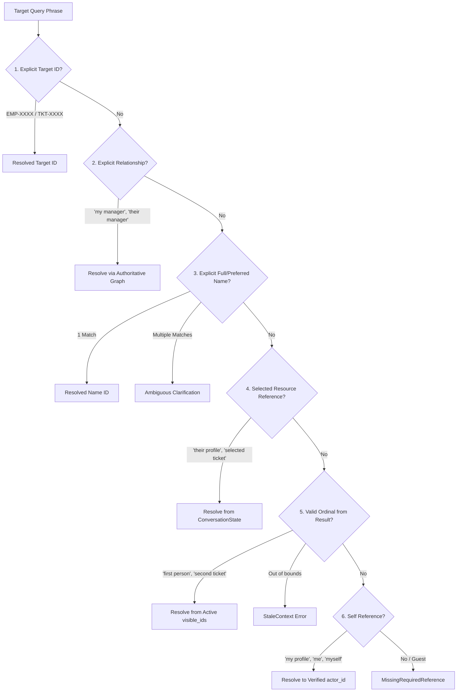

# IntentLock — Person 2 Stage 4: Entity, Relationship and Scope Resolution
**Author:** Sharan (Person 2) — Intelligence, Semantic Planning & Results  
**Baseline Commit:** `d189664ddfe789da0b22e1269e5ba0d42fdb4bf6`  
**Date:** 2026-10-17  
**Status:** Implemented Locally & Verified  

---

## 1. Executive Summary & Design Invariants

Stage 4 establishes the authoritative resolution layer for entity references, reporting hierarchies, and geographic/department constraints in `backend/services/entity_scope_resolver.py`.

### Critical Invariants:
1. **Strict Precedence:** Explicit ID > Explicit relationship > Explicit name (exact, ambiguous if duplicate) > Valid selection > Valid ordinal > Self (only on explicit self-reference).
2. **Never Guess or Fallback to Self:** Out-of-scope queries return `NotAvailableWithinPermittedScope`. Failed queries never silently substitute the caller's self-profile.
3. **Ambiguity Requires Clarification:** When multiple visible employees share a name (e.g. two "Priya"s), resolution returns `Ambiguous` and requests an explicit employee ID. It **never** silently picks the first match.
4. **Cycle-Safe & Truncation-Honest Traversal:** Reporting tree traversal uses a visited set to detect cycles (e.g. $A \rightarrow B \rightarrow A$) and deduplicate nodes. When traversal hits depth/node limits, it sets `is_truncated=True` and `TruncatedTraversal` rather than falsely claiming to show "everyone".
5. **Data-Driven Location Coverage:** Geographic locations are evaluated against authoritative coverage metadata. Uncovered locations (e.g. "Tulum", "Tokyo") return `UnknownCoverage` with an honest clarification reason `UNRESOLVED_LOCATION`, preserving the requested location without guessing zero or defaulting to Bengaluru.

---

## 2. Order of Precedence & Resolution Contracts



### Precedence Details:
- **Explicit ID:** `resolve_entity_reference("EMP-2001")` $\rightarrow$ `status="Resolved"`, `matched_via="explicit_employee_id"`.
- **Name Disambiguation:** `resolve_entity_reference("Show Priya's profile")` with two Priyas $\rightarrow$ `status="Ambiguous"`, `candidates=["EMP-3001", "EMP-3002"]`.
- **Context Follow-Up:** `resolve_entity_reference("Who is their manager?", selected_employee_id="EMP-2001")` $\rightarrow$ `status="Resolved"`, `resolved_id="EMP-4002"`.
- **Missing Selection:** `resolve_entity_reference("Who is their manager?", selected_employee_id=None)` $\rightarrow$ `status="MissingRequiredReference"` (does not fallback to self!).
- **Ordinal Bounds:** `resolve_entity_reference("Show fifth person")` on 2 items $\rightarrow$ `status="StaleContext"`.
- **Self Profile:** `resolve_entity_reference("Show my profile")` with guest (`actor_id=""`) $\rightarrow$ `status="MissingRequiredReference"`.

---

## 3. Authoritative Reporting Tree Traversal (`traverse_reporting_tree`)

### Safety Guarantees:
- **Cycle Detection:** `visited = {root_id}` prevents cycles back to root or between circular reports from causing infinite recursion.
- **Deduplication:** Repeated edges in reporting graphs are merged.
- **Bounded Work:** Default `max_depth=5` and `max_nodes=100`.
- **Honest Truncation:** If a large organization exceeds traversal limits, `is_truncated=True` is returned. The UI and narrative layers are explicitly informed that the graph is partial.
- **Zero vs Unknown Root:** A known root with no reports returns `status="Resolved"` and `member_ids=[]`; an empty or missing root returns `status="Ambiguous"`.

---

## 4. Location Coverage & Geographic Scope Resolution (`normalize_location`)

Authoritative location resolution decouples hardcoded city names from semantic parsing:
- **Covered Facilities:** `"bengaluru"`, `"bangalore"`, `"blr"` $\rightarrow$ `canonical_location="Bengaluru"`, `is_covered=True`.
- **Unknown Facilities:** `"Tulum"`, `"London"`, `"Tokyo"` $\rightarrow$ `status="UnknownCoverage"`, `requested_location="Tulum"`, `is_covered=False`.
- **Clarification Emission:** When a query targets an unknown facility, IntentLock preserves the requested name and generates an honest clarification:
  > *"Location 'Tulum' is not in covered organizational facilities. Available locations: Bengaluru."*
  *(Reason code: `UNRESOLVED_LOCATION`)*.

---

## 5. Acceptance Verification & Test Results

All 13 tests in `tests/test_entity_scope_resolution.py` passed offline (`INTENTLOCK_OFFLINE_TESTS=1`):

```text
============================= test session starts =============================
platform win32 -- Python 3.10.11, pytest-8.4.2, pluggy-1.6.0
rootdir: C:\SHARAN PROJECTS\IntentLock
collected 13 items

tests\test_entity_scope_resolution.py .............                      [100%]

============================= 13 passed in 0.39s ==============================
```

### Verified Behaviors:
- `test_exact_employee_and_ticket_id_resolution`: Resolves `EMP-2001` and `TKT-2026-009`.
- `test_duplicate_permitted_names_produce_ambiguity`: Two Priyas produce `Ambiguous` status and candidate list without guessing.
- `test_explicit_target_overrides_old_selection`: New explicit ID overrides older `selected_employee_id`.
- `test_my_manager_resolution`: Resolves caller's manager via authoritative reporting graph.
- `test_selected_person_manager_resolution`: Resolves manager for selected employee.
- `test_missing_selected_entity_returns_missing_reference`: Rejects relative queries when selection is absent.
- `test_ordinal_stale_context_bounds`: Ordinal beyond visible count returns `StaleContext`.
- `test_reporting_tree_cycle_detection_and_deduplication`: Resolves circular graph without loops.
- `test_reporting_tree_multi_tier_traversal`: Traverses 4-level hierarchy (CTO $\rightarrow$ VP $\rightarrow$ Manager $\rightarrow$ ICs).
- `test_reporting_tree_truncation_honesty`: Returns `TruncatedTraversal` and `is_truncated=True` when depth limit is reached.
- `test_unknown_location_resolution_preserves_name_and_clarifies`: Preserves "Tulum", returns `UnknownCoverage`, and emits clarification.
- `test_covered_location_alias_normalization`: Normalizes Bangalore and BLR to Bengaluru.
- `test_out_of_scope_target_cannot_substitute_actor`: Out-of-scope query returns `NotAvailableWithinPermittedScope` without falling back to self.

---

## 6. Integration Requests for Person 1 (Persistence & Data Owner)

1. **Authoritative Location Coverage Metadata:** Provide a dynamic query method in `EmployeeKnowledgeService` (or Supabase table `locations`) returning active facilities and recognized aliases, replacing static metadata dictionaries.
2. **Recursive Descendant SQL Function:** In Supabase Postgres, provide a recursive Common Table Expression (CTE) `get_reporting_tree(root_id, max_depth)` to optimize deep graph queries in a single database round-trip.
